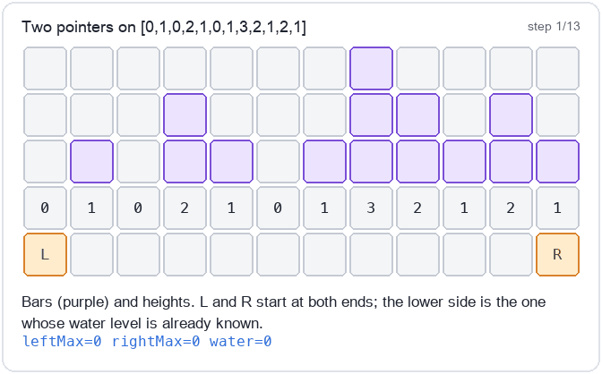
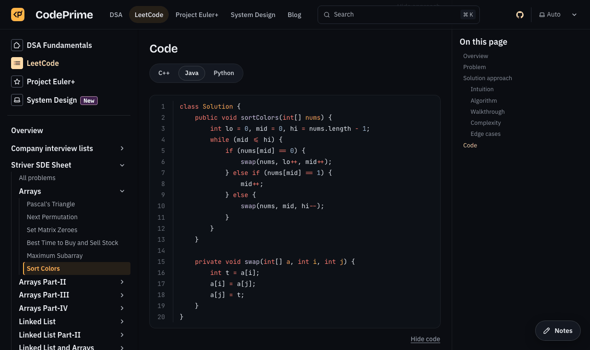
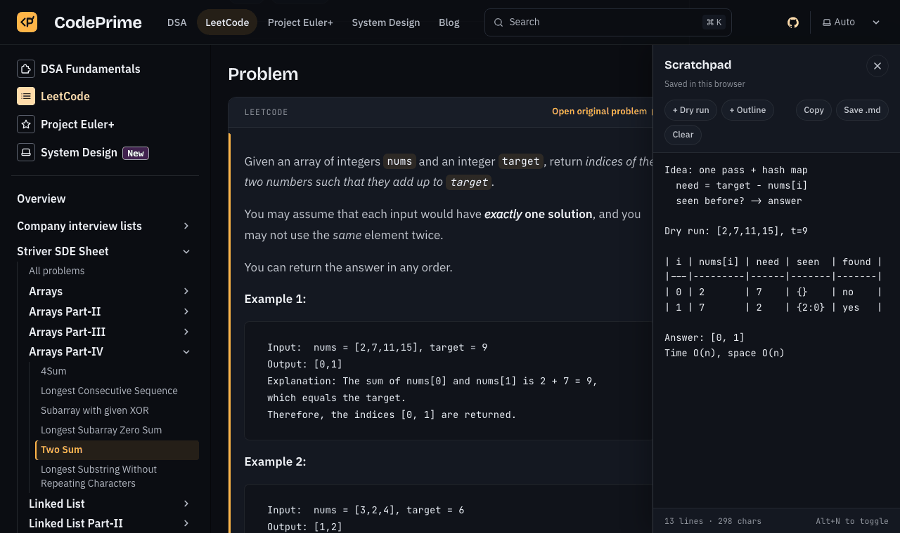

<div align="center">

# CodePrime

**Learn the pattern, not the answer.**

192 interview problems — the Striver SDE sheet, Blind 75 and more — each explained step by step,<br />
with C++, Java and Python solutions tested against brute force.<br />
Use it to prepare from scratch, or for a last-minute revision before the interview.

[**Open the site →**](https://umangkumarr.github.io/CodePrime/)

[](https://github.com/umangkumarr/CodePrime/actions/workflows/ci.yml)
[](LICENSE)
[](https://github.com/umangkumarr/CodePrime/stargazers)



</div>

## Why CodePrime

- **The full problem, on the page.** Official statement, every example and the constraints, with a link to solve it on LeetCode, GeeksforGeeks, InterviewBit or Coding Ninjas.
- **Think before you peek.** The approach and the code stay hidden until you choose to reveal them.
- **Explanations that teach the idea.** Intuition, the algorithm step by step, complexity with reasons, and the edge cases that trip people up — with animated walkthroughs and diagrams where a picture helps.
- **C++, Java and Python.** Every solution in all three, using the judge's own function signature, so you can paste it straight in. Your language choice is remembered.
- **Tested, not just written.** Every solution was checked against the official examples and thousands of random inputs compared with a brute force before it was published.
- **A scratchpad on every problem.** Notes, dry-run tables and an outline template, saved per problem in your browser.
- **Track your progress.** Mark problems solved and watch each sheet fill up.
- **Built for last-minute revision too.** Every page leads with the difficulty, time and space complexity and the topics, and each approach opens with its intuition. Turn on *Always show solutions* and skim a whole sheet, or one topic, the night before.

| Switch languages | Dry-run in the scratchpad |
| --- | --- |
|  |  |

## What's inside

| Track | What you get |
| --- | --- |
| [**LeetCode sheets**](https://umangkumarr.github.io/CodePrime/docs/leetcode/) | Striver SDE sheet (177 problems in 27 sections), Striver DP, Blind 75, company interview lists and more |
| [**DSA fundamentals**](https://umangkumarr.github.io/CodePrime/docs/dsa/) | Bit manipulation, number theory and trees, from first principles |
| [**System design**](https://umangkumarr.github.io/CodePrime/system-design/) | How real products work end to end, and what changed as they scaled |
| [**Project Euler+**](https://umangkumarr.github.io/CodePrime/docs/project-euler/) | Maths-heavy challenges where brute force fails |

Or [browse by topic](https://umangkumarr.github.io/CodePrime/docs/tags/): arrays, trees, dynamic programming, graphs, two pointers and dozens more.

## Contributing

Found a mistake, have a cleaner solution, or want to add a problem or a language? Contributions are welcome — see [CONTRIBUTING.md](CONTRIBUTING.md). Every pull request is checked automatically: the page structure, the three-language code tabs, Python syntax, a type-check and a full site build.

If CodePrime helps you prepare, **[star the repository](https://github.com/umangkumarr/CodePrime)** so more people can find it.

## Run it locally

Requires **Node.js 22.12+**.

```sh
git clone https://github.com/umangkumarr/CodePrime.git
cd CodePrime
npm install
npm run dev        # http://localhost:4321/CodePrime/
```

| Command | What it does |
| --- | --- |
| `npm run build` | Production build in `dist/` |
| `npm run preview` | Serve the production build |
| `npm run check` | Type-check |
| `python3 .github/scripts/check_content.py` | Check every problem page (also runs in CI) |

<details>
<summary>Project layout</summary>

| Path | What lives there |
| --- | --- |
| `src/content/docs/docs/codes/` | Problem pages (one Markdown file each) |
| `src/content/docs/docs/dsa/` | DSA fundamentals articles |
| `src/content/docs/docs/interviews/` | Company interview lists |
| `src/content/docs/docs/project-euler/` | Project Euler+ solutions |
| `src/content/docs/system-design/` | System design overview and case studies |
| `src/data/sidebar.json` | Sidebar groups; the LeetCode sheet pages are generated from it |
| `src/plugins/` | Markdown pipeline: problem layout, language tabs, base-path links |
| `src/components/` | Problem header, notes scratchpad, track pages, Starlight overrides |
| `src/scripts/` | Spoiler gates, language tabs, solved tracking, scratchpad |
| `public/img/codes/` | Generated walkthrough animations and diagrams |

Built with [Astro](https://astro.build) and [Starlight](https://starlight.astro.build). Every push to `main` deploys to GitHub Pages through `.github/workflows/deploy.yml`.

</details>

## Credits

Problem lists follow [Striver's SDE sheet](https://takeuforward.org/interviews/strivers-sde-sheet-top-coding-interview-problems/) and Blind 75; problem statements belong to their original platforms, which each page links to. CodePrime is an independent project and is not affiliated with them.

## License

[MIT](LICENSE) © Umang Kumar
