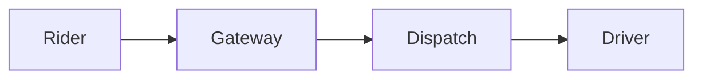

CodePrime is open source, and every page is a plain Markdown file in [the GitHub repository](https://github.com/umangkumarr/CodePrime). Fixing a typo, improving an explanation and adding a new problem are all welcome.

## Run the site locally

You need **Node.js 22.12 or newer**.

```sh
git clone https://github.com/umangkumarr/CodePrime.git
cd CodePrime
npm install
npm run dev
```

The site is then available at `http://localhost:4321/CodePrime/` and reloads as you edit.

## Add a problem

Create `src/content/docs/docs/codes/<problem-slug>.md`. The front matter holds the facts; the body holds the explanation. The page header, the "Solve on LeetCode" button, the complexity badges, the topic chips and the spoiler-safe code panel are all generated from it.

````md
---
title: Two Sum
source: https://leetcode.com/problems/two-sum/
difficulty: Easy            # optional: Easy | Medium | Hard
tags: [Array, Hash Table]
complexity:
  time: O(n)
  space: O(n)
---

## Problem

The official statement in Markdown, then every example and the constraints:

**Example 1:**

```text
Input:  nums = [2,7,11,15], target = 9
Output: [0,1]
```

**Constraints:**

- $2 \le$ `nums.length` $\le 10^4$

## Solution approach

### Intuition
### Algorithm
### Complexity

- **Time:** $O(n)$ — why.
- **Space:** $O(n)$ — why.

### Edge cases

## Code

```cpp
// C++ solution
```

```java
// Java solution
```

```python
# Python solution
```
````

[Two Sum](/docs/codes/two-sum/) is the reference example. The three code blocks must follow one another with nothing in between: the site turns them into one **C++ | Java | Python** tab group, and remembers the reader's language. A page with several approaches writes one such run per approach, each fence carrying the same `title="Approach 2: …"`. Use the judge's own function signature and the same algorithm in all three languages.

Before submitting, run every solution on the official examples and on random inputs against a simple brute force.

Finally, add the page's slug to the right group in `src/data/sidebar.json`.

## Add a system design case study

Create `src/content/docs/system-design/case-studies/<name>.md`. It appears in the System Design sidebar automatically. Diagrams can be written as [Mermaid](https://mermaid.js.org/) code blocks:

````md

````

## Open a pull request

1. Fork the repository and create a branch.
2. Run `python3 .github/scripts/check_content.py`, `npm run check` and `npm run build`. CI runs the same checks on every pull request.
3. Open a pull request into `main` describing what you added or changed and how you tested it.
