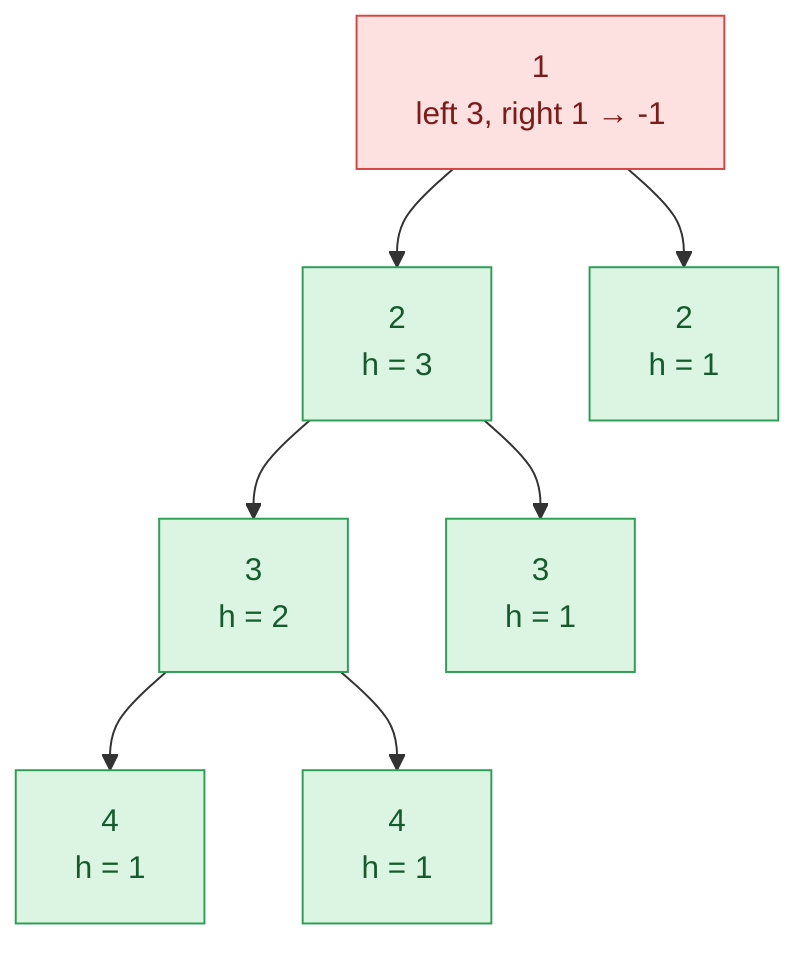

## Problem

Given a binary tree, determine if it is **height-balanced**.

A **height-balanced** binary tree is a binary tree in which the depth of the two subtrees of every node never differs by more than one.

**Example 1:**


```text
Input:  root = [3,9,20,null,null,15,7]
Output: true
```

**Example 2:**


```text
Input:  root = [1,2,2,3,3,null,null,4,4]
Output: false
```

**Example 3:**

```text
Input:  root = []
Output: true
```

**Constraints:**

- The number of nodes in the tree is in the range `[0, 5000]`.
- $-10^4 \le$ `Node.val` $\le 10^4$

## Solution approach

### Intuition

The condition must hold at **every** node, and checking it at a node needs the heights of both its subtrees. The naive approach calls a separate `height()` function at each node, which recomputes the same heights again and again: $O(n^2)$ on a skewed tree.

Compute heights bottom-up instead (post-order): a node's height is `1 + max(left, right)`, so each node does constant work once its children are done. To report imbalance through the same return value, use `-1` as a sentinel meaning "this subtree is not balanced". Once any subtree returns `-1`, every ancestor returns `-1` immediately, so the answer bubbles up to the root without further work.

### Algorithm

1. `height(node)` returns the height of the subtree rooted at `node`, or `-1` if that subtree is unbalanced. An empty subtree has height `0`.
2. Compute `lh = height(node->left)`; if it is `-1`, return `-1`. Do the same for `rh` on the right.
3. If `abs(lh - rh) > 1`, return `-1`; otherwise return `1 + max(lh, rh)`.
4. `isBalanced(root)` returns `height(root) != -1`.

### Walkthrough

Example 2, with the value `height()` returns written under each node. Node `2` (left child of the root) still has a valid height `3`, but the root sees `3` versus `1`, a difference of `2`, and returns `-1`:



### Complexity

- **Time:** $O(n)$ — every node is visited once and does constant work.
- **Space:** $O(h)$ — the recursion stack, where $h$ is the tree height ($O(n)$ for a skewed tree, $O(\log n)$ for a balanced one).

### Edge cases

- **Empty tree** (Example 3): `height(nullptr)` returns `0`, so the answer is `true`.
- **Long skewed chain:** the first node with a two-level difference returns `-1`, and every ancestor returns `-1` without inspecting its other subtree.

## Code

```cpp title="C++"
class Solution {
    // Height of the subtree, or -1 if it is not height-balanced.
    int height(TreeNode* node) {
        if (!node) return 0;
        int lh = height(node->left);
        if (lh == -1) return -1;
        int rh = height(node->right);
        if (rh == -1) return -1;
        if (abs(lh - rh) > 1) return -1;
        return 1 + max(lh, rh);
    }

   public:
    bool isBalanced(TreeNode* root) {
        return height(root) != -1;
    }
};
```
