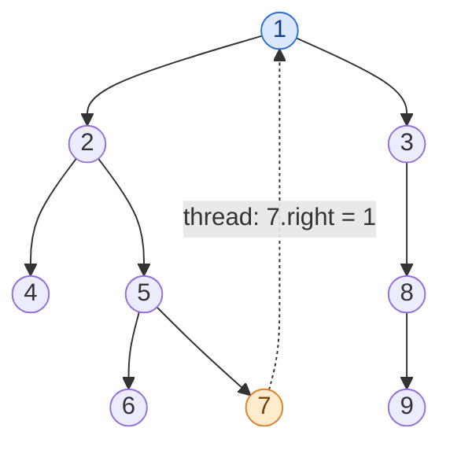

## Problem

Given the `root` of a binary tree, return _the inorder traversal of its nodes' values_.

**Example 1:**


```text
Input:  root = [1,null,2,3]
Output: [1,3,2]
```

**Example 2:**


```text
Input:  root = [1,2,3,4,5,null,8,null,null,6,7,9]
Output: [4,2,6,5,7,1,3,9,8]
```

**Example 3:**

```text
Input:  root = []
Output: []
```

**Example 4:**

```text
Input:  root = [1]
Output: [1]
```

**Constraints:**

- The number of nodes in the tree is in the range `[0, 100]`.
- $-100 \le$ `Node.val` $\le 100$

**Follow-up:** Recursive solution is trivial, could you do it iteratively?

## Solution approach

Inorder means: the whole left subtree, then the node, then the whole right subtree. The recursive version is three lines; the follow-up asks us to do without recursion. Two iterative approaches are worth knowing.

### Approach 1: Explicit stack

**Intuition:** Simulate the call stack. Before we can output a node we must finish its left subtree, so we walk left from `cur` pushing every node on the way. When there is no further left child, the node on top of the stack is the leftmost unvisited node: output it, then repeat the same process on its right subtree.

**Algorithm:**

1. Set `cur = root`.
2. While `cur` is not null or `st` is not empty:
   - while `cur` is not null, push it and move `cur = cur->left`;
   - pop the top node into `cur`, append `cur->val`, and set `cur = cur->right`.

**Complexity:** $O(n)$ time — every node is pushed and popped once. $O(h)$ space for the stack, where $h$ is the tree height.

### Approach 2: Morris traversal

**Intuition:** The stack exists only to answer one question: after finishing a left subtree, how do we get back up to its parent? Morris traversal answers it with the tree itself. The last node visited in the left subtree of `cur` is its **inorder predecessor** — the rightmost node of `cur->left`, which always has a null right pointer. Temporarily point that null `right` pointer back to `cur` (a "thread"). When the walk later follows the thread back to `cur`, we know the left subtree is done; we remove the thread, output `cur`, and go right. Every thread is created once and removed once, so the tree is restored by the end.

**Algorithm:**

1. Set `cur = root`. While `cur` is not null:
   - If `cur->left` is null, there is nothing to the left: append `cur->val` and move `cur = cur->right` (this may follow a thread back to an ancestor).
   - Otherwise find the predecessor `prev`: start at `cur->left` and go right while `prev->right` is neither null nor `cur`.
     - If `prev->right` is null, this is the first visit to `cur`: create the thread `prev->right = cur` and move `cur = cur->left`.
     - If `prev->right == cur`, we have come back through the thread, so the left subtree is finished: remove the thread, append `cur->val`, and move `cur = cur->right`.

In Example 2, when `cur` is the root `1` for the first time, its predecessor is `7` (the rightmost node of the subtree rooted at `2`). The dashed edge is the temporary thread that brings the walk back to `1` right after `7` is output:



**Complexity:** $O(n)$ time — finding predecessors walks each edge of the tree at most a constant number of times (once to create a thread and once to remove it). $O(1)$ extra space — only two pointers; the output list is not counted.

### Edge cases

- **Empty tree** (Example 3): both loops are skipped and an empty list is returned.
- **No left children** (Example 1's root): Morris simply outputs the node and moves right; no thread is created.
- **Tree is restored:** in Morris traversal every thread is removed before the walk leaves that subtree, so the caller's tree is unchanged afterwards.

## Code

```cpp title="Approach 1: Explicit stack"
class Solution {
   public:
    vector<int> inorderTraversal(TreeNode* root) {
        vector<int> order;
        stack<TreeNode*> st;
        TreeNode* cur = root;
        while (cur || !st.empty()) {
            while (cur) {
                st.push(cur);
                cur = cur->left;
            }
            cur = st.top();
            st.pop();
            order.push_back(cur->val);
            cur = cur->right;
        }
        return order;
    }
};
```

```java title="Approach 1: Explicit stack"
class Solution {
    public List<Integer> inorderTraversal(TreeNode root) {
        List<Integer> order = new ArrayList<>();
        ArrayDeque<TreeNode> st = new ArrayDeque<>();
        TreeNode cur = root;
        while (cur != null || !st.isEmpty()) {
            while (cur != null) {
                st.push(cur);
                cur = cur.left;
            }
            cur = st.pop();
            order.add(cur.val);
            cur = cur.right;
        }
        return order;
    }
}
```

```python title="Approach 1: Explicit stack"
class Solution:
    def inorderTraversal(self, root: TreeNode | None) -> list[int]:
        order = []
        st = []
        cur = root
        while cur or st:
            while cur:
                st.append(cur)
                cur = cur.left
            cur = st.pop()
            order.append(cur.val)
            cur = cur.right
        return order
```

```cpp title="Approach 2: Morris traversal"
class Solution {
   public:
    vector<int> inorderTraversal(TreeNode* root) {
        vector<int> order;
        TreeNode* cur = root;
        while (cur) {
            if (!cur->left) {
                order.push_back(cur->val);
                cur = cur->right;
                continue;
            }
            TreeNode* prev = cur->left;
            while (prev->right && prev->right != cur) prev = prev->right;
            if (!prev->right) {
                prev->right = cur;  // thread back to cur
                cur = cur->left;
            } else {
                prev->right = nullptr;  // left subtree done: remove the thread
                order.push_back(cur->val);
                cur = cur->right;
            }
        }
        return order;
    }
};
```

```java title="Approach 2: Morris traversal"
class Solution {
    public List<Integer> inorderTraversal(TreeNode root) {
        List<Integer> order = new ArrayList<>();
        TreeNode cur = root;
        while (cur != null) {
            if (cur.left == null) {
                order.add(cur.val);
                cur = cur.right;
                continue;
            }
            TreeNode prev = cur.left;
            while (prev.right != null && prev.right != cur) prev = prev.right;
            if (prev.right == null) {
                prev.right = cur;  // thread back to cur
                cur = cur.left;
            } else {
                prev.right = null;  // left subtree done: remove the thread
                order.add(cur.val);
                cur = cur.right;
            }
        }
        return order;
    }
}
```

```python title="Approach 2: Morris traversal"
class Solution:
    def inorderTraversal(self, root: TreeNode | None) -> list[int]:
        order = []
        cur = root
        while cur:
            if not cur.left:
                order.append(cur.val)
                cur = cur.right
                continue
            prev = cur.left
            while prev.right and prev.right is not cur:
                prev = prev.right
            if not prev.right:
                prev.right = cur  # thread back to cur
                cur = cur.left
            else:
                prev.right = None  # left subtree done: remove the thread
                order.append(cur.val)
                cur = cur.right
        return order
```
