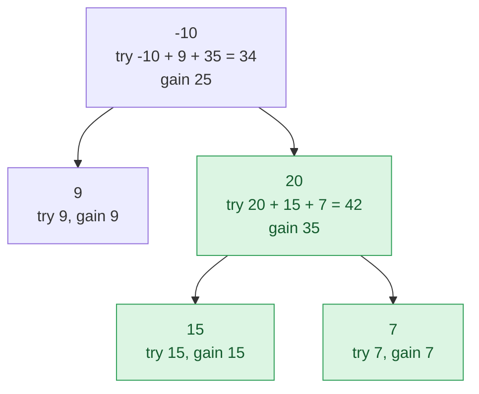

## Problem

A **path** in a binary tree is a sequence of nodes where each pair of adjacent nodes in the sequence has an edge connecting them. A node can only appear in the sequence **at most once**. Note that the path does not need to pass through the root.

The **path sum** of a path is the sum of the node's values in the path.

Given the `root` of a binary tree, return _the maximum **path sum** of any **non-empty** path_.

**Example 1:**


```text
Input:  root = [1,2,3]
Output: 6
Explanation: The optimal path is 2 -> 1 -> 3 with a path sum of 2 + 1 + 3 = 6.
```

**Example 2:**


```text
Input:  root = [-10,9,20,null,null,15,7]
Output: 42
Explanation: The optimal path is 15 -> 20 -> 7 with a path sum of 15 + 20 + 7 = 42.
```

**Constraints:**

- The number of nodes in the tree is in the range $[1, 3 \times 10^4]$.
- $-1000 \le$ `Node.val` $\le 1000$

## Solution approach

### Intuition

Every path has exactly one **highest node** (the node closest to the root). From that top node the path goes down at most into the left subtree and at most into the right subtree, each part being a straight downward chain. So:

> best path with top `node` = `node->val` + (best downward chain into the left subtree, or nothing) + (best downward chain into the right subtree, or nothing).

Define `gain(node)` as the largest sum of a downward chain that **starts** at `node` (it may stop at `node` itself). A chain can continue into only one child, so

`gain(node) = node->val + max(0, gain(left), gain(right))`.

Taking `max(0, …)` means "do not extend into a subtree whose best chain is negative" — dropping it is always allowed.

A post-order DFS computes both quantities in one pass: it gets `left = max(0, gain(left))` and `right = max(0, gain(right))` from the children, updates the global answer with the path that bends at this node (`node->val + left + right`), and returns the one-sided chain `node->val + max(left, right)` to its parent. The value returned upwards must be one-sided because the parent's path cannot use both branches of a child.

### Algorithm

1. Set `best = INT_MIN` (the path is non-empty, so even an all-negative tree has an answer).
2. `gain(node)`: return `0` for a null node. Otherwise
   - `left = max(0, gain(node->left))`, `right = max(0, gain(node->right))`;
   - `best = max(best, node->val + left + right)`;
   - return `node->val + max(left, right)`.
3. Call `gain(root)` and return `best`.

### Walkthrough

Example 2, with the value each call returns (`gain`) and the path it tries as the top (`try`). The best is at node `20`: `20 + 15 + 7 = 42`. The root can only offer `-10 + 9 + 35 = 34`:



### Complexity

- **Time:** $O(n)$ — each node is visited once with constant work.
- **Space:** $O(h)$ — the recursion stack, where $h$ is the tree height (up to $n$ for a skewed tree).

### Edge cases

- **All values negative** such as `[-3]` or `[-2,-1]`: both child gains are clamped to `0`, so each node tries the path made of itself alone, and `best` becomes the largest single value (`-3`, `-1`).
- **Overflow:** at most $3 \times 10^4$ nodes of magnitude $1000$ give sums within $\pm 3 \times 10^7$, so `int` is safe.

## Code

```cpp
class Solution {
    int best;

    // Largest sum of a downward chain starting at node; updates best with the
    // largest path whose highest node is node.
    int gain(TreeNode* node) {
        if (!node) return 0;
        int left = max(0, gain(node->left));
        int right = max(0, gain(node->right));
        best = max(best, node->val + left + right);
        return node->val + max(left, right);
    }

   public:
    int maxPathSum(TreeNode* root) {
        best = INT_MIN;
        gain(root);
        return best;
    }
};
```

```java
class Solution {
    private int best;

    public int maxPathSum(TreeNode root) {
        best = Integer.MIN_VALUE;
        gain(root);
        return best;
    }

    // Largest sum of a downward chain starting at node; updates best with the
    // largest path whose highest node is node.
    private int gain(TreeNode node) {
        if (node == null) return 0;
        int left = Math.max(0, gain(node.left));
        int right = Math.max(0, gain(node.right));
        best = Math.max(best, node.val + left + right);
        return node.val + Math.max(left, right);
    }
}
```

```python
class Solution:
    def maxPathSum(self, root: TreeNode | None) -> int:
        # Post-order with an explicit stack. gain[node] is the largest sum of a
        # downward chain starting at node, kept until its parent is processed.
        best = float('-inf')
        gain = {}
        stack = [(root, False)]
        while stack:
            node, children_done = stack.pop()
            if not node:
                continue
            if children_done:
                left = max(0, gain.pop(node.left, 0))
                right = max(0, gain.pop(node.right, 0))
                best = max(best, node.val + left + right)
                gain[node] = node.val + max(left, right)
            else:
                stack.append((node, True))
                stack.append((node.right, False))
                stack.append((node.left, False))
        return best
```
