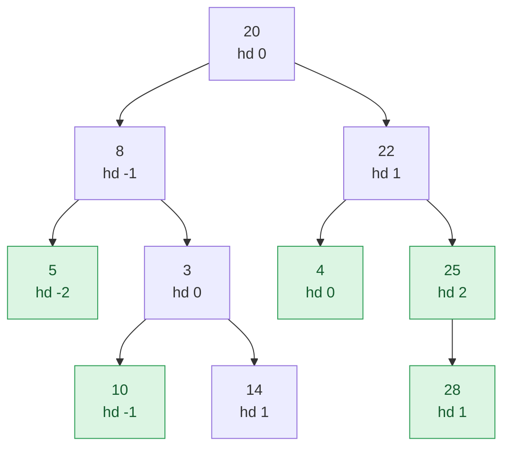

## Problem

Given a binary tree, return its bottom view. The bottom view of a binary tree is the set of nodes visible when the tree is viewed from the bottom.

**Note:** If there are multiple bottom-most nodes for a horizontal distance from the root, then the latter one in the level order traversal is considered.

Complete the function `bottomView()` which takes the root node of the tree and returns the bottom view as a list of node values, from left to right.

**Example 1:**


```text
Input:  root = [1, 2, 3, 4, 5, N, 6]
Output: [4, 2, 5, 3, 6]
Explanation: The green nodes represent the bottom view of the binary tree.
```


**Example 2:**


```text
Input:  root = [20, 8, 22, 5, 3, 4, 25, N, N, 10, 14, N, N, 28, N]
Output: [5, 10, 4, 28, 25]
Explanation: The green nodes represent the bottom view of the binary tree.
```


**Constraints:**

- $1 \le$ size of binary tree, `Node.data` $\le 10^5$

Expected time complexity: $O(n)$. Expected auxiliary space: $O(n)$.

## Solution approach

### Intuition

Give every node a **horizontal distance** `hd`: the root has `hd = 0`, a left child has its parent's `hd - 1`, and a right child has `hd + 1`. Nodes with the same `hd` lie in the same vertical column, and looking from below we see, in each column, the node that is lowest.

A level-order traversal (BFS) visits nodes by increasing depth, and within one depth from left to right. So if we simply let every node **overwrite** the entry for its column, the value left at the end is the deepest node of that column, and among equally deep nodes, the one that comes later in level order — exactly the tie-break the problem asks for.

A DFS would also work if it compared depths, but BFS gets the tie-break for free and, being iterative, cannot overflow the call stack on a skewed tree with $10^5$ nodes.

Columns are contiguous: every node's `hd` differs from its parent's by exactly one, so all values between `minHd` and `maxHd` occur. That lets us use a plain array indexed by `hd - minHd` instead of an ordered map.

### Algorithm

1. BFS from `(root, 0)` with a queue of `(node, hd)` pairs. For each popped node, append `(hd, node->data)` to `seen`, update `minHd` and `maxHd`, and push the left child with `hd - 1` and the right child with `hd + 1`.
2. Create `view` of size `maxHd - minHd + 1`.
3. Go through `seen` in order and set `view[hd - minHd] = data`; later entries overwrite earlier ones.
4. Return `view`, which is already ordered from the leftmost column to the rightmost.

### Walkthrough

Example 2 with each node's `hd`. Green nodes are the last ones written into their column. Column `0` holds `20`, `3` and `4`; `3` and `4` are both at depth 2, and `4` comes later in level order, so it wins. Likewise `28` beats `14` in column `1`:



### Complexity

- **Time:** $O(n)$ — each node is enqueued and dequeued once, and `seen` is scanned once.
- **Space:** $O(n)$ — the queue, `seen` and `view` each hold at most $n$ entries.

### Edge cases

- **Single node:** `minHd = maxHd = 0` and the view is `[root->data]`.
- **Skewed tree:** every node is in its own column and appears in the view; the iterative BFS has no recursion depth problem.
- **Ties at the same depth and column:** resolved by overwrite order, which is level order.

## Code

```cpp
class Solution {
   public:
    vector<int> bottomView(Node* root) {
        if (!root) return {};
        vector<pair<int, int>> seen;  // (hd, data) in level order
        queue<pair<Node*, int>> q;
        q.push({root, 0});
        int minHd = 0, maxHd = 0;
        while (!q.empty()) {
            auto [node, hd] = q.front();
            q.pop();
            seen.push_back({hd, node->data});
            minHd = min(minHd, hd);
            maxHd = max(maxHd, hd);
            if (node->left) q.push({node->left, hd - 1});
            if (node->right) q.push({node->right, hd + 1});
        }
        vector<int> view(maxHd - minHd + 1);
        for (auto [hd, data] : seen) view[hd - minHd] = data;  // later in level order wins
        return view;
    }
};
```

```java
class Solution {
    private record Item(Node node, int hd) {}

    public ArrayList<Integer> bottomView(Node root) {
        ArrayList<Integer> view = new ArrayList<>();
        if (root == null) return view;
        ArrayList<int[]> seen = new ArrayList<>();  // (hd, data) in level order
        ArrayDeque<Item> q = new ArrayDeque<>();
        q.add(new Item(root, 0));
        int minHd = 0, maxHd = 0;
        while (!q.isEmpty()) {
            Item it = q.poll();
            Node node = it.node();
            int hd = it.hd();
            seen.add(new int[] {hd, node.data});
            minHd = Math.min(minHd, hd);
            maxHd = Math.max(maxHd, hd);
            if (node.left != null) q.add(new Item(node.left, hd - 1));
            if (node.right != null) q.add(new Item(node.right, hd + 1));
        }
        int[] bottom = new int[maxHd - minHd + 1];
        for (int[] p : seen) bottom[p[0] - minHd] = p[1];  // later in level order wins
        for (int x : bottom) view.add(x);
        return view;
    }
}
```

```python
from collections import deque


class Solution:
    def bottomView(self, root):
        if not root:
            return []
        seen = []  # (hd, data) in level order
        q = deque([(root, 0)])
        min_hd = max_hd = 0
        while q:
            node, hd = q.popleft()
            seen.append((hd, node.data))
            min_hd = min(min_hd, hd)
            max_hd = max(max_hd, hd)
            if node.left:
                q.append((node.left, hd - 1))
            if node.right:
                q.append((node.right, hd + 1))
        view = [0] * (max_hd - min_hd + 1)
        for hd, data in seen:
            view[hd - min_hd] = data  # later in level order wins
        return view
```
