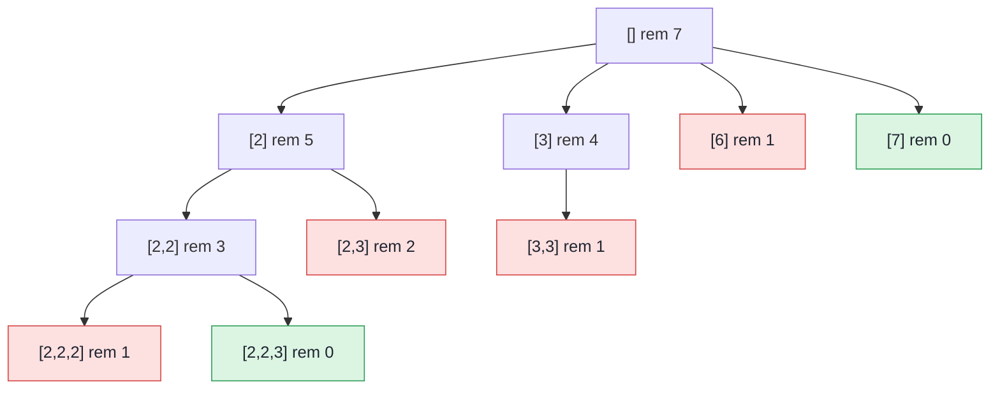

## Problem

Given an array of **distinct** integers `candidates` and a target integer `target`, return a list of all **unique combinations** of `candidates` where the chosen numbers sum to `target`. You may return the combinations in **any order**.

The **same** number may be chosen from `candidates` an **unlimited number of times**. Two combinations are unique if the frequency of at least one of the chosen numbers is different.

The test cases are generated such that the number of unique combinations that sum up to `target` is less than `150` combinations for the given input.

**Example 1:**

```text
Input:  candidates = [2,3,6,7], target = 7
Output: [[2,2,3],[7]]
Explanation:
2 and 3 are candidates, and 2 + 2 + 3 = 7. Note that 2 can be used multiple times.
7 is a candidate, and 7 = 7.
These are the only two combinations.
```

**Example 2:**

```text
Input:  candidates = [2,3,5], target = 8
Output: [[2,2,2,2],[2,3,3],[3,5]]
```

**Example 3:**

```text
Input:  candidates = [2], target = 1
Output: []
```

**Constraints:**

- $1 \le$ `candidates.length` $\le 30$
- $2 \le$ `candidates[i]` $\le 40$
- All elements of `candidates` are **distinct**.
- $1 \le$ `target` $\le 40$

## Solution approach

### Intuition

A combination is a multiset, so `[2,2,3]`, `[2,3,2]` and `[3,2,2]` are the same answer. To generate each multiset exactly once, build every combination in **non-decreasing order of index**: after choosing `candidates[i]`, the next element may be `candidates[i]` again (unlimited reuse) or anything after it, but never anything before it. Every multiset has exactly one such ordering, so no duplicates are produced and no de-duplication is needed.

Sorting the candidates first gives a cheap prune: once `candidates[i] > remaining`, every later candidate is larger too, so the whole rest of the loop can be abandoned.

### Algorithm

1. Sort `candidates` and call `backtrack(candidates, 0, target, path, res)`.
2. In `backtrack(nums, start, remaining, path, res)`:
   - If `remaining == 0`, copy `path` into `res` and return.
   - For `i` from `start` while `nums[i] <= remaining`: push `nums[i]`, recurse with the **same** `start = i` (so `nums[i]` can be taken again) and `remaining - nums[i]`, then pop it.
3. Return `res`.

### Walkthrough

Example 1 (`[2, 3, 6, 7]`, `target = 7`). Each box is a call with its `path` and remaining sum; a call only tries candidates from its own index onwards. Green calls record an answer, red ones are dead ends where even the smallest allowed candidate is too big:



Note that `[3]` never tries `2` again — that would rebuild `[2,2,3]` in a different order.

### Complexity

Let `n` be the number of candidates, `T` the target and `m` the smallest candidate.

- **Time:** $O(n^{T/m + 1})$ — a combination has at most `T / m` elements, so the recursion tree has depth at most `T / m` and each node branches into at most `n` children; copying each answer adds at most `T / m` per result. The sorted prune makes the real tree far smaller.
- **Space:** $O(T/m)$ — the recursion depth and the length of `path`, not counting the output.

### Edge cases

- **No combination (Example 3):** `2 > 1`, so the root loop does not run and `res` stays empty.
- **A candidate equal to `target`:** recorded at depth 1, like `[7]`.
- **Input order:** sorting makes the prune valid regardless of how `candidates` is given.

## Code

```cpp title="C++"
class Solution {
    void backtrack(const vector<int>& nums, int start, int remaining, vector<int>& path,
                   vector<vector<int>>& res) {
        if (remaining == 0) {
            res.push_back(path);
            return;
        }
        for (int i = start; i < (int)nums.size() && nums[i] <= remaining; i++) {
            path.push_back(nums[i]);
            backtrack(nums, i, remaining - nums[i], path, res);  // i, not i + 1: reuse allowed
            path.pop_back();
        }
    }

   public:
    vector<vector<int>> combinationSum(vector<int>& candidates, int target) {
        sort(candidates.begin(), candidates.end());
        vector<vector<int>> res;
        vector<int> path;
        backtrack(candidates, 0, target, path, res);
        return res;
    }
};
```
