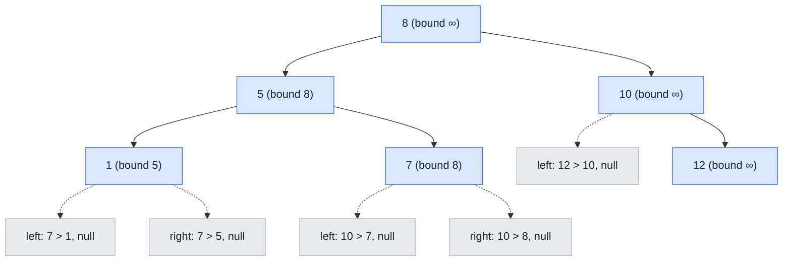

## Problem

Given an array of integers `preorder`, which represents the **preorder traversal** of a BST (i.e., **binary search tree**), construct the tree and return *its root*.

It is **guaranteed** that there is always possible to find a binary search tree with the given requirements for the given test cases.

A **binary search tree** is a binary tree where for every node, any descendant of `Node.left` has a value **strictly less than** `Node.val`, and any descendant of `Node.right` has a value **strictly greater than** `Node.val`.

A **preorder traversal** of a binary tree displays the value of the node first, then traverses `Node.left`, then traverses `Node.right`.

**Example 1:**


```text
Input:  preorder = [8,5,1,7,10,12]
Output: [8,5,10,1,7,null,12]
```

**Example 2:**

```text
Input:  preorder = [1,3]
Output: [1,null,3]
```

**Constraints:**

- $1 \le$ `preorder.length` $\le 100$
- $1 \le$ `preorder[i]` $\le 1000$
- All the values of `preorder` are **unique**.

## Solution approach

### Intuition

The straightforward recursion takes `preorder[0]` as the root, scans for the first larger value to split the rest into the left and right subtrees, and recurses. The scan makes it $O(n^2)$ on a skewed tree.

We can avoid the scan by building the tree **in preorder itself**, consuming the array from left to right with a single shared index `idx`. The only question at each step is: *does the next value belong in the subtree we are building right now?* In a BST every subtree has a range of allowed values. Because preorder reaches each subtree only after all values that are too small for it have already been placed, only the **upper bound** needs checking:

- the root may take any value (bound `INT_MAX`);
- the left child of `root` must be smaller than `root->val`, so its bound is `root->val`;
- the right child of `root` inherits `root`'s own bound.

If `preorder[idx]` exceeds the bound, it is not part of this subtree: return `nullptr` and let an ancestor with a larger bound take it. Each value is consumed exactly once, so the whole build is linear.

### Algorithm

1. Set `idx = 0` and call `build(preorder, idx, INT_MAX)`.
2. In `build(preorder, idx, bound)`:
   - If `idx` is past the end, or `preorder[idx] > bound`, return `nullptr`.
   - Create `root` from `preorder[idx]` and advance `idx`.
   - `root->left = build(preorder, idx, root->val)` — values smaller than the root.
   - `root->right = build(preorder, idx, bound)` — the remaining values up to the parent's bound.
   - Return `root`.

### Walkthrough

Example 1, `preorder = [8, 5, 1, 7, 10, 12]`. Each node shows its value and the bound it was checked against; the dashed edges are the calls that returned `nullptr` because the next value was too large:



The key moment is after `7`: its right call has bound `8` and sees `10`, so it returns `nullptr`; the recursion climbs back to `8`, whose right call has bound `∞` and accepts `10`.

### Complexity

- **Time:** $O(n)$ — each value creates one node, and each node makes two calls, of which at most one rejects a value without consuming it; so there are $O(n)$ calls in total.
- **Space:** $O(h)$ — the recursion stack, where `h` is the height of the tree ($O(n)$ for a skewed input such as a sorted array).

### Edge cases

- **Single element:** both child calls hit the end of the array and return `nullptr`.
- **Strictly increasing input** (Example 2): every left call is rejected and the tree becomes a right chain.
- **Strictly decreasing input:** every value fits its parent's left bound, giving a left chain.

## Code

```cpp title="C++"
class Solution {
    TreeNode* build(const vector<int>& preorder, int& idx, int bound) {
        if (idx == (int)preorder.size() || preorder[idx] > bound) return nullptr;
        TreeNode* root = new TreeNode(preorder[idx++]);
        root->left = build(preorder, idx, root->val);
        root->right = build(preorder, idx, bound);
        return root;
    }

   public:
    TreeNode* bstFromPreorder(vector<int>& preorder) {
        int idx = 0;
        return build(preorder, idx, INT_MAX);
    }
};
```
