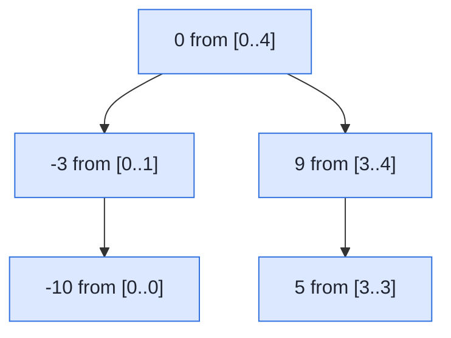

## Problem

Given an integer array `nums` where the elements are sorted in **ascending order**, convert *it to a **height-balanced** binary search tree*.

A **height-balanced** binary tree is a binary tree in which the depth of the two subtrees of every node never differs by more than one.

**Example 1:**


```text
Input:  nums = [-10,-3,0,5,9]
Output: [0,-3,9,-10,null,5]
Explanation: [0,-10,5,null,-3,null,9] is also accepted:
```


**Example 2:**

![Two balanced BSTs for [1,3]: 3 with left child 1, and 1 with right child 3](https://assets.leetcode.com/uploads/2021/02/18/btree.jpg)

```text
Input:  nums = [1,3]
Output: [3,1]
Explanation: [1,null,3] and [3,1] are both height-balanced BSTs.
```

**Constraints:**

- $1 \le$ `nums.length` $\le 10^4$
- $-10^4 \le$ `nums[i]` $\le 10^4$
- `nums` is sorted in a **strictly increasing** order.

## Solution approach

### Intuition

An inorder traversal of a BST visits its values in sorted order, so **any** BST built from `nums` has `nums` as its inorder sequence. Choosing `nums[mid]` as the root therefore forces `nums[start..mid-1]` into the left subtree and `nums[mid+1..end]` into the right one — the BST property holds automatically.

To keep the tree **height-balanced**, pick `mid` in the middle of the range: the two halves then differ in size by at most one. Applying the same rule recursively to each half gives subtrees whose heights also differ by at most one, at every node.

When the range has even length there are two middle elements and either works. The code takes the **upper** middle, `start + (end - start + 1) / 2`, which reproduces exactly the outputs shown in both examples.

### Algorithm

1. Call `build(nums, 0, n - 1)`.
2. In `build(nums, start, end)`:
   - If `start > end`, the range is empty: return null.
   - Let `mid = start + (end - start + 1) / 2` and create `root` from `nums[mid]`.
   - `root->left = build(nums, start, mid - 1)` and `root->right = build(nums, mid + 1, end)`.
   - Return `root`.

### Walkthrough

Example 1. Each node shows the index range it was built from; its value is the (upper) middle element of that range:



This is `[0,-3,9,-10,null,5]`, the expected output.

### Complexity

- **Time:** $O(n)$ — each element becomes a node in exactly one call with $O(1)$ work.
- **Space:** $O(\log n)$ — the recursion depth equals the height of the balanced tree (the output tree itself is not counted).

### Edge cases

- **Single element:** both child ranges are empty, giving a one-node tree.
- **Two elements** (Example 2): the upper middle is the root and the other element becomes its left child.
- **Index overflow:** `start + (end - start + 1) / 2` never forms `start + end`, though with $n \le 10^4$ either form would be safe.

## Code

```cpp
class Solution {
    TreeNode* build(const vector<int>& nums, int start, int end) {
        if (start > end) return nullptr;
        int mid = start + (end - start + 1) / 2;
        TreeNode* root = new TreeNode(nums[mid]);
        root->left = build(nums, start, mid - 1);
        root->right = build(nums, mid + 1, end);
        return root;
    }

   public:
    TreeNode* sortedArrayToBST(vector<int>& nums) {
        return build(nums, 0, (int)nums.size() - 1);
    }
};
```

```java
class Solution {
    private TreeNode build(int[] nums, int start, int end) {
        if (start > end) return null;
        int mid = start + (end - start + 1) / 2;
        TreeNode root = new TreeNode(nums[mid]);
        root.left = build(nums, start, mid - 1);
        root.right = build(nums, mid + 1, end);
        return root;
    }

    public TreeNode sortedArrayToBST(int[] nums) {
        return build(nums, 0, nums.length - 1);
    }
}
```

```python
class Solution:
    def sortedArrayToBST(self, nums: list[int]) -> TreeNode | None:
        def build(start, end):
            if start > end:
                return None
            mid = (start + end + 1) // 2
            root = TreeNode(nums[mid])
            root.left = build(start, mid - 1)
            root.right = build(mid + 1, end)
            return root

        return build(0, len(nums) - 1)
```
