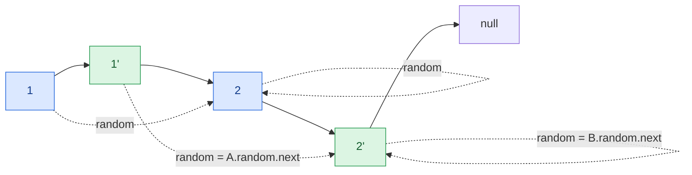

## Problem

A linked list of length `n` is given such that each node contains an additional random pointer, which could point to any node in the list, or `null`.

Construct a [**deep copy**](https://en.wikipedia.org/wiki/Object_copying#Deep_copy) of the list. The deep copy should consist of exactly `n` **brand new** nodes, where each new node has its value set to the value of its corresponding original node. Both the `next` and `random` pointer of the new nodes should point to new nodes in the copied list such that the pointers in the original list and copied list represent the same list state. **None of the pointers in the new list should point to nodes in the original list**.

For example, if there are two nodes `X` and `Y` in the original list, where `X.random --> Y`, then for the corresponding two nodes `x` and `y` in the copied list, `x.random --> y`.

Return _the head of the copied linked list_.

The linked list is represented in the input/output as a list of `n` nodes. Each node is represented as a pair of `[val, random_index]` where:

- `val`: an integer representing `Node.val`
- `random_index`: the index of the node (range from `0` to `n-1`) that the `random` pointer points to, or `null` if it does not point to any node.

Your code will **only** be given the `head` of the original linked list.

**Example 1:**


```text
Input:  head = [[7,null],[13,0],[11,4],[10,2],[1,0]]
Output: [[7,null],[13,0],[11,4],[10,2],[1,0]]
```

**Example 2:**


```text
Input:  head = [[1,1],[2,1]]
Output: [[1,1],[2,1]]
```

**Example 3:**


```text
Input:  head = [[3,null],[3,0],[3,null]]
Output: [[3,null],[3,0],[3,null]]
```

**Constraints:**

- $0 \le n \le 1000$
- $-10^4 \le$ `Node.val` $\le 10^4$
- `Node.random` is `null` or is pointing to some node in the linked list.

## Solution approach

### Intuition

The hard part of a deep copy is the `random` pointer: when we create the copy of a node, the node its `random` points to may not have been copied yet, and we need a way to get from an original node to its copy.

The straightforward fix is a hash map from each original node to its copy (two passes, $O(n)$ extra space). We can avoid the map entirely by storing that mapping **inside the list itself**: insert each copy directly after its original, so the list becomes `A → A' → B → B' → C → C' ...`. Now "the copy of `X`" is simply `X->next`, so the copy of `X->random` is `X->random->next`.

### Algorithm

1. **Interleave.** For each original node `cur`, create `copy` with the same `val`, set `copy->next = cur->next` and `cur->next = copy`, then jump to `copy->next` (the next original).
2. **Set random pointers.** Walk the originals again (`cur` moves two steps at a time). If `cur->random` is not `nullptr`, set `cur->next->random = cur->random->next` — the copy of the node it points to.
3. **Separate the lists.** Walk once more with a dummy node `dummy` and a tail `tail` for the copied list. For each original `cur`, take `copy = cur->next`, restore `cur->next = copy->next`, and append `copy` to `tail`. This rebuilds the original list exactly as it was and links the copies together.
4. Return `dummy.next`.

### Walkthrough

Example 2 (`[[1,1],[2,1]]`): after step 1 the copies sit right after their originals, so every original reaches its copy through `next`. The dashed edges are the original `random` pointers; step 2 copies them across by following one extra `next`.



Step 3 then unzips `1 → 1' → 2 → 2'` back into `1 → 2` and `1' → 2'`.

### Complexity

- **Time:** $O(n)$ — three linear passes over the list.
- **Space:** $O(1)$ extra — only a few pointers besides the `n` new nodes that form the answer.

### Edge cases

- **Empty list:** all three loops are skipped and `dummy.next` is `nullptr`.
- **`random` is `null`:** guarded by the `if (cur->random)` check, so the copy's `random` keeps its default `nullptr`.
- **`random` points to the node itself:** `cur->random->next` is then `cur`'s own copy, which is correct.
- **The original list must be left intact:** step 3 restores every `cur->next`.

## Code

```cpp title="C++"
class Solution {
   public:
    Node* copyRandomList(Node* head) {
        // 1. Insert each copy right after its original: A -> A' -> B -> B' ...
        for (Node* cur = head; cur; cur = cur->next->next) {
            Node* copy = new Node(cur->val);
            copy->next = cur->next;
            cur->next = copy;
        }
        // 2. The copy of X is X->next, so the copy of X->random is X->random->next.
        for (Node* cur = head; cur; cur = cur->next->next) {
            if (cur->random) cur->next->random = cur->random->next;
        }
        // 3. Unzip the two lists, restoring the original.
        Node dummy(0);
        Node* tail = &dummy;
        for (Node* cur = head; cur; cur = cur->next) {
            Node* copy = cur->next;
            cur->next = copy->next;
            tail->next = copy;
            tail = copy;
        }
        return dummy.next;
    }
};
```
