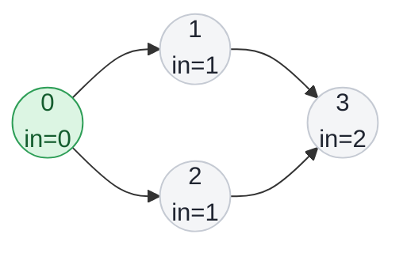

## Problem

There are a total of `numCourses` courses you have to take, labeled from `0` to `numCourses - 1`. You are given an array `prerequisites` where `prerequisites[i] = [a_i, b_i]` indicates that you **must** take course `b_i` first if you want to take course `a_i`.

- For example, the pair `[0, 1]`, indicates that to take course `0` you have to first take course `1`.

Return _the ordering of courses you should take to finish all courses_. If there are many valid answers, return **any** of them. If it is impossible to finish all courses, return **an empty array**.

**Example 1:**

```text
Input:  numCourses = 2, prerequisites = [[1,0]]
Output: [0,1]
Explanation: There are a total of 2 courses to take. To take course 1 you should have finished course 0. So the correct course order is [0,1].
```

**Example 2:**

```text
Input:  numCourses = 4, prerequisites = [[1,0],[2,0],[3,1],[3,2]]
Output: [0,2,1,3]
Explanation: There are a total of 4 courses to take. To take course 3 you should have finished both courses 1 and 2. Both courses 1 and 2 should be taken after you finished course 0.
So one correct course order is [0,1,2,3]. Another correct ordering is [0,2,1,3].
```

**Example 3:**

```text
Input:  numCourses = 1, prerequisites = []
Output: [0]
```

**Constraints:**

- $1 \le$ `numCourses` $\le 2000$
- $0 \le$ `prerequisites.length` $\le$ `numCourses * (numCourses - 1)`
- `prerequisites[i].length == 2`
- $0 \le a_i, b_i \lt$ `numCourses`
- $a_i \ne b_i$
- All the pairs `[a_i, b_i]` are **distinct**.

## Solution approach

### Intuition

Draw an edge `b → a` for every pair `[a, b]` ("`b` unlocks `a`"). A valid order is exactly a **topological order** of this directed graph, and one exists if and only if the graph has no cycle.

Kahn's algorithm builds the order greedily. A course whose **in-degree** (number of unmet prerequisites) is `0` can be taken right now. Take it, and "remove" its outgoing edges by decrementing the in-degree of every course it unlocks; any course that drops to `0` becomes available. If the graph has a cycle, the courses on it always keep at least one unmet prerequisite (another course on the cycle), so they never reach in-degree `0` and the order ends up shorter than `numCourses`.

### Algorithm

1. Build `adj` with an edge `pre[1] → pre[0]` for every pair, and count `indeg[pre[0]]`.
2. Put every course with `indeg == 0` into `order`. `order` doubles as the BFS queue: `head` is the index of the next course to process.
3. While `head < order.size()`: for each `v` in `adj[order[head]]`, decrement `indeg[v]`, and append `v` to `order` when it reaches `0`; then advance `head`. Everything in `order` is a course whose prerequisites all appear before it.
4. If `order.size() == numCourses`, return `order`; otherwise a cycle blocked some courses, so return an empty array.

### Walkthrough

Example 2. In-degrees start at `0:0, 1:1, 2:1, 3:2`. Course `0` is taken first and unlocks `1` and `2`; course `3` only becomes available after **both** `1` and `2` are taken.



The code produces `[0, 1, 2, 3]`, which is one of the accepted answers.

### Complexity

- **Time:** $O(V + E)$ — building the graph touches each pair once, and each course enters `order` at most once, with its edges scanned once.
- **Space:** $O(V + E)$ — the adjacency list plus `indeg` and `order`.

### Edge cases

- **No prerequisites:** every course starts with in-degree `0`, so `order` is `0, 1, ..., numCourses - 1`.
- **A cycle anywhere** (for example `[[1,0],[0,1]]`): the courses on it never reach in-degree `0`, `order.size() < numCourses`, and `{}` is returned.
- **Deep chains** of 2000 courses: the method is iterative, so there is no recursion-depth risk.

## Code

```cpp title="C++"
class Solution {
   public:
    vector<int> findOrder(int numCourses, vector<vector<int>>& prerequisites) {
        vector<vector<int>> adj(numCourses);
        vector<int> indeg(numCourses, 0);
        for (const auto& pre : prerequisites) {
            adj[pre[1]].push_back(pre[0]);
            indeg[pre[0]]++;
        }

        vector<int> order;  // also used as the BFS queue
        order.reserve(numCourses);
        for (int c = 0; c < numCourses; c++)
            if (indeg[c] == 0) order.push_back(c);

        for (size_t head = 0; head < order.size(); head++) {
            for (int v : adj[order[head]])
                if (--indeg[v] == 0) order.push_back(v);
        }

        if ((int)order.size() < numCourses) return {};
        return order;
    }
};
```
