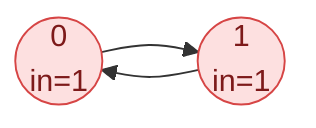

## Problem

There are a total of `numCourses` courses you have to take, labeled from `0` to `numCourses - 1`. You are given an array `prerequisites` where `prerequisites[i] = [a_i, b_i]` indicates that you **must** take course `b_i` first if you want to take course `a_i`.

- For example, the pair `[0, 1]`, indicates that to take course `0` you have to first take course `1`.

Return `true` if you can finish all courses. Otherwise, return `false`.

**Example 1:**

```text
Input:  numCourses = 2, prerequisites = [[1,0]]
Output: true
Explanation: There are a total of 2 courses to take.
To take course 1 you should have finished course 0. So it is possible.
```

**Example 2:**

```text
Input:  numCourses = 2, prerequisites = [[1,0],[0,1]]
Output: false
Explanation: There are a total of 2 courses to take.
To take course 1 you should have finished course 0, and to take course 0 you should also have finished course 1. So it is impossible.
```

**Constraints:**

- $1 \le$ `numCourses` $\le 2000$
- $0 \le$ `prerequisites.length` $\le 5000$
- `prerequisites[i].length == 2`
- $0 \le a_i, b_i \lt$ `numCourses`
- All the pairs `prerequisites[i]` are **unique**.

## Solution approach

### Intuition

Draw an edge `b → a` for every pair `[a, b]`. All courses can be finished exactly when this directed graph has **no cycle**: on a cycle every course waits for another course on the same cycle, so none of them can ever be started.

Kahn's algorithm detects this by simulating the semester. A course with **in-degree** `0` (no unmet prerequisites) can be taken. Taking it removes its outgoing edges, which may bring other courses down to in-degree `0`. In an acyclic graph this process eventually takes every course; courses on (or behind) a cycle are never freed. So we only need to count how many courses get taken.

### Algorithm

1. Build `adj` with an edge `pre[1] → pre[0]` for every pair, and count `indeg[pre[0]]`.
2. Push every course with `indeg == 0` onto the stack `ready` (any container works; order does not matter for a yes/no answer).
3. While `ready` is not empty: pop `u`, increment `taken`, and for each `v` in `adj[u]` decrement `indeg[v]`, pushing `v` when it reaches `0`.
4. Return `taken == numCourses`.

### Walkthrough

Example 2: both courses start with in-degree `1`, so `ready` starts empty, `taken` stays `0`, and the answer is `false`.



### Complexity

- **Time:** $O(V + E)$ — each pair is read once while building, and each course is popped at most once with its edges scanned once.
- **Space:** $O(V + E)$ — the adjacency list plus `indeg` and `ready`.

### Edge cases

- **No prerequisites:** every course is ready immediately and `taken == numCourses`.
- **A cycle in only one component:** the other components are still processed, but the cycle's courses are never taken, so the result is `false`.
- **A long chain of 2000 courses:** the algorithm is iterative, so there is no recursion-depth concern.

## Code

```cpp title="C++"
class Solution {
   public:
    bool canFinish(int numCourses, vector<vector<int>>& prerequisites) {
        vector<vector<int>> adj(numCourses);
        vector<int> indeg(numCourses, 0);
        for (const auto& pre : prerequisites) {
            adj[pre[1]].push_back(pre[0]);
            indeg[pre[0]]++;
        }

        vector<int> ready;
        for (int c = 0; c < numCourses; c++)
            if (indeg[c] == 0) ready.push_back(c);

        int taken = 0;
        while (!ready.empty()) {
            int u = ready.back();
            ready.pop_back();
            taken++;
            for (int v : adj[u])
                if (--indeg[v] == 0) ready.push_back(v);
        }
        return taken == numCourses;
    }
};
```
