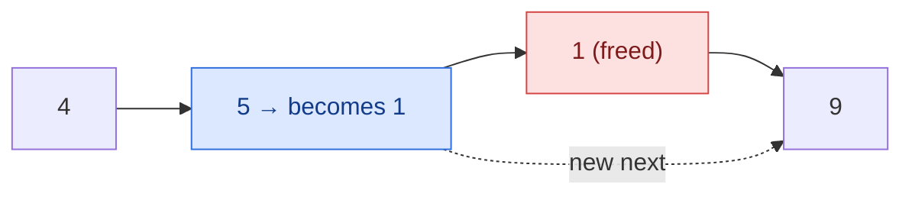

## Problem

There is a singly-linked list `head` and we want to delete a node `node` in it.

You are given the node to be deleted `node`. You will **not be given access** to the first node of `head`.

All the values of the linked list are **unique**, and it is guaranteed that the given node `node` is not the last node in the linked list.

Delete the given node. Note that by deleting the node, we do not mean removing it from memory. We mean:

- The value of the given node should not exist in the linked list.
- The number of nodes in the linked list should decrease by one.
- All the values before `node` should be in the same order.
- All the values after `node` should be in the same order.

**Custom testing:**

- For the input, you should provide the entire linked list `head` and the node to be given `node`. `node` should not be the last node of the list and should be an actual node in the list.
- We will build the linked list and pass the node to your function.
- The output will be the entire list after calling your function.

**Example 1:**


```text
Input:  head = [4,5,1,9], node = 5
Output: [4,1,9]
Explanation: You are given the second node with value 5, the linked list should become 4 -> 1 -> 9 after calling your function.
```

**Example 2:**


```text
Input:  head = [4,5,1,9], node = 1
Output: [4,5,9]
Explanation: You are given the third node with value 1, the linked list should become 4 -> 5 -> 9 after calling your function.
```

**Constraints:**

- The number of the nodes in the given list is in the range `[2, 1000]`.
- $-1000 \le$ `Node.val` $\le 1000$
- The value of each node in the list is **unique**.
- The `node` to be deleted is **in the list** and is **not a tail** node.

## Solution approach

### Intuition

To unlink a node we normally change its predecessor's `next`, but we cannot reach the predecessor: we have no head and the list is singly linked. However, the problem only asks that the **values** of the list look as if `node` were removed. So instead of removing `node`, we make `node` become its successor (copy the successor's value and `next` into it) and remove the successor, which we *can* unlink because we hold its predecessor — `node` itself. This is possible only because `node` is guaranteed not to be the tail.

### Algorithm

1. Save the successor as `next`.
2. `*node = *next` copies both `val` and `next` from the successor into `node`. The list now reads `... → node (with next's value) → node after next → ...`, so the original value is gone and the length dropped by one.
3. Nothing in the list points to `next` any more, so free it with `delete`.

### Walkthrough

Example 1, `node` is the node holding `5`:



The list reads `4 → 1 → 9`.

### Complexity

- **Time:** $O(1)$ — one struct copy and one `delete`.
- **Space:** $O(1)$.

### Edge cases

- **`node` is the second-to-last node** (Example 2 style, deleting `1` before `9`): the copy sets `node->next` to `nullptr`, which correctly makes `node` the new tail.
- **The tail cannot be deleted** this way, but the constraints rule that out, so `node->next` is never `nullptr`.
- The physically freed object is the original successor, not `node`; any outside pointer to that successor becomes dangling. The judge only reads the list from `head`, so this is fine here.

## Code

```cpp title="C++"
class Solution {
   public:
    void deleteNode(ListNode* node) {
        ListNode* next = node->next;
        *node = *next;
        delete next;
    }
};
```
