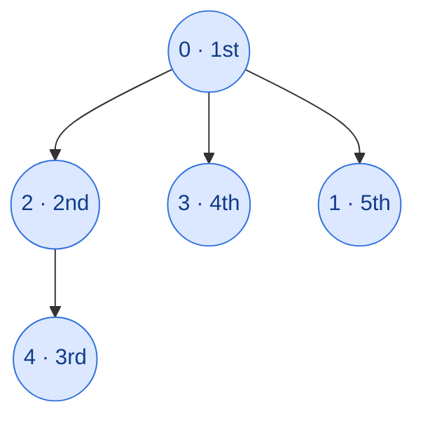

## Problem

Given a connected undirected graph containing **V** vertices represented by a 2-d adjacency list **`adj[][]`**, where each `adj[i]` represents the list of vertices connected to vertex `i`. Perform a Depth First Search (DFS) traversal starting from vertex `0`, visiting vertices from left to right as per the given adjacency list, and return a list containing the DFS traversal of the graph.

**Note:** Do traverse in the same order as they are in the given adjacency list.

Complete the function `dfs()` which takes the adjacency list `adj` and returns the DFS traversal as a list of vertices.

**Example 1:**


```text
Input:  adj[][] = [[2, 3, 1], [0], [0, 4], [0], [2]]
Output: [0, 2, 4, 3, 1]
Explanation: Starting from 0, the DFS traversal proceeds as follows:
Visit 0 → Output: 0
Visit 2 (the first neighbor of 0) → Output: 0, 2
Visit 4 (the first neighbor of 2) → Output: 0, 2, 4
Backtrack to 2, then backtrack to 0, and visit 3 → Output: 0, 2, 4, 3
Finally, backtrack to 0 and visit 1 → Final Output: 0, 2, 4, 3, 1
```

**Example 2:**


```text
Input:  adj[][] = [[1, 2], [0, 2], [0, 1, 3, 4], [2], [2]]
Output: [0, 1, 2, 3, 4]
Explanation: Starting from 0, the DFS traversal proceeds as follows:
Visit 0 → Output: 0
Visit 1 (the first neighbor of 0) → Output: 0, 1
Visit 2 (the first neighbor of 1) → Output: 0, 1, 2
Visit 3 (the first neighbor of 2) → Output: 0, 1, 2, 3
Backtrack to 2 and visit 4 → Final Output: 0, 1, 2, 3, 4
```

**Constraints:**

- $1 \le V =$ `adj.size()` $\le 10^4$
- $0 \le$ `adj[i][j]` $\le 10^4$

## Solution approach

### Intuition

Depth-first search commits to one neighbour and follows it as deep as possible before backing up to try the next one. Recording a vertex the first time we reach it gives the DFS order. Because the graph is undirected and may have cycles, a vertex can be reached along many paths; the `visited` array guarantees that each vertex is recorded and expanded exactly once. Scanning `adj[u]` from left to right gives exactly the order the problem requires.

### Algorithm

1. Create `visited` of size `V` (all `false`) and an empty `order`.
2. Call `visit(0)`:
   - mark `u` as visited and append it to `order`;
   - for each `v` in `adj[u]`, from left to right, call `visit(v)` if `v` is not yet visited.
3. Return `order`.

### Walkthrough

Example 1. Solid edges are the ones DFS follows (numbers show the visit order); the graph happens to be a tree, so no edge is skipped.



After `4` has no unvisited neighbours, the recursion returns to `2`, then to `0`, which continues with its next neighbours `3` and `1`.

### Complexity

- **Time:** $O(V + E)$ — each vertex is visited once and each adjacency list is scanned once.
- **Space:** $O(V)$ — `visited`, `order`, and the recursion stack, which can be $V$ deep on a path-shaped graph.

### Edge cases

- **Cycles** (Example 2 has the triangle `0-1-2`): when DFS at `2` sees `0` and `1` again, `visited` skips them.
- **Single vertex** with an empty list: `order` is just `[0]`.

## Code

```cpp
class Solution {
    void visit(int u, const vector<vector<int>>& adj, vector<bool>& visited, vector<int>& order) {
        visited[u] = true;
        order.push_back(u);
        for (int v : adj[u])
            if (!visited[v]) visit(v, adj, visited, order);
    }

   public:
    vector<int> dfs(vector<vector<int>>& adj) {
        vector<bool> visited(adj.size(), false);
        vector<int> order;
        visit(0, adj, visited, order);
        return order;
    }
};
```

```java
class Solution {
    public ArrayList<Integer> dfs(ArrayList<ArrayList<Integer>> adj) {
        boolean[] visited = new boolean[adj.size()];
        ArrayList<Integer> order = new ArrayList<>();
        // One neighbour iterator per vertex on the DFS path (explicit stack, so deep graphs can't overflow).
        Deque<Iterator<Integer>> stack = new ArrayDeque<>();
        visited[0] = true;
        order.add(0);
        stack.push(adj.get(0).iterator());
        while (!stack.isEmpty()) {
            Iterator<Integer> it = stack.peek();
            if (!it.hasNext()) {
                stack.pop();  // all neighbours done: backtrack
                continue;
            }
            int v = it.next();
            if (!visited[v]) {
                visited[v] = true;
                order.add(v);
                stack.push(adj.get(v).iterator());
            }
        }
        return order;
    }
}
```

```python
class Solution:
    def dfs(self, adj):
        visited = [False] * len(adj)
        visited[0] = True
        order = [0]
        stack = [iter(adj[0])]  # one neighbour iterator per vertex on the DFS path
        while stack:
            for v in stack[-1]:
                if not visited[v]:
                    visited[v] = True
                    order.append(v)
                    stack.append(iter(adj[v]))
                    break
            else:
                stack.pop()  # all neighbours done: backtrack
        return order
```
