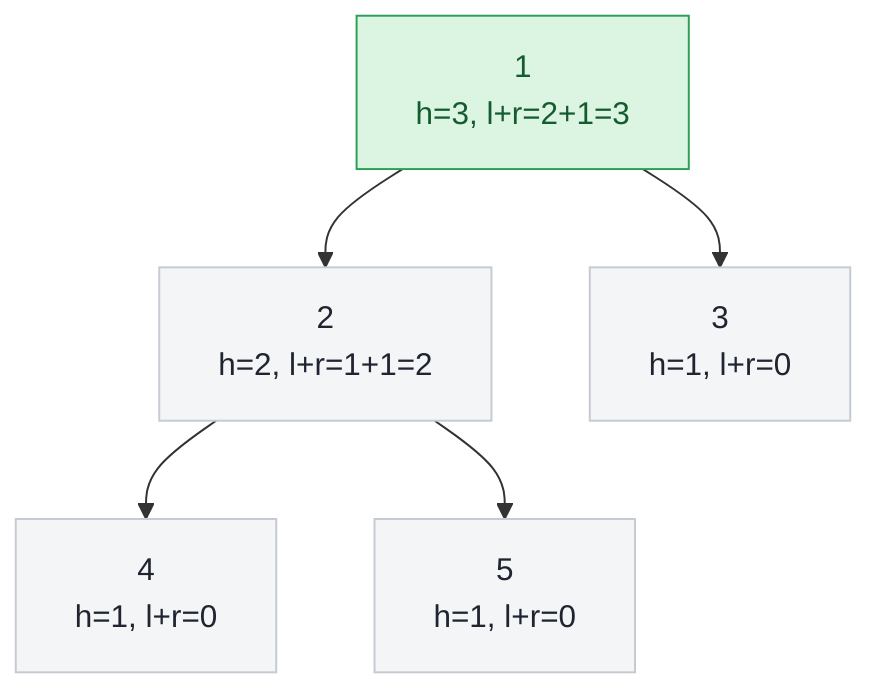

## Problem

Given the `root` of a binary tree, return _the length of the **diameter** of the tree_.

The **diameter** of a binary tree is the **length** of the longest path between any two nodes in a tree. This path may or may not pass through the `root`.

The **length** of a path between two nodes is represented by the number of edges between them.

**Example 1:**


```text
Input:  root = [1,2,3,4,5]
Output: 3
Explanation: 3 is the length of the path [4,2,1,3] or [5,2,1,3].
```

**Example 2:**

```text
Input:  root = [1,2]
Output: 1
```

**Constraints:**

- The number of nodes in the tree is in the range $[1, 10^4]$.
- $-100 \le$ `Node.val` $\le 100$

## Solution approach

### Intuition

Every path in a tree has a unique **highest node**: the path climbs up from one end to that node and goes down to the other end. If the highest node is `u`, the longest such path goes as deep as possible on both sides, so its length is `height(u->left) + height(u->right)`, where `height` counts the nodes on the longest downward path (`0` for an empty subtree), i.e. the edges from `u` down through that child.

So the diameter is the maximum of `height(left) + height(right)` over all nodes. A single post-order DFS computes each node's height from its children's heights and, at the same time, updates the best sum — every node is processed once, with no repeated height computations.

### Algorithm

1. `height(node, best)` returns `0` for `nullptr`.
2. Otherwise compute `l = height(node->left, best)` and `r = height(node->right, best)`.
3. Update `best = max(best, l + r)`: the longest path whose highest node is `node`.
4. Return `1 + max(l, r)`, the height of `node`.
5. `diameterOfBinaryTree` starts `best` at `0`, runs `height(root, best)` and returns `best`.

### Walkthrough

Example 1. Each node shows the height returned to its parent and the candidate `l + r`; the best candidate is at the root:



The answer is `3` (for example the path `4 → 2 → 1 → 3`).

### Complexity

- **Time:** $O(n)$ — each node is visited exactly once and does constant work.
- **Space:** $O(h)$ for the recursion stack, where $h$ is the tree height ($O(n)$ for a skewed tree of $10^4$ nodes, which is still a safe recursion depth).

### Edge cases

- **Single node:** `l = r = 0`, so the diameter is `0`.
- **The longest path does not pass through the root** (e.g. a deep left subtree with a tiny right one): `best` is updated at every node, not only at the root, so it is still found.
- **Skewed tree** (Example 2): the path ends at the root, and `l + r` at the root equals the depth of the chain.

## Code

```cpp
class Solution {
    int height(TreeNode* node, int& best) {
        if (!node) return 0;
        int l = height(node->left, best);
        int r = height(node->right, best);
        best = max(best, l + r);  // longest path whose highest node is `node`
        return 1 + max(l, r);
    }

   public:
    int diameterOfBinaryTree(TreeNode* root) {
        int best = 0;
        height(root, best);
        return best;
    }
};
```

```java
class Solution {
    private int best;

    public int diameterOfBinaryTree(TreeNode root) {
        best = 0;
        height(root);
        return best;
    }

    private int height(TreeNode node) {
        if (node == null) return 0;
        int l = height(node.left);
        int r = height(node.right);
        best = Math.max(best, l + r);  // longest path whose highest node is `node`
        return 1 + Math.max(l, r);
    }
}
```

```python
class Solution:
    def diameterOfBinaryTree(self, root: Optional[TreeNode]) -> int:
        best = 0
        height = {}  # heights of finished subtrees whose parent is not finished yet
        stack = [(root, False)]
        while stack:  # post-order: children's heights before the parent's
            node, children_done = stack.pop()
            if node is None:
                continue
            if children_done:
                l = height.pop(node.left, 0)
                r = height.pop(node.right, 0)
                best = max(best, l + r)  # longest path whose highest node is `node`
                height[node] = 1 + max(l, r)
            else:
                stack.append((node, True))
                stack.append((node.left, False))
                stack.append((node.right, False))
        return best
```
