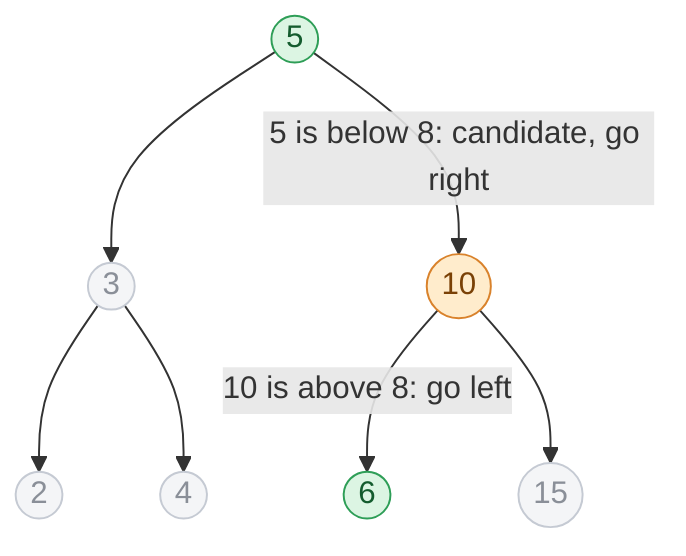

## Problem

You are given a BST (binary search tree) with `N` nodes and a value `X`. Your task is to find the greatest value node of the BST which is smaller than or equal to `X`.

**Note:** `X` is not smaller than the smallest node of the BST.

Complete the function `floorInBST(root, X)`, which receives the root of the tree (a `TreeNode<int>*` with fields `val`, `left` and `right`) and returns the floor of `X`.

**Example 1:**


```text
Input:  tree = [10,5,15,2,6,-1,-1,-1,-1,-1,-1], X = 7
Output: 6
Explanation: The greatest value node of the BST which is smaller than or equal to 7 is 6.
```

**Example 2:**


```text
Input:  tree = [2,1,3,-1,-1,-1,-1], X = 2
Output: 2
Explanation: The greatest value node of the BST which is smaller than or equal to 2 is 2.
```

**Example 3:**

```text
Input:  tree = [5,3,10,2,4,6,15,-1,-1,-1,-1,-1,-1,-1,-1], X = 15
Output: 15
```

**Example 4:**

```text
Input:  tree = [5,3,10,2,4,6,15,-1,-1,-1,-1,-1,-1,-1,-1], X = 8
Output: 6
```

The tree is given in level order, with `-1` standing for a missing child.

**Constraints:**

- $1 \le T \le 5$ test cases
- $1 \le N \le 5 \times 10^3$
- $1 \le$ `nodeVal[i]` $\le 10^9$
- Time limit: 1 second.

## Solution approach

### Intuition

The floor of `X` is the largest value that is not greater than `X`. In a BST every node splits the remaining values: everything on its left is smaller, everything on its right is larger. That tells us at each node which side can still hold a better answer:

- If `root->val == X`, nothing can beat it — return it.
- If `root->val < X`, this node is a valid candidate. Anything on its left is even smaller, so a **better** candidate can only be in the right subtree. Record it and go right.
- If `root->val > X`, this node and its whole right subtree are too large. The floor, if any, is on the left.

Each step discards one subtree entirely, so we follow a single root-to-leaf path, exactly like a binary search. The last candidate recorded on that path is the answer.

### Algorithm

1. Set `floorVal = -1` (the value to return if no node is at most `X`; the note guarantees that never happens).
2. While `root` is not null:
   - If `root->val == X`, return `X`.
   - If `root->val < X`, set `floorVal = root->val` and move to `root->right`.
   - Otherwise move to `root->left`.
3. Return `floorVal`.

Candidates only ever increase along the path: we go right after recording one, so every later candidate is larger. That is why simply overwriting `floorVal` is correct.

### Walkthrough

Example 4 (`X = 8`): the search visits 5, 10 and 6. Green nodes were recorded as candidates; the orange node was too large and sent the search left.



At 6 we record `floorVal = 6` and step right into an empty subtree, so the loop ends and `6` is returned.

### Complexity

- **Time:** $O(h)$, where $h$ is the height of the tree — one node per level. That is $O(\log N)$ for a balanced tree and $O(N)$ for a completely skewed one.
- **Space:** $O(1)$ — the loop keeps only `root` and `floorVal` (a recursive version would use $O(h)$ stack).

### Edge cases

- **`X` is in the tree** (Examples 2 and 3): the equality check returns it immediately.
- **`X` larger than every value:** the search keeps going right, recording each node, and ends with the maximum.
- **Skewed tree:** still correct; only the running time grows to $O(N)$.

## Code

```cpp
int floorInBST(TreeNode<int>* root, int X) {
    int floorVal = -1;
    while (root) {
        if (root->val == X) return X;
        if (root->val < X) {
            floorVal = root->val;
            root = root->right;
        } else {
            root = root->left;
        }
    }
    return floorVal;
}
```

```java
public class Solution {
    public static int floorInBST(TreeNode<Integer> root, int X) {
        int floorVal = -1;
        while (root != null) {
            if (root.val == X) return X;
            if (root.val < X) {
                floorVal = root.val;
                root = root.right;
            } else {
                root = root.left;
            }
        }
        return floorVal;
    }
}
```

```python
def floorInBST(root, X):
    floor_val = -1
    while root:
        if root.val == X:
            return X
        if root.val < X:
            floor_val = root.val
            root = root.right
        else:
            root = root.left
    return floor_val
```
