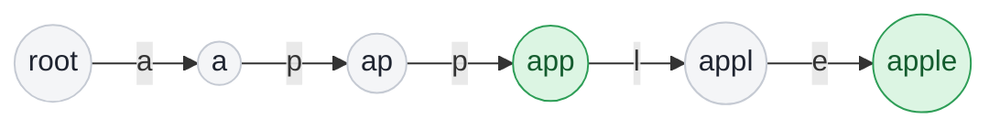

## Problem

A [**trie**](https://en.wikipedia.org/wiki/Trie) (pronounced as "try") or **prefix tree** is a tree data structure used to efficiently store and retrieve keys in a dataset of strings. There are various applications of this data structure, such as autocomplete and spellchecker.

Implement the Trie class:

- `Trie()` Initializes the trie object.
- `void insert(String word)` Inserts the string `word` into the trie.
- `boolean search(String word)` Returns `true` if the string `word` is in the trie (i.e., was inserted before), and `false` otherwise.
- `boolean startsWith(String prefix)` Returns `true` if there is a previously inserted string `word` that has the prefix `prefix`, and `false` otherwise.

**Example 1:**

```text
Input:
["Trie", "insert", "search", "search", "startsWith", "insert", "search"]
[[], ["apple"], ["apple"], ["app"], ["app"], ["app"], ["app"]]
Output:
[null, null, true, false, true, null, true]

Explanation:
Trie trie = new Trie();
trie.insert("apple");
trie.search("apple");   // return True
trie.search("app");     // return False
trie.startsWith("app"); // return True
trie.insert("app");
trie.search("app");     // return True
```

**Constraints:**

- $1 \le$ `word.length`, `prefix.length` $\le 2000$
- `word` and `prefix` consist only of lowercase English letters.
- At most $3 \times 10^4$ calls **in total** will be made to `insert`, `search`, and `startsWith`.

## Solution approach

### Intuition

A trie stores each word as a **path** from the root, one edge per character. Words that start the same way share the beginning of their path, so the prefix `"app"` is stored once for `"app"`, `"apple"` and `"apply"`.

Every node therefore represents one prefix — the characters on the path from the root to it. Two questions follow naturally:

- **Is some inserted word prefixed by `p`?** Exactly when the path for `p` exists.
- **Was `w` itself inserted?** The path must exist **and** some insertion must have ended there. A path can exist only because a longer word passes through it (after inserting `"apple"`, the path `"app"` exists, but `"app"` was never inserted), so each node carries a flag `isEnd`.

Because the alphabet is `'a'..'z'`, each node holds a fixed array `next[26]`; following a character is a single array lookup.

### Algorithm

1. `insert(word)`: start at `root`; for each character, create the child `next[ch - 'a']` if it is missing, then move to it. Set `isEnd = true` on the last node.
2. `walk(s)` follows `s` from the root and returns the node it ends at, or `nullptr` as soon as a child is missing.
3. `search(word)`: `walk(word)` must return a node whose `isEnd` is `true`.
4. `startsWith(prefix)`: `walk(prefix)` must return any node.
5. Each node's destructor deletes its children, so destroying the `Trie` frees every node.

### Walkthrough

The trie after the example's two insertions, `"apple"` then `"app"`. Green nodes have `isEnd = true`:



Before `insert("app")`, the `app` node already existed (it lies on the path of `"apple"`) but was not marked, so `search("app")` returned `false` while `startsWith("app")` returned `true`. Inserting `"app"` creates no nodes; it only sets the flag.

### Complexity

- **Time:** $O(L)$ per operation, where $L$ is the length of the word or prefix — one array lookup (and at most one allocation) per character.
- **Space:** $O(T \cdot \Sigma)$, where $T$ is the total number of inserted characters and $\Sigma = 26$ — at most one node per inserted character, each holding 26 child pointers.

### Edge cases

- **A word that is only a prefix of another word** (`"app"` vs `"apple"`): handled by the `isEnd` flag, as shown above.
- **Inserting the same word twice:** the second insertion walks the existing path and sets a flag that is already `true`.
- **Searching a word longer than anything inserted:** `walk` hits a missing child and returns `nullptr`.

## Code

```cpp title="C++"
class Trie {
    struct Node {
        Node* next[26] = {};
        bool isEnd = false;
        ~Node() {
            for (Node* child : next) delete child;
        }
    };

    Node root;

    // Follows s from the root; returns the node it ends at, or nullptr if the path breaks.
    const Node* walk(const string& s) const {
        const Node* cur = &root;
        for (char ch : s) {
            cur = cur->next[ch - 'a'];
            if (!cur) return nullptr;
        }
        return cur;
    }

  public:
    Trie() {}

    void insert(string word) {
        Node* cur = &root;
        for (char ch : word) {
            Node*& child = cur->next[ch - 'a'];
            if (!child) child = new Node();
            cur = child;
        }
        cur->isEnd = true;
    }

    bool search(string word) {
        const Node* node = walk(word);
        return node && node->isEnd;
    }

    bool startsWith(string prefix) { return walk(prefix) != nullptr; }
};
```
