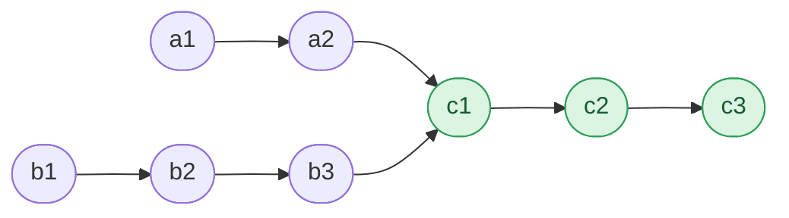

## Problem

Given the heads of two singly linked-lists `headA` and `headB`, return _the node at which the two lists intersect_. If the two linked lists have no intersection at all, return `null`.

For example, the following two linked lists begin to intersect at node `c1`:


The test cases are generated such that there are no cycles anywhere in the entire linked structure.

**Note** that the linked lists must **retain their original structure** after the function returns.

**Custom Judge:**

The inputs to the **judge** are given as follows (your program is **not** given these inputs):

- `intersectVal` - The value of the node where the intersection occurs. This is `0` if there is no intersected node.
- `listA` - The first linked list.
- `listB` - The second linked list.
- `skipA` - The number of nodes to skip ahead in `listA` (starting from the head) to get to the intersected node.
- `skipB` - The number of nodes to skip ahead in `listB` (starting from the head) to get to the intersected node.

The judge will then create the linked structure based on these inputs and pass the two heads, `headA` and `headB` to your program. If you correctly return the intersected node, then your solution will be **accepted**.

**Example 1:**

![Lists [4,1,8,4,5] and [5,6,1,8,4,5] sharing the tail 8,4,5](https://assets.leetcode.com/uploads/2021/03/05/160_example_1_1.png)

```text
Input:  intersectVal = 8, listA = [4,1,8,4,5], listB = [5,6,1,8,4,5], skipA = 2, skipB = 3
Output: Intersected at '8'
Explanation: The intersected node's value is 8 (note that this must not be 0 if the two lists intersect).
From the head of A, it reads as [4,1,8,4,5]. From the head of B, it reads as [5,6,1,8,4,5]. There are 2 nodes before the intersected node in A; There are 3 nodes before the intersected node in B.
- Note that the intersected node's value is not 1 because the nodes with value 1 in A and B (2nd node in A and 3rd node in B) are different node references. In other words, they point to two different locations in memory, while the nodes with value 8 in A and B (3rd node in A and 4th node in B) point to the same location in memory.
```

**Example 2:**

![Lists [1,9,1,2,4] and [3,2,4] sharing the tail 2,4](https://assets.leetcode.com/uploads/2021/03/05/160_example_2.png)

```text
Input:  intersectVal = 2, listA = [1,9,1,2,4], listB = [3,2,4], skipA = 3, skipB = 1
Output: Intersected at '2'
Explanation: The intersected node's value is 2 (note that this must not be 0 if the two lists intersect).
From the head of A, it reads as [1,9,1,2,4]. From the head of B, it reads as [3,2,4]. There are 3 nodes before the intersected node in A; There are 1 node before the intersected node in B.
```

**Example 3:**

![Lists [2,6,4] and [1,5] that do not intersect](https://assets.leetcode.com/uploads/2021/03/05/160_example_3.png)

```text
Input:  intersectVal = 0, listA = [2,6,4], listB = [1,5], skipA = 3, skipB = 2
Output: No intersection
Explanation: From the head of A, it reads as [2,6,4]. From the head of B, it reads as [1,5]. Since the two lists do not intersect, intersectVal must be 0, while skipA and skipB can be arbitrary values.
The two lists do not intersect, so return null.
```

**Constraints:**

- The number of nodes of `listA` is in the `m`.
- The number of nodes of `listB` is in the `n`.
- $1 \le m, n \le 3 \times 10^4$
- $1 \le$ `Node.val` $\le 10^5$
- $0 \le$ `skipA` $\le m$
- $0 \le$ `skipB` $\le n$
- `intersectVal` is `0` if `listA` and `listB` do not intersect.
- `intersectVal == listA[skipA] == listB[skipB]` if `listA` and `listB` intersect.

**Follow-up:** Could you write a solution that runs in $O(m + n)$ time and use only $O(1)$ memory?

## Solution approach

### Intuition

Two lists intersect when they share a **node** (the same address), not merely an equal value. After the first shared node, the lists are identical to the end, so they share a common tail of length `c`.

Write list A as `a` private nodes followed by the tail, and list B as `b` private nodes followed by the same tail. If we walked both lists in lock-step from their heads, the pointers would reach the tail at different times whenever `a != b`. The trick is to make both pointers travel the **same distance**:

- pointer `p` walks A, then jumps to the head of B;
- pointer `q` walks B, then jumps to the head of A.

After `a + c + 1 + b` moves (the `+ 1` is the move onto `nullptr` at the end of a list), `p` has covered all of A and the private part of B; after `b + c + 1 + a` moves, `q` has covered all of B and the private part of A. These counts are equal, so both arrive at the first shared node **at the same moment**. If there is no shared tail (`c = 0`), both reach `nullptr` together after `m + n + 1` moves, and the loop stops there.



Here `p` visits `a1 a2 c1 c2 c3 null b1 b2 b3 c1` and `q` visits `b1 b2 b3 c1 c2 c3 null a1 a2 c1`. On the first pass they reach `c1` at different times, but after the switch both land on `c1` after exactly 9 moves, and the loop stops there.

### Algorithm

1. Set `p = headA` and `q = headB`.
2. While `p != q`:
   - advance `p` to `p->next`, or to `headB` if `p` is `nullptr`;
   - advance `q` to `q->next`, or to `headA` if `q` is `nullptr`.
3. Return `p` (the shared node, or `nullptr` if the lists never meet).

Each pointer switches lists at most once, so the loop takes at most `m + n + 1` iterations; the lists are only read, so their structure is retained.

### Complexity

- **Time:** $O(m + n)$ — each pointer visits every node of both lists at most once.
- **Space:** $O(1)$ — two pointers.

### Edge cases

- **No intersection:** both pointers become `nullptr` at the same step (after `m + n + 1` moves), `p == q` ends the loop and `nullptr` is returned.
- **Lists of equal private length:** the pointers meet on the first pass, before either switches lists.
- **One list is a suffix of the other** (for example `skipB = 0`): the head of the shorter list is itself the intersection, and the pointers still meet there after the switch.

## Code

```cpp title="C++"
class Solution {
   public:
    ListNode *getIntersectionNode(ListNode *headA, ListNode *headB) {
        ListNode *p = headA, *q = headB;
        while (p != q) {
            p = p ? p->next : headB;
            q = q ? q->next : headA;
        }
        return p;
    }
};
```
