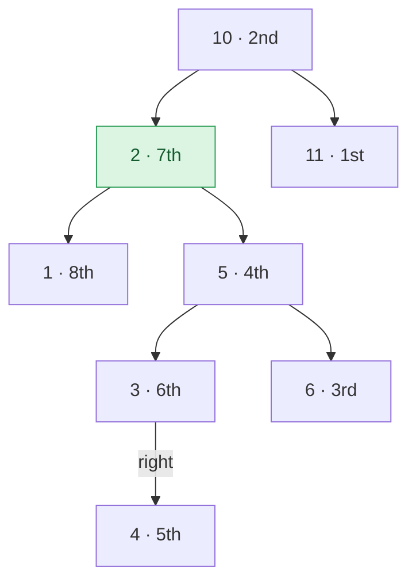

## Problem

Given the **root** of a Binary Search Tree (BST) and an integer **k**, find the k-th largest element in the BST without modifying its structure.

Complete the function `kthLargest()` which takes the `root` of the BST and the integer `k` and returns the k-th largest key.

**Example 1:**


```text
Input:  root = [4, 2, 9], k = 2
Output: 4
Explanation: The second largest element is 4.
```

**Example 2:**


```text
Input:  root = [10, 2, 11, 1, 5, N, N, N, N, 3, 6, N, 4], k = 7
Output: 2
Explanation: The 7th largest element is 2.
```

**Example 3:**


```text
Input:  root = [4, 2, 9], k = 3
Output: 2
Explanation: The 3rd largest element is 2.
```

**Constraints:**

- $1 \le$ size of binary tree $\le 10^5$
- $0 \le$ `Node.data` $\le 10^5$
- $1 \le k \le$ `root.size()`

## Solution approach

### Intuition

An in-order traversal of a BST (left, node, right) visits keys in increasing order. Mirroring it — **right, node, left** — visits them in **decreasing** order, so the k-th node visited holds the k-th largest key.

There is no need to collect every key: we can stop as soon as the k-th node is visited. Before the first visit the traversal walks down the right spine (up to `h` nodes), and after that every step visits one more node, so it does $O(h + k)$ work instead of $O(n)$.

The tree can have $10^5$ nodes and may be a single chain, so a recursive traversal could be $10^5$ calls deep. An explicit stack does the same thing without risking a stack overflow.



Example 2 annotated with the order of visits: `11, 10, 6, 5, 4, 3, 2, ...` — the 7th visit is `2`, and the traversal stops there without visiting `1`.

### Algorithm

1. Start with an empty stack `st` and `cur = root`.
2. Loop:
   - push `cur` and move to `cur->right` until `cur` is `nullptr` (walk to the largest unvisited key);
   - pop the top node `cur`; this is the next key in decreasing order. Decrement `k`; if it reaches `0`, return `cur->data`;
   - move to `cur->left`, whose keys are the next smaller ones.

### Complexity

- **Time:** $O(h + k)$ — each pushed node is popped at most once, and we stop after `k` pops; at most `h` extra nodes are pushed along spines.
- **Space:** $O(h)$ — the stack holds one root-to-node path.

### Edge cases

- **`k = 1`:** the first pop is the rightmost node, the maximum.
- **`k` equals the tree size:** the traversal runs to the leftmost node, the minimum.
- **Skewed tree** of $10^5$ nodes: handled iteratively, so there is no deep recursion.

## Code

```cpp
class Solution {
   public:
    int kthLargest(Node* root, int k) {
        stack<Node*> st;
        Node* cur = root;
        while (true) {
            while (cur) {
                st.push(cur);
                cur = cur->right;
            }
            cur = st.top();
            st.pop();
            if (--k == 0) return cur->data;
            cur = cur->left;
        }
    }
};
```

```java
class Solution {
    public int kthLargest(Node root, int k) {
        ArrayDeque<Node> st = new ArrayDeque<>();
        Node cur = root;
        while (true) {
            while (cur != null) {
                st.push(cur);
                cur = cur.right;
            }
            cur = st.pop();
            if (--k == 0) return cur.data;
            cur = cur.left;
        }
    }
}
```

```python
class Solution:
    def kthLargest(self, root, k):
        st = []
        cur = root
        while True:
            while cur:
                st.append(cur)
                cur = cur.right
            cur = st.pop()
            k -= 1
            if k == 0:
                return cur.data
            cur = cur.left
```
