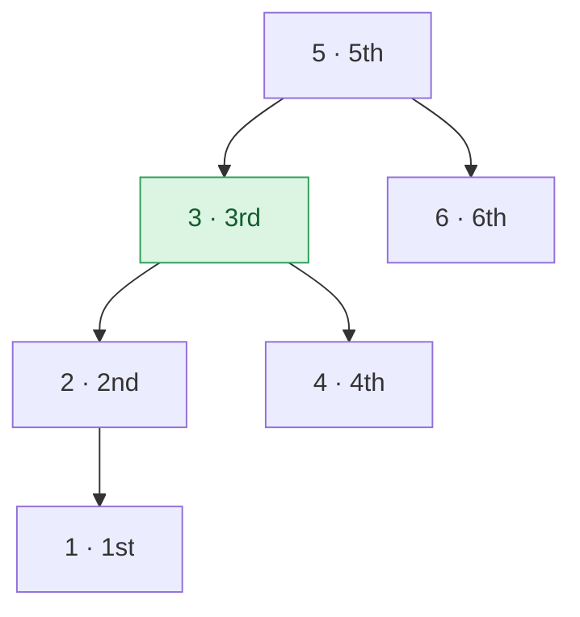

## Problem

Given the `root` of a binary search tree, and an integer `k`, return _the_ `kth` _smallest value (**1-indexed**) of all the values of the nodes in the tree_.

**Example 1:**


```text
Input:  root = [3,1,4,null,2], k = 1
Output: 1
```

**Example 2:**


```text
Input:  root = [5,3,6,2,4,null,null,1], k = 3
Output: 3
```

**Constraints:**

- The number of nodes in the tree is `n`.
- $1 \le k \le n \le 10^4$
- $0 \le$ `Node.val` $\le 10^4$

**Follow-up:** If the BST is modified often (i.e., we can do insert and delete operations) and you need to find the kth smallest frequently, how would you optimize?

## Solution approach

### Intuition

An in-order traversal of a BST (left, node, right) visits the keys in increasing order, so the k-th node it visits holds the k-th smallest value.

We do not need the whole sorted list — only the k-th visit. An **iterative** in-order traversal with an explicit stack can stop the moment it gets there. Before the first visit it walks down the left spine (up to `h` nodes); after that each step produces one more visit, so the work is $O(h + k)$ rather than $O(n)$. The explicit stack also avoids deep recursion on a skewed tree.



Example 2 with each node's in-order position: with `k = 3`, the traversal pops `1`, `2`, `3` and returns `3` without touching `4`, `5`, `6`.

### Algorithm

1. Start with an empty stack `st` and `cur = root`.
2. Loop:
   - push `cur` and move to `cur->left` until `cur` is `nullptr` (walk to the smallest unvisited value);
   - pop the top node `cur`, the next value in increasing order. Decrement `k`; if it reaches `0`, return `cur->val`;
   - move to `cur->right`, whose values come next.

### Follow-up: frequent updates and queries

If the tree changes often and we query often, store in every node the size of its subtree, `size(node) = 1 + size(left) + size(right)`, and keep it up to date during insert and delete (only the nodes on the modified path change). Then the k-th smallest is found by a single descent:

- let `L = size(node->left)`;
- if `k <= L`, go left; if `k == L + 1`, the answer is `node`; otherwise set `k -= L + 1` and go right.

Each query, insert and delete then costs $O(h)$, which is $O(\log n)$ in a balanced BST (for example a red-black or AVL tree augmented with sizes — an *order-statistic tree*).

### Complexity

- **Time:** $O(h + k)$ — at most `h` extra nodes are pushed along the first left spine, then each pop is one visit and we stop after `k`.
- **Space:** $O(h)$ — the stack holds one root-to-node path.

### Edge cases

- **`k = 1`:** the first pop is the leftmost node, the minimum (Example 1).
- **`k = n`:** the traversal runs to the rightmost node, the maximum.
- **Skewed tree:** the stack grows to `n` entries but there is no recursion, so no risk of stack overflow.

## Code

```cpp
class Solution {
   public:
    int kthSmallest(TreeNode* root, int k) {
        stack<TreeNode*> st;
        TreeNode* cur = root;
        while (true) {
            while (cur) {
                st.push(cur);
                cur = cur->left;
            }
            cur = st.top();
            st.pop();
            if (--k == 0) return cur->val;
            cur = cur->right;
        }
    }
};
```

```java
class Solution {
    public int kthSmallest(TreeNode root, int k) {
        ArrayDeque<TreeNode> st = new ArrayDeque<>();
        TreeNode cur = root;
        while (true) {
            while (cur != null) {
                st.push(cur);
                cur = cur.left;
            }
            cur = st.pop();
            if (--k == 0) return cur.val;
            cur = cur.right;
        }
    }
}
```

```python
class Solution:
    def kthSmallest(self, root: TreeNode | None, k: int) -> int:
        st = []
        cur = root
        while True:
            while cur:
                st.append(cur)
                cur = cur.left
            cur = st.pop()
            k -= 1
            if k == 0:
                return cur.val
            cur = cur.right
```
