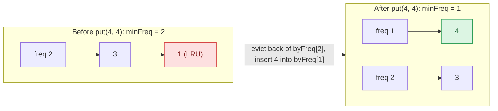

## Problem

Design and implement a data structure for a [Least Frequently Used (LFU)](https://en.wikipedia.org/wiki/Least_frequently_used) cache.

Implement the `LFUCache` class:

- `LFUCache(int capacity)` Initializes the object with the `capacity` of the data structure.
- `int get(int key)` Gets the value of the `key` if the `key` exists in the cache. Otherwise, returns `-1`.
- `void put(int key, int value)` Update the value of the `key` if present, or inserts the `key` if not already present. When the cache reaches its `capacity`, it should invalidate and remove the **least frequently used** key before inserting a new item. For this problem, when there is a **tie** (i.e., two or more keys with the same frequency), the **least recently used** `key` would be invalidated.

To determine the least frequently used key, a **use counter** is maintained for each key in the cache. The key with the smallest **use counter** is the least frequently used key.

When a key is first inserted into the cache, its **use counter** is set to `1` (due to the `put` operation). The **use counter** for a key in the cache is incremented either a `get` or `put` operation is called on it.

The functions `get` and `put` must each run in $O(1)$ average time complexity.

**Example 1:**

```text
Input
["LFUCache", "put", "put", "get", "put", "get", "get", "put", "get", "get", "get"]
[[2], [1, 1], [2, 2], [1], [3, 3], [2], [3], [4, 4], [1], [3], [4]]
Output
[null, null, null, 1, null, -1, 3, null, -1, 3, 4]

Explanation
// cnt(x) = the use counter for key x
// cache=[] will show the last used order for tiebreakers (leftmost element is  most recent)
LFUCache lfu = new LFUCache(2);
lfu.put(1, 1);   // cache=[1,_], cnt(1)=1
lfu.put(2, 2);   // cache=[2,1], cnt(2)=1, cnt(1)=1
lfu.get(1);      // return 1
                 // cache=[1,2], cnt(2)=1, cnt(1)=2
lfu.put(3, 3);   // 2 is the LFU key because cnt(2)=1 is the smallest, invalidate 2.
                 // cache=[3,1], cnt(3)=1, cnt(1)=2
lfu.get(2);      // return -1 (not found)
lfu.get(3);      // return 3
                 // cache=[3,1], cnt(3)=2, cnt(1)=2
lfu.put(4, 4);   // Both 1 and 3 have the same cnt, but 1 is LRU, invalidate 1.
                 // cache=[4,3], cnt(4)=1, cnt(3)=2
lfu.get(1);      // return -1 (not found)
lfu.get(3);      // return 3
                 // cache=[3,4], cnt(4)=1, cnt(3)=3
lfu.get(4);      // return 4
                 // cache=[4,3], cnt(4)=2, cnt(3)=3
```

**Constraints:**

- $1 \le$ `capacity` $\le 10^4$
- $0 \le$ `key` $\le 10^5$
- $0 \le$ `value` $\le 10^9$
- At most $2 \times 10^5$ calls will be made to `get` and `put`.

## Solution approach

### Intuition

On eviction we need "the least recently used key among those with the smallest use counter". A heap or an ordered map keyed by `(freq, time)` finds it in $O(\log n)$, but the problem demands $O(1)$. Three observations get us there:

1. **Bucket keys by frequency.** For every frequency `f` keep a list of the keys that currently have counter `f`, ordered by recency (most recent at the front). Within one bucket the LRU key is simply the **back** of the list.
2. **Counters only move by one.** A `get` or `put` on an existing key moves it from bucket `f` to the **front** of bucket `f + 1`. With a key-to-node map, that is an $O(1)$ unlink plus an $O(1)$ insert (`list::splice` does both without reallocating).
3. **The minimum frequency is easy to maintain.** Keep `minFreq`. It only changes in two ways:
   - a new key is inserted with counter `1`, so `minFreq = 1`;
   - a key is promoted out of bucket `minFreq` and leaves it empty, so `minFreq` becomes `minFreq + 1` (the promoted key is now there).

   Eviction never needs to search for a new minimum, because it is always immediately followed by an insert that sets `minFreq = 1`.

So the victim is always `byFreq[minFreq].back()`, found in $O(1)$.



### Algorithm

State: `capacity`, `minFreq`, `byFreq` (frequency → `list<Entry>`, most recent first) and `where` (key → iterator to its `Entry`, which stores `key`, `value`, `freq`).

- `touch(it)` — promote an entry: splice it out of `byFreq[f]` and onto the front of `byFreq[f + 1]` and set `freq = f + 1`. If `byFreq[f]` became empty, erase it, and if `f == minFreq`, increment `minFreq`.
- `get(key)`: if `key` is not in `where`, return `-1`. Otherwise `touch` its entry and return its `value`.
- `put(key, value)`:
  1. If `key` exists, overwrite its `value` and `touch` it.
  2. Otherwise, if the cache is full (`where.size() == capacity`), evict `byFreq[minFreq].back()`: erase its key from `where`, pop it, and erase the bucket if it became empty.
  3. Insert `{key, value, 1}` at the front of `byFreq[1]`, record it in `where`, and set `minFreq = 1`.

### Complexity

- **Time:** $O(1)$ average per `get` and `put` — a constant number of hash-map lookups and list splices/pushes/pops.
- **Space:** $O(\text{capacity})$ — one entry per cached key, and at most one non-empty bucket per distinct frequency among them.

### Edge cases

- **Tie on frequency** (the `put(4, 4)` step above): bucket `2` holds `[3, 1]`; `1` was used less recently, so it is at the back and is evicted.
- **`put` on an existing key** counts as a use: the value is overwritten **and** the key is promoted, and no eviction happens.
- **Capacity `1`:** every insert of a new key evicts the only key; `minFreq` is then reset to `1` by the insert.

## Code

```cpp
class LFUCache {
    struct Entry {
        int key, value, freq;
    };

    int capacity, minFreq = 0;
    unordered_map<int, list<Entry>> byFreq;           // freq -> entries, most recent first
    unordered_map<int, list<Entry>::iterator> where;  // key -> its entry

    // Count one more use: move the entry to the front of the next bucket.
    void touch(list<Entry>::iterator it) {
        int f = it->freq;
        list<Entry>& from = byFreq[f];
        list<Entry>& to = byFreq[f + 1];
        to.splice(to.begin(), from, it);
        it->freq = f + 1;
        if (from.empty()) {
            byFreq.erase(f);
            if (minFreq == f) minFreq = f + 1;
        }
    }

   public:
    LFUCache(int capacity) : capacity(capacity) {}

    int get(int key) {
        auto found = where.find(key);
        if (found == where.end()) return -1;
        touch(found->second);
        return found->second->value;
    }

    void put(int key, int value) {
        auto found = where.find(key);
        if (found != where.end()) {
            found->second->value = value;
            touch(found->second);
            return;
        }
        if ((int)where.size() == capacity) {
            list<Entry>& bucket = byFreq[minFreq];
            where.erase(bucket.back().key);
            bucket.pop_back();
            if (bucket.empty()) byFreq.erase(minFreq);
        }
        list<Entry>& ones = byFreq[1];
        ones.push_front({key, value, 1});
        where[key] = ones.begin();
        minFreq = 1;
    }
};
```

```java
class LFUCache {
    private final int capacity;
    private int minFreq = 0;
    private final HashMap<Integer, Integer> values = new HashMap<>();  // key -> value
    private final HashMap<Integer, Integer> freqOf = new HashMap<>();  // key -> use count
    // freq -> keys, least recent first (LinkedHashSet keeps insertion order)
    private final HashMap<Integer, LinkedHashSet<Integer>> byFreq = new HashMap<>();

    public LFUCache(int capacity) {
        this.capacity = capacity;
    }

    // Count one more use: move the key to the most-recent end of the next bucket.
    private void touch(int key) {
        int f = freqOf.get(key);
        LinkedHashSet<Integer> from = byFreq.get(f);
        from.remove(key);
        if (from.isEmpty()) {
            byFreq.remove(f);
            if (minFreq == f) minFreq = f + 1;
        }
        byFreq.computeIfAbsent(f + 1, x -> new LinkedHashSet<>()).add(key);
        freqOf.put(key, f + 1);
    }

    public int get(int key) {
        Integer value = values.get(key);
        if (value == null) return -1;
        touch(key);
        return value;
    }

    public void put(int key, int value) {
        if (values.containsKey(key)) {
            values.put(key, value);
            touch(key);
            return;
        }
        if (values.size() == capacity) {
            LinkedHashSet<Integer> bucket = byFreq.get(minFreq);
            int victim = bucket.iterator().next();
            bucket.remove(victim);
            if (bucket.isEmpty()) byFreq.remove(minFreq);
            values.remove(victim);
            freqOf.remove(victim);
        }
        values.put(key, value);
        freqOf.put(key, 1);
        byFreq.computeIfAbsent(1, x -> new LinkedHashSet<>()).add(key);
        minFreq = 1;
    }
}
```

```python
from collections import OrderedDict, defaultdict


class LFUCache:

    def __init__(self, capacity: int):
        self.capacity = capacity
        self.min_freq = 0
        self.values = {}  # key -> value
        self.freq = {}    # key -> use count
        # freq -> keys, least recent first
        self.by_freq = defaultdict(OrderedDict)

    def _touch(self, key: int) -> None:
        # Count one more use: move the key to the most-recent end of the next bucket.
        f = self.freq[key]
        bucket = self.by_freq[f]
        del bucket[key]
        if not bucket:
            del self.by_freq[f]
            if self.min_freq == f:
                self.min_freq = f + 1
        self.by_freq[f + 1][key] = None
        self.freq[key] = f + 1

    def get(self, key: int) -> int:
        if key not in self.values:
            return -1
        self._touch(key)
        return self.values[key]

    def put(self, key: int, value: int) -> None:
        if key in self.values:
            self.values[key] = value
            self._touch(key)
            return
        if len(self.values) == self.capacity:
            bucket = self.by_freq[self.min_freq]
            victim, _ = bucket.popitem(last=False)
            if not bucket:
                del self.by_freq[self.min_freq]
            del self.values[victim]
            del self.freq[victim]
        self.values[key] = value
        self.freq[key] = 1
        self.by_freq[1][key] = None
        self.min_freq = 1
```
