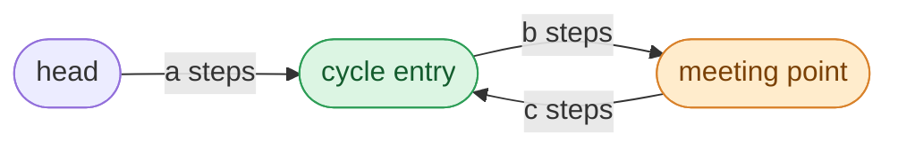

## Problem

Given the `head` of a linked list, return _the node where the cycle begins. If there is no cycle, return_ `null`.

There is a cycle in a linked list if there is some node in the list that can be reached again by continuously following the `next` pointer. Internally, `pos` is used to denote the index of the node that tail's `next` pointer is connected to (**0-indexed**). It is `-1` if there is no cycle. **Note that** `pos` **is not passed as a parameter**.

**Do not modify** the linked list.

**Example 1:**


```text
Input:  head = [3,2,0,-4], pos = 1
Output: tail connects to node index 1
Explanation: There is a cycle in the linked list, where tail connects to the second node.
```

**Example 2:**


```text
Input:  head = [1,2], pos = 0
Output: tail connects to node index 0
Explanation: There is a cycle in the linked list, where tail connects to the first node.
```

**Example 3:**


```text
Input:  head = [1], pos = -1
Output: no cycle
Explanation: There is no cycle in the linked list.
```

**Constraints:**

- The number of the nodes in the list is in the range $[0, 10^4]$.
- $-10^5 \le$ `Node.val` $\le 10^5$
- `pos` is `-1` or a **valid index** in the linked-list.

**Follow-up:** Can you solve it using $O(1)$ (i.e. constant) memory?

## Solution approach

### Intuition

A hash set of visited nodes finds the entry (the first node seen twice) in $O(n)$ time but $O(n)$ memory. Floyd's **tortoise and hare** needs only two pointers and works in two phases.

**Phase 1 — detect.** Move `slow` one step and `fast` two steps at a time. Without a cycle, `fast` falls off the end. With a cycle, once both are inside it, `fast` gains one node per step on `slow`, so it must land on `slow` within one lap.

**Phase 2 — locate the entry.** Name the distances:



The cycle has length `L = b + c`. When they meet, `slow` has walked `a + b` steps and `fast` has walked twice that, `2(a + b)`. The extra `a + b` steps that `fast` made are whole laps of the cycle, so `a + b = kL` for some `k >= 1`, which rearranges to

$$a = kL - b = (k - 1)L + c.$$

Read it as a statement about walking: **`a` steps from `head` reach the entry, and `a` steps from the meeting point also reach the entry** (`c` steps get there, and the extra `(k - 1)` laps return to the same node). So reset one pointer to `head`, keep the other at the meeting point, and move both one step at a time — they meet exactly at the cycle entry.

### Algorithm

1. Set `slow = fast = head`.
2. While `fast` and `fast->next` are not `nullptr`:
   - `slow = slow->next`, `fast = fast->next->next`;
   - if `slow == fast`, a cycle exists:
     - set `slow = head`;
     - while `slow != fast`, advance both by one step;
     - return `slow` (the entry).
3. The loop ended because `fast` reached the end: return `nullptr`.

### Complexity

- **Time:** $O(n)$ — phase 1 takes at most `a + L` steps before the pointers meet, phase 2 takes `a` steps.
- **Space:** $O(1)$ — two pointers; the list is never modified.

### Edge cases

- **Empty list or single node without a cycle** (Example 3): `fast->next` is `nullptr`, the loop never runs, and `nullptr` is returned.
- **Cycle through the head** (Example 2, `a = 0`): then `b = kL`, so the pointers meet at `head` itself; after the reset `slow == fast` already, phase 2 takes no steps and `head` is returned.
- **Self-loop:** `fast->next->next` is the same node; the pointers meet there and phase 2 returns it.

## Code

```cpp title="C++"
class Solution {
   public:
    ListNode *detectCycle(ListNode *head) {
        ListNode *slow = head, *fast = head;
        while (fast && fast->next) {
            slow = slow->next;
            fast = fast->next->next;
            if (slow == fast) {
                slow = head;
                while (slow != fast) {
                    slow = slow->next;
                    fast = fast->next;
                }
                return slow;
            }
        }
        return nullptr;
    }
};
```
