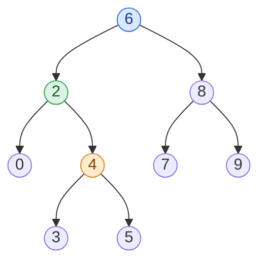

## Problem

Given a binary search tree (BST), find the lowest common ancestor (LCA) node of two given nodes in the BST.

According to the [definition of LCA on Wikipedia](https://en.wikipedia.org/wiki/Lowest_common_ancestor): "The lowest common ancestor is defined between two nodes `p` and `q` as the lowest node in `T` that has both `p` and `q` as descendants (where we allow **a node to be a descendant of itself**)."

**Example 1:**

![BST [6,2,8,0,4,7,9,null,null,3,5]](https://assets.leetcode.com/uploads/2018/12/14/binarysearchtree_improved.png)

```text
Input:  root = [6,2,8,0,4,7,9,null,null,3,5], p = 2, q = 8
Output: 6
Explanation: The LCA of nodes 2 and 8 is 6.
```

**Example 2:**

![BST [6,2,8,0,4,7,9,null,null,3,5]](https://assets.leetcode.com/uploads/2018/12/14/binarysearchtree_improved.png)

```text
Input:  root = [6,2,8,0,4,7,9,null,null,3,5], p = 2, q = 4
Output: 2
Explanation: The LCA of nodes 2 and 4 is 2, since a node can be a descendant of itself according to the LCA definition.
```

**Example 3:**

```text
Input:  root = [2,1], p = 2, q = 1
Output: 2
```

**Constraints:**

- The number of nodes in the tree is in the range $[2, 10^5]$.
- $-10^9 \le$ `Node.val` $\le 10^9$
- All `Node.val` are **unique**.
- `p != q`
- `p` and `q` will exist in the BST.

## Solution approach

### Intuition

The general binary-tree LCA algorithm visits every node, $O(n)$. A BST tells us where `p` and `q` are without searching: at any node `cur`, a value smaller than `cur->val` lies in the left subtree and a larger one in the right subtree.

Walk down from the root:

- If both `p` and `q` are smaller than `cur`, both are in the left subtree, so their LCA is there too — go left.
- If both are larger, go right.
- Otherwise they **split** at `cur` (one on each side), or one of them **is** `cur`. Either way `cur` is an ancestor of both, and no lower node is: any child of `cur` loses one of them. So `cur` is the LCA.

This is just the search path to `p` and `q`, followed while it is shared.

### Algorithm

1. Set `cur = root`.
2. Loop:
   - if `p->val < cur->val` and `q->val < cur->val`, set `cur = cur->left`;
   - else if `p->val > cur->val` and `q->val > cur->val`, set `cur = cur->right`;
   - else return `cur`.

### Walkthrough

Example 2 (`p = 2`, `q = 4`): at `6` both values are smaller, so go left; at `2`, `p` equals the node, so the paths split here and `2` is returned.



Blue: visited and both values on one side; green: the split point (the answer); orange: the other target.

### Complexity

- **Time:** $O(h)$ — one step down per iteration, where `h` is the tree height ($O(\log n)$ if balanced, $O(n)$ for a skewed tree).
- **Space:** $O(1)$ — the loop keeps a single pointer, no recursion stack.

### Edge cases

- **One node is the ancestor of the other** (Examples 2 and 3): neither "both smaller" nor "both larger" holds at that node, so it is returned.
- **The loop always terminates:** `p` and `q` exist in the tree, so the walk reaches the split point before running off a leaf.
- **Large values:** only comparisons are used, so values near $\pm 10^9$ cannot overflow.

## Code

```cpp
class Solution {
   public:
    TreeNode* lowestCommonAncestor(TreeNode* root, TreeNode* p, TreeNode* q) {
        TreeNode* cur = root;
        while (true) {
            if (p->val < cur->val && q->val < cur->val)
                cur = cur->left;
            else if (p->val > cur->val && q->val > cur->val)
                cur = cur->right;
            else
                return cur;  // p and q split here (or one of them is cur)
        }
    }
};
```

```java
class Solution {
    public TreeNode lowestCommonAncestor(TreeNode root, TreeNode p, TreeNode q) {
        TreeNode cur = root;
        while (true) {
            if (p.val < cur.val && q.val < cur.val)
                cur = cur.left;
            else if (p.val > cur.val && q.val > cur.val)
                cur = cur.right;
            else
                return cur;  // p and q split here (or one of them is cur)
        }
    }
}
```

```python
class Solution:
    def lowestCommonAncestor(self, root: 'TreeNode', p: 'TreeNode', q: 'TreeNode') -> 'TreeNode':
        cur = root
        while True:
            if p.val < cur.val and q.val < cur.val:
                cur = cur.left
            elif p.val > cur.val and q.val > cur.val:
                cur = cur.right
            else:
                return cur  # p and q split here (or one of them is cur)
```
