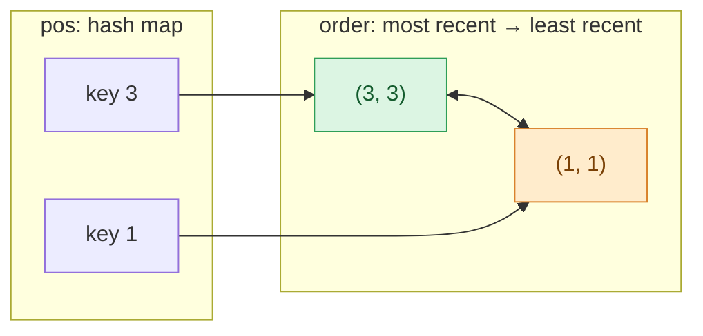

## Problem

Design a data structure that follows the constraints of a **[Least Recently Used (LRU) cache](https://en.wikipedia.org/wiki/Cache_replacement_policies#LRU)**.

Implement the `LRUCache` class:

- `LRUCache(int capacity)` Initialize the LRU cache with **positive** size `capacity`.
- `int get(int key)` Return the value of the `key` if the key exists, otherwise return `-1`.
- `void put(int key, int value)` Update the value of the `key` if the `key` exists. Otherwise, add the `key-value` pair to the cache. If the number of keys exceeds the `capacity` from this operation, **evict** the least recently used key.

The functions `get` and `put` must each run in `O(1)` average time complexity.

**Example 1:**

```text
Input
["LRUCache", "put", "put", "get", "put", "get", "put", "get", "get", "get"]
[[2], [1, 1], [2, 2], [1], [3, 3], [2], [4, 4], [1], [3], [4]]
Output
[null, null, null, 1, null, -1, null, -1, 3, 4]

Explanation
LRUCache lRUCache = new LRUCache(2);
lRUCache.put(1, 1); // cache is {1=1}
lRUCache.put(2, 2); // cache is {1=1, 2=2}
lRUCache.get(1);    // return 1
lRUCache.put(3, 3); // LRU key was 2, evicts key 2, cache is {1=1, 3=3}
lRUCache.get(2);    // returns -1 (not found)
lRUCache.put(4, 4); // LRU key was 1, evicts key 1, cache is {4=4, 3=3}
lRUCache.get(1);    // return -1 (not found)
lRUCache.get(3);    // return 3
lRUCache.get(4);    // return 4
```

**Constraints:**

- $1 \le$ `capacity` $\le 3000$
- $0 \le$ `key` $\le 10^4$
- $0 \le$ `value` $\le 10^5$
- At most $2 \times 10^5$ calls will be made to `get` and `put`.

## Solution approach

### Intuition

We need two things in $O(1)$:

1. **Find a key** — a hash map does that.
2. **Know which key was used least recently, and mark a key as just used** — keep all entries in a list ordered by recency: most recent at the front, least recent at the back. Marking a key as used means moving its node to the front; evicting means removing the back.

A plain list cannot find a node in $O(1)$, and a hash map has no order, so combine them: the doubly linked list stores `(key, value)` pairs in recency order, and the hash map stores, for each key, an **iterator to its node**. With the iterator, a node can be unlinked and moved to the front in $O(1)$ (`std::list::splice` relinks the node without copying it, and keeps the iterator valid). The back node stores its key, so on eviction we know which map entry to erase.

### Algorithm

- `order`: a doubly linked list of `(key, value)` pairs, most recently used first. `pos`: a hash map from each key to its node in `order`.
- `get(key)`: if `key` is not in `pos`, return `-1`. Otherwise splice its node to the front of `order` and return its value.
- `put(key, value)`:
  1. If `key` exists, update the value in its node, splice the node to the front and return.
  2. If the cache is full (`order.size() == cap`), erase `order.back()`'s key from `pos` and pop the back node.
  3. Push `(key, value)` to the front and store `pos[key] = order.begin()`.

### Walkthrough

State of Example 1 right after `put(3, 3)`: the map points into the list, the front is the most recent key and the back (`1`) is the next one to be evicted. Key `2` was evicted from the back by this `put`.



The next call, `get(2)`, misses. Then `put(4, 4)` finds the cache full and evicts the back node `(1, 1)`.

### Complexity

- **Time:** $O(1)$ average per `get` and `put` — one or two hash-map operations plus constant-time list splicing, insertion and deletion.
- **Space:** $O(\text{capacity})$ — at most `capacity` list nodes and map entries.

### Edge cases

- **`put` on an existing key** updates the value and refreshes its recency without evicting anything, even when the cache is full.
- **Capacity 1:** every `put` of a new key evicts the only entry, which is also the back of the list.
- **`get` refreshes recency:** in Example 1, `get(1)` moves `1` to the front, which is why `put(3, 3)` evicts `2` and not `1`.

## Code

```cpp
class LRUCache {
    int cap;
    list<pair<int, int>> order;  // (key, value), most recently used at the front
    unordered_map<int, list<pair<int, int>>::iterator> pos;

   public:
    LRUCache(int capacity) : cap(capacity) {}

    int get(int key) {
        auto it = pos.find(key);
        if (it == pos.end()) return -1;
        order.splice(order.begin(), order, it->second);  // mark as most recent
        return it->second->second;
    }

    void put(int key, int value) {
        auto it = pos.find(key);
        if (it != pos.end()) {
            it->second->second = value;
            order.splice(order.begin(), order, it->second);
            return;
        }
        if ((int)order.size() == cap) {
            pos.erase(order.back().first);  // evict the least recently used key
            order.pop_back();
        }
        order.emplace_front(key, value);
        pos[key] = order.begin();
    }
};
```

```java
class LRUCache {
    private static class Node {
        int key, value;
        Node prev, next;

        Node(int key, int value) {
            this.key = key;
            this.value = value;
        }
    }

    private final int cap;
    private final Node head = new Node(0, 0);  // sentinels: head.next is the most recently used,
    private final Node tail = new Node(0, 0);  // tail.prev the least recently used
    private final Map<Integer, Node> pos = new HashMap<>();

    public LRUCache(int capacity) {
        cap = capacity;
        head.next = tail;
        tail.prev = head;
    }

    public int get(int key) {
        Node node = pos.get(key);
        if (node == null) return -1;
        moveToFront(node);  // mark as most recent
        return node.value;
    }

    public void put(int key, int value) {
        Node node = pos.get(key);
        if (node != null) {
            node.value = value;
            moveToFront(node);
            return;
        }
        if (pos.size() == cap) {
            Node lru = tail.prev;  // evict the least recently used key
            unlink(lru);
            pos.remove(lru.key);
        }
        node = new Node(key, value);
        linkFront(node);
        pos.put(key, node);
    }

    private void unlink(Node node) {
        node.prev.next = node.next;
        node.next.prev = node.prev;
    }

    private void linkFront(Node node) {
        node.prev = head;
        node.next = head.next;
        head.next.prev = node;
        head.next = node;
    }

    private void moveToFront(Node node) {
        unlink(node);
        linkFront(node);
    }
}
```

```python
from collections import OrderedDict


class LRUCache:

    def __init__(self, capacity: int):
        self.cap = capacity
        self.order = OrderedDict()  # key -> value, least recently used first

    def get(self, key: int) -> int:
        if key not in self.order:
            return -1
        self.order.move_to_end(key)  # mark as most recent
        return self.order[key]

    def put(self, key: int, value: int) -> None:
        if key in self.order:
            self.order[key] = value
            self.order.move_to_end(key)
            return
        if len(self.order) == self.cap:
            self.order.popitem(last=False)  # evict the least recently used key
        self.order[key] = value
```
