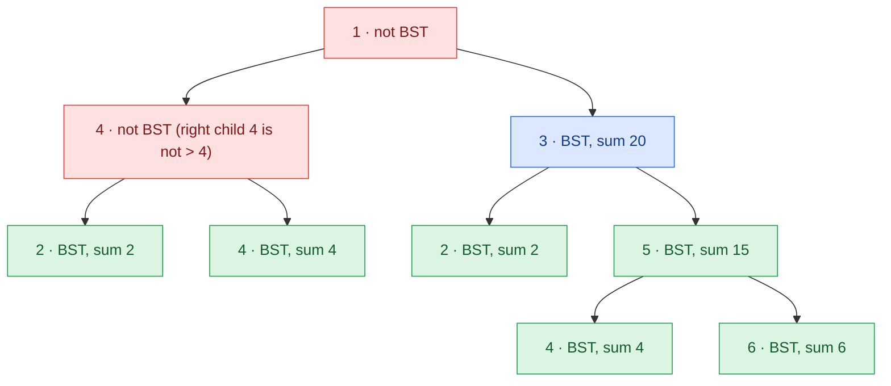

## Problem

Given a **binary tree** `root`, return _the maximum sum of all keys of **any** sub-tree which is also a Binary Search Tree (BST)_.

Assume a BST is defined as follows:

- The left subtree of a node contains only nodes with keys **less than** the node's key.
- The right subtree of a node contains only nodes with keys **greater than** the node's key.
- Both the left and right subtrees must also be binary search trees.

**Example 1:**


```text
Input:  root = [1,4,3,2,4,2,5,null,null,null,null,null,null,4,6]
Output: 20
Explanation: Maximum sum in a valid Binary search tree is obtained in root node with key equal to 3.
```

**Example 2:**


```text
Input:  root = [4,3,null,1,2]
Output: 2
Explanation: Maximum sum in a valid Binary search tree is obtained in a single root node with key equal to 2.
```

**Example 3:**

```text
Input:  root = [-4,-2,-5]
Output: 0
Explanation: All values are negatives. Return an empty BST.
```

**Constraints:**

- The number of nodes in the tree is in the range $[1, 4 \times 10^4]$.
- $-4 \times 10^4 \le$ `Node.val` $\le 4 \times 10^4$

## Solution approach

### Intuition

A subtree rooted at `node` is a BST exactly when

1. both child subtrees are BSTs, and
2. `node->val` is greater than the **largest** key on the left and smaller than the **smallest** key on the right.

So whether a subtree is a BST — and its sum — can be decided from four facts about each child: is it a BST, its minimum, its maximum and its sum. A post-order traversal computes these bottom-up, visiting every node once instead of re-validating every subtree from scratch ($O(n^2)$).

An empty child is a BST with `min = +inf` and `max = -inf`, so it never violates condition 2. Since the empty tree is allowed (Example 3), the answer starts at `0`.

### Algorithm

1. `dfs(node)` returns an `Info {isBST, mn, mx, sum}` for the subtree.
2. For `nullptr`, return `{true, INT_MAX, INT_MIN, 0}`.
3. Compute `L = dfs(node->left)` and `R = dfs(node->right)`.
4. If `L.isBST && R.isBST && L.mx < node->val && node->val < R.mn`, the subtree is a BST: its sum is `L.sum + R.sum + node->val`; update `best`; return `{true, min(L.mn, node->val), max(R.mx, node->val), sum}`.
5. Otherwise return `{false, ...}` — the other fields no longer matter, because no ancestor can be a BST either.
6. `maxSumBST` calls `dfs(root)` and returns `best`.

### Walkthrough

Example 1, with the `Info` each call returns (`sum` only shown for BST subtrees). Green subtrees are BSTs; the subtree rooted at `3` has the largest sum, `20`:



The node `4` fails because its right child has the same key (`4 < R.mn` is false). The root `1` then fails because its left subtree is not a BST, even though `1 < 2` holds on the right.

### Complexity

- **Time:** $O(n)$ — each node is visited once with $O(1)$ work.
- **Space:** $O(h)$ — recursion stack, where `h` is the tree height ($O(n)$ for a skewed tree).

### Edge cases

- **All values negative** (Example 3): every BST sum is negative, so `best` stays `0` (the empty BST).
- **Duplicate keys**, e.g. `4` with a left child `4`: the strict checks `L.mx < node->val` and `node->val < R.mn` reject them, as the definition requires.
- **Sentinels:** keys lie in $[-4 \times 10^4, 4 \times 10^4]$, so `INT_MAX`/`INT_MIN` can never collide with a real key, and the largest sum $4 \times 10^4 \cdot 4 \times 10^4 = 1.6 \times 10^9$ fits in an `int`.

## Code

```cpp title="C++"
class Solution {
    struct Info {
        bool isBST;
        int mn, mx, sum;
    };
    int best = 0;

    Info dfs(TreeNode* node) {
        if (!node) return {true, INT_MAX, INT_MIN, 0};
        Info L = dfs(node->left), R = dfs(node->right);
        if (L.isBST && R.isBST && L.mx < node->val && node->val < R.mn) {
            int sum = L.sum + R.sum + node->val;
            best = max(best, sum);
            return {true, min(L.mn, node->val), max(R.mx, node->val), sum};
        }
        return {false, 0, 0, 0};
    }

   public:
    int maxSumBST(TreeNode* root) {
        dfs(root);
        return best;
    }
};
```
