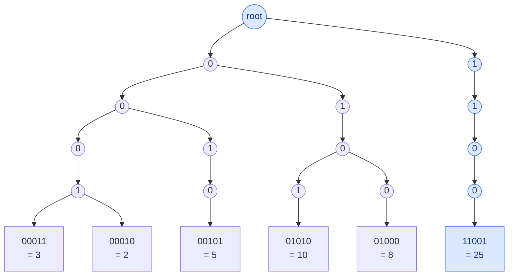

## Problem

Given an integer array `nums`, return _the maximum result of_ `nums[i] XOR nums[j]`, where `0 <= i <= j < n`.

**Example 1:**

```text
Input:  nums = [3,10,5,25,2,8]
Output: 28
Explanation: The maximum result is 5 XOR 25 = 28.
```

**Example 2:**

```text
Input:  nums = [14,70,53,83,49,91,36,80,92,51,66,70]
Output: 127
```

**Constraints:**

- $1 \le$ `nums.length` $\le 2 \times 10^5$
- $0 \le$ `nums[i]` $\le 2^{31} - 1$

## Solution approach

### Intuition

A number with bit `b` set is larger than any number that agrees with it above `b` and has bit `b` clear, no matter what the lower bits are ($2^b > 2^b - 1$). So to maximise `x ^ y` for a fixed `x` we should decide the bits of the result **from the top down**, making each one `1` whenever some candidate `y` allows it, given the choices already made above.

A **binary trie** over the bits of all numbers (bit 30 first) makes this a single walk: at each level, the children of the current node are exactly the bit values available among the numbers that match the path so far. Prefer the child whose bit is the **opposite** of `x`'s bit (that result bit becomes `1`); fall back to the same bit only if the opposite one does not exist. Doing this for every `x` and taking the maximum gives the answer. Comparing all pairs would be $O(n^2)$; each walk here is 31 steps.

### Algorithm

1. Build the trie as a flat array `trie` of `{child0, child1}` index pairs (index `0` is the root; a child index `0` means "missing"), and insert every number from bit `30` down to bit `0`.
2. For each `x` in `nums`, walk from the root: for bit `b`, let `want = 1 - ((x >> b) & 1)`. If `trie[node][want]` exists, set bit `b` in `cur` and move there; otherwise move to the other child (which must exist, because `x` itself is in the trie).
3. `best = max(best, cur)` over all `x`.

### Walkthrough

Example 1 using 5 bits (all values are below 32). Querying `x = 5 = 00101`, the walk wants `1, 1, 0, 1, 0` and gets `1, 1, 0, 0, 1` — it can take the opposite bit at the first three levels, then must follow the same bit — ending at `25 = 11001`, so `5 ^ 25 = 11100 = 28`:



### Complexity

- **Time:** $O(n \log M)$ — each insert and each query walks 31 levels ($M = 2^{31}$), so about $31 \cdot 2n$ steps.
- **Space:** $O(n \log M)$ — at most 31 new nodes per number.

### Edge cases

- **A single number:** the walk can only follow `x` itself, so the answer is `x ^ x = 0`, matching `i == j` being allowed.
- **Duplicates:** they share a trie path and do not change the result.
- **Large values** up to $2^{31} - 1$: bit `30` is the highest bit, so `1 << b` with `b <= 30` never overflows an `int`.

## Code

```cpp
class Solution {
   public:
    int findMaximumXOR(vector<int>& nums) {
        const int HIGH = 30;  // nums[i] < 2^31
        vector<array<int, 2>> trie(1, {0, 0});  // node 0 is the root; child 0 means "none"
        trie.reserve(nums.size() * (HIGH + 1) + 1);

        for (int x : nums) {
            int node = 0;
            for (int b = HIGH; b >= 0; --b) {
                int bit = (x >> b) & 1;
                if (!trie[node][bit]) {
                    trie[node][bit] = trie.size();
                    trie.push_back({0, 0});
                }
                node = trie[node][bit];
            }
        }

        int best = 0;
        for (int x : nums) {
            int node = 0, cur = 0;
            for (int b = HIGH; b >= 0; --b) {
                int want = 1 - ((x >> b) & 1);
                if (trie[node][want]) {
                    cur |= 1 << b;
                    node = trie[node][want];
                } else {
                    node = trie[node][1 - want];
                }
            }
            best = max(best, cur);
        }
        return best;
    }
};
```

```java
class Solution {
    public int findMaximumXOR(int[] nums) {
        final int HIGH = 30;  // nums[i] < 2^31
        // Flat trie: children of node v are trie[2v] (bit 0) and trie[2v + 1] (bit 1).
        // Node 0 is the root; child 0 means "none".
        int[] trie = new int[2 * (nums.length * (HIGH + 1) + 1)];
        int size = 1;

        for (int x : nums) {
            int node = 0;
            for (int b = HIGH; b >= 0; b--) {
                int slot = 2 * node + ((x >> b) & 1);
                if (trie[slot] == 0) trie[slot] = size++;
                node = trie[slot];
            }
        }

        int best = 0;
        for (int x : nums) {
            int node = 0, cur = 0;
            for (int b = HIGH; b >= 0; b--) {
                int want = 1 - ((x >> b) & 1);
                if (trie[2 * node + want] != 0) {
                    cur |= 1 << b;
                    node = trie[2 * node + want];
                } else {
                    node = trie[2 * node + 1 - want];
                }
            }
            best = Math.max(best, cur);
        }
        return best;
    }
}
```

```python
class Solution:
    def findMaximumXOR(self, nums: List[int]) -> int:
        HIGH = 30  # nums[i] < 2^31
        # Flat trie: children of node v are trie[2v] (bit 0) and trie[2v + 1] (bit 1).
        # Node 0 is the root; child 0 means "none".
        trie = [0, 0]

        for x in nums:
            node = 0
            for b in range(HIGH, -1, -1):
                slot = 2 * node + ((x >> b) & 1)
                if not trie[slot]:
                    trie[slot] = len(trie) // 2
                    trie += (0, 0)
                node = trie[slot]

        best = 0
        for x in nums:
            node = cur = 0
            for b in range(HIGH, -1, -1):
                want = 1 - ((x >> b) & 1)
                if trie[2 * node + want]:
                    cur |= 1 << b
                    node = trie[2 * node + want]
                else:
                    node = trie[2 * node + 1 - want]
            best = max(best, cur)
        return best
```
