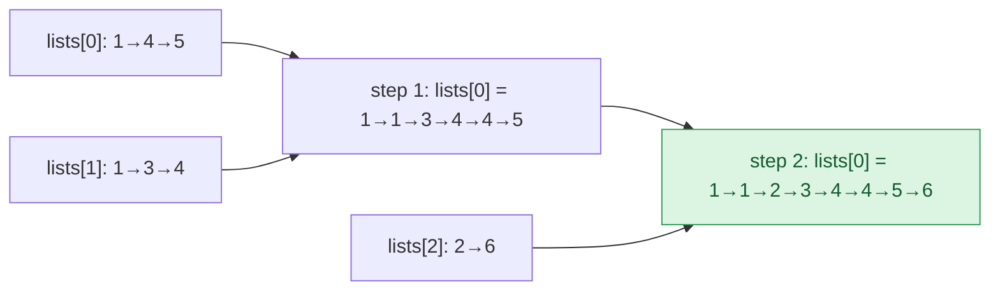

## Problem

You are given an array of `k` linked-lists `lists`, each linked-list is sorted in ascending order.

_Merge all the linked-lists into one sorted linked-list and return it._

**Example 1:**

```text
Input:  lists = [[1,4,5],[1,3,4],[2,6]]
Output: [1,1,2,3,4,4,5,6]
Explanation: The linked-lists are:
[
  1->4->5,
  1->3->4,
  2->6
]
merging them into one sorted linked list:
1->1->2->3->4->4->5->6
```

**Example 2:**

```text
Input:  lists = []
Output: []
```

**Example 3:**

```text
Input:  lists = [[]]
Output: []
```

**Constraints:**

- `k == lists.length`
- $0 \le k \le 10^4$
- $0 \le$ `lists[i].length` $\le 500$
- $-10^4 \le$ `lists[i][j]` $\le 10^4$
- `lists[i]` is sorted in **ascending order**.
- The sum of `lists[i].length` will not exceed $10^4$.

## Solution approach

### Intuition

Merging two sorted lists is easy and linear (see [Merge Two Sorted Lists](/docs/codes/merge-two-sorted-lists/)). The question is the **order** in which to merge `k` of them. Let `N` be the total number of nodes.

- Folding them one by one into a growing result is slow: the result is re-walked at every step, so with `k` lists of equal length the cost is about $N/k \cdot (1 + 2 + \dots + k) = O(kN)$.
- Merging them **in pairs**, like the merge phase of merge sort, keeps the lists balanced: in each round every node takes part in exactly one two-way merge, so a round costs $O(N)$, and the number of lists halves every round, so there are $\lceil \log_2 k \rceil$ rounds. Total: $O(N \log k)$.

(A min-heap holding the current head of every list gives the same $O(N \log k)$ bound with $O(k)$ extra space; the pairwise merge needs no extra memory.)

### Algorithm

1. If `lists` is empty, return `nullptr`.
2. For `step = 1, 2, 4, ...` while `step < k`: for every `i` that is a multiple of `2 * step` with `i + step < k`, set `lists[i] = mergeTwo(lists[i], lists[i + step])`. After the round with step `s`, `lists[i]` for each multiple `i` of `2s` holds the merge of the original lists `i .. i + 2s - 1`.
3. Return `lists[0]`.
4. `mergeTwo(a, b)` relinks nodes behind a stack-allocated `dummy` head: repeatedly attach the smaller of `a` and `b` to `tail`, then append whatever remains.

### Walkthrough

Example 1 with `k = 3`:



In round `step = 1` only the pair `(0, 1)` exists (`lists[2]` has no partner), and in round `step = 2` the pair `(0, 2)` is merged.

### Complexity

- **Time:** $O(N \log k)$ — $\lceil \log_2 k \rceil$ rounds, each touching every node at most once.
- **Space:** $O(1)$ — nodes are relinked in place; the only extra node is the local `dummy`.

### Edge cases

- **`lists` is empty** (Example 2): return `nullptr` before indexing `lists[0]`.
- **Empty lists inside `lists`** (Example 3): `mergeTwo` with a `nullptr` side just returns the other side via `tail->next = a ? a : b`.
- **`k = 1`:** no round runs and `lists[0]` is returned unchanged.

## Code

```cpp
class Solution {
    ListNode* mergeTwo(ListNode* a, ListNode* b) {
        ListNode dummy;
        ListNode* tail = &dummy;
        while (a && b) {
            if (a->val <= b->val) {
                tail->next = a;
                a = a->next;
            } else {
                tail->next = b;
                b = b->next;
            }
            tail = tail->next;
        }
        tail->next = a ? a : b;
        return dummy.next;
    }

   public:
    ListNode* mergeKLists(vector<ListNode*>& lists) {
        if (lists.empty()) return nullptr;
        int k = lists.size();
        for (int step = 1; step < k; step *= 2)
            for (int i = 0; i + step < k; i += 2 * step)
                lists[i] = mergeTwo(lists[i], lists[i + step]);
        return lists[0];
    }
};
```

```java
class Solution {
    private ListNode mergeTwo(ListNode a, ListNode b) {
        ListNode dummy = new ListNode();
        ListNode tail = dummy;
        while (a != null && b != null) {
            if (a.val <= b.val) {
                tail.next = a;
                a = a.next;
            } else {
                tail.next = b;
                b = b.next;
            }
            tail = tail.next;
        }
        tail.next = (a != null) ? a : b;
        return dummy.next;
    }

    public ListNode mergeKLists(ListNode[] lists) {
        if (lists.length == 0) return null;
        int k = lists.length;
        for (int step = 1; step < k; step *= 2)
            for (int i = 0; i + step < k; i += 2 * step)
                lists[i] = mergeTwo(lists[i], lists[i + step]);
        return lists[0];
    }
}
```

```python
class Solution:
    def mergeTwo(self, a: ListNode | None, b: ListNode | None) -> ListNode | None:
        dummy = tail = ListNode()
        while a and b:
            if a.val <= b.val:
                tail.next, a = a, a.next
            else:
                tail.next, b = b, b.next
            tail = tail.next
        tail.next = a or b
        return dummy.next

    def mergeKLists(self, lists: list[ListNode | None]) -> ListNode | None:
        if not lists:
            return None
        k = len(lists)
        step = 1
        while step < k:
            for i in range(0, k - step, 2 * step):
                lists[i] = self.mergeTwo(lists[i], lists[i + step])
            step *= 2
        return lists[0]
```
