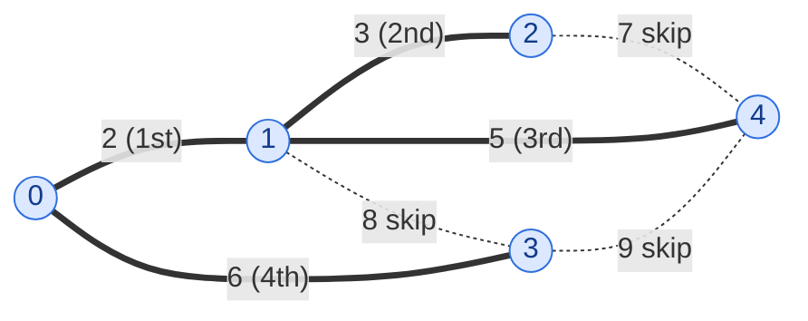

import { Tabs, TabItem } from '@astrojs/starlight/components';

## Problem

Given a weighted, undirected, and connected graph represented by an adjacency list **`adj[][][]`**, where `adj[u]` contains pairs `[v, w]` representing an edge from `u` to `v` with weight `w`.

Find the total weight of its Minimum Spanning Tree (MST) using Prim's Algorithm.

Complete the function `primMST()`, which takes the adjacency list `adj` and returns the total weight of the MST.

**Example 1:**


```text
Input:  adj[][][] = [[[1, 5], [2, 1]], [[0, 5], [2, 3]], [[0, 1], [1, 3]]]
Output: 4
```


```text
Explanation: The MST contains edges (0, 2) with weight 1 and (1, 2) with weight 3.
The total weight is 1 + 3 = 4.
```

**Example 2:**


```text
Input:  adj[][][] = [[[1, 5]], [[0, 5]]]
Output: 5
Explanation: Only one Spanning Tree is possible which has a weight of 5.
```

**Constraints:**

- $2 \le V \le 1000$
- $V - 1 \le E \le V(V-1)/2$
- $1 \le w \le 1000$
- The graph is connected and doesn't contain self-loops & multiple edges.

## Solution approach

Both classic algorithms rest on the **cut property**: split the vertices into any two non-empty groups; the lightest edge crossing between the groups belongs to some minimum spanning tree. Kruskal applies it edge by edge in global weight order; Prim applies it to the single growing tree. The judge only checks the total weight, so either is accepted (the statement asks for Prim's).

Here is a slightly larger graph (not from the problem) with its MST in bold. The edge labels give the weight and, in brackets, the order in which **Kruskal** accepts the edge; **Prim** from vertex `0` happens to add the same edges in the same order here: 2, 3, 5, 6, total 16.



Edges `2–4` (7), `1–3` (8) and `3–4` (9) are skipped because when they are reached their endpoints are already connected, so adding them would close a cycle.

### Approach 1: Kruskal's algorithm

**Intuition**

Process edges from lightest to heaviest. An edge whose endpoints are in **different** components of the forest built so far is the lightest edge crossing the cut "this component vs. everything else", so by the cut property it is safe to take. An edge whose endpoints are already in the **same** component would close a cycle and is never needed. A **disjoint set union** (DSU) with path compression and union by size answers "same component?" in near-constant time.

**Algorithm**

1. Collect each undirected edge once as `{w, u, v}` (only when `u < v`, since `adj` lists every edge from both ends) and sort `edges` by weight.
2. Start a DSU where every vertex is its own set (`parent[i] = i`, `sz[i] = 1`).
3. For each edge in order: if `unite(u, v)` succeeds (the endpoints had different roots), add `w` to `total` and count the edge; stop once `V - 1` edges are taken.
4. Return `total`.

**Complexity**

- **Time:** $O(E \log E) = O(E \log V)$ — sorting dominates; the DSU work is $O(E \, \alpha(V))$.
- **Space:** $O(V + E)$ — the edge list and the DSU arrays.

### Approach 2: Prim's algorithm

**Intuition**

Grow one tree from vertex `0`. At every step, the cheapest edge leaving the tree crosses the cut "tree vs. the rest", so it is safe to add. `key[v]` holds the weight of the cheapest edge found so far from the tree to the outside vertex `v`; a min-heap of `{key, vertex}` pairs gives the next vertex to attach. Instead of a decrease-key operation, a better key is simply pushed again, and outdated ("stale") heap entries are skipped when popped.

**Algorithm**

1. Set `key[0] = 0`, every other `key` to `INT_MAX`, and push `{0, 0}`.
2. Pop the pair `{k, u}` with the smallest key. If `inMST[u]` is already set, it is a stale entry — skip it. Otherwise mark `inMST[u]`, and add `k` to `total` (the weight of the edge that attached `u`, or `0` for the root).
3. For every neighbour `[v, w]` of `u`: if `v` is not in the tree and `w < key[v]`, set `key[v] = w` and push `{w, v}`.
4. When the heap is empty every vertex has been attached exactly once; return `total`.

**Complexity**

- **Time:** $O(E \log V)$ — each edge can push at most one heap entry, so there are $O(E)$ pushes and pops at $O(\log E) = O(\log V)$ each; every adjacency list is scanned once.
- **Space:** $O(V + E)$ — `key`, `inMST` and up to $O(E)$ heap entries.

On a dense graph ($E \approx V^2/2$ is allowed here) an array-based Prim that scans all `V` keys for the minimum runs in $O(V^2)$, which is slightly better asymptotically; with $V \le 1000$ both are fast.

### Edge cases

- **Two vertices** (Example 2): Kruskal takes the only edge; Prim attaches vertex `1` with key `5`.
- **Equal weights:** ties can be broken arbitrarily — different MSTs may result, but they all have the same total weight.
- **Overflow:** the total is at most $999 \times 1000$, well within `int`.

## Code

<Tabs>
<TabItem label="Kruskal">

```cpp title="Approach 1: Kruskal's algorithm"
class Solution {
    vector<int> parent, sz;

    int find(int x) {
        while (parent[x] != x) {
            parent[x] = parent[parent[x]];  // path halving
            x = parent[x];
        }
        return x;
    }

    bool unite(int a, int b) {
        a = find(a);
        b = find(b);
        if (a == b) return false;
        if (sz[a] < sz[b]) swap(a, b);
        parent[b] = a;
        sz[a] += sz[b];
        return true;
    }

   public:
    int primMST(vector<vector<vector<int>>>& adj) {
        int V = adj.size();
        vector<array<int, 3>> edges;  // {w, u, v}
        for (int u = 0; u < V; u++)
            for (auto& e : adj[u])
                if (u < e[0]) edges.push_back({e[1], u, e[0]});
        sort(edges.begin(), edges.end());

        parent.resize(V);
        iota(parent.begin(), parent.end(), 0);
        sz.assign(V, 1);

        int total = 0, taken = 0;
        for (auto& [w, u, v] : edges) {
            if (!unite(u, v)) continue;
            total += w;
            if (++taken == V - 1) break;
        }
        return total;
    }
};
```

</TabItem>
<TabItem label="Prim">

```cpp title="Approach 2: Prim's algorithm"
class Solution {
   public:
    int primMST(vector<vector<vector<int>>>& adj) {
        int V = adj.size();
        vector<int> key(V, INT_MAX);
        vector<bool> inMST(V, false);
        priority_queue<pair<int, int>, vector<pair<int, int>>, greater<>> pq;  // {key, vertex}
        key[0] = 0;
        pq.push({0, 0});
        int total = 0;
        while (!pq.empty()) {
            auto [k, u] = pq.top();
            pq.pop();
            if (inMST[u]) continue;  // stale entry
            inMST[u] = true;
            total += k;
            for (auto& e : adj[u]) {
                int v = e[0], w = e[1];
                if (!inMST[v] && w < key[v]) {
                    key[v] = w;
                    pq.push({w, v});
                }
            }
        }
        return total;
    }
};
```

</TabItem>
</Tabs>
