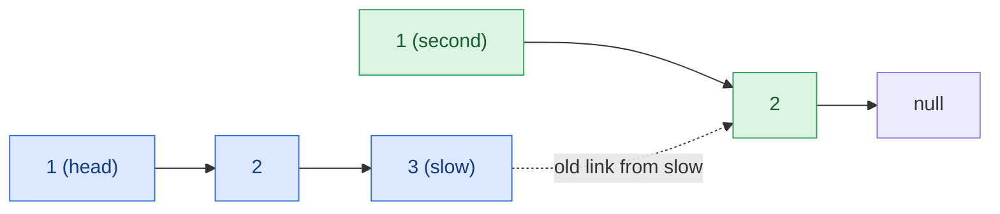

## Problem

Given the `head` of a singly linked list, return `true` *if it is a palindrome or* `false` *otherwise*.

**Example 1:**


```text
Input:  head = [1,2,2,1]
Output: true
```

**Example 2:**


```text
Input:  head = [1,2]
Output: false
```

**Constraints:**

- The number of nodes in the list is in the range $[1, 10^5]$.
- $0 \le$ `Node.val` $\le 9$

**Follow-up:** Could you do it in $O(n)$ time and $O(1)$ space?

## Solution approach

### Intuition

Copying the values into an array and checking it from both ends is easy but uses $O(n)$ extra space. The obstacle to doing it in place is that a singly linked list can only be walked forwards, while a palindrome check needs to read the second half **backwards**.

So make the second half walkable backwards: reverse it in place. Then the first half read forwards must equal the reversed second half read forwards. Afterwards, reverse the second half again so the caller gets the list back unchanged.

To find where the second half starts, use **slow and fast pointers**: `fast` moves two nodes per step and `slow` one, so when `fast` can no longer move, `slow` is at the end of the first half.

### Algorithm

1. Start `slow = head`, `fast = head`. While `fast->next` and `fast->next->next` exist, move `slow` one step and `fast` two. Now `slow` is the last node of the first half (for an odd length, the middle node, which does not need a partner).
2. Reverse the list starting at `slow->next` with the helper `reverse`; call the new head `second`.
3. Walk `p = head` and `q = second` together while `q` is not null; if any `p->val != q->val`, the answer is `false`.
4. Restore the list: `slow->next = reverse(second)`. Return the answer.

`reverse` is the standard iterative reversal: keep `prev`, and for each node point its `next` back to `prev`.

### Walkthrough

For `head = [1,2,3,2,1]`, after step 2 the list looks like this (`slow` stops at the middle node `3`):



The comparison checks `1 = 1` and `2 = 2`, then `q` reaches null and the loop stops; the middle node `3` is never compared, which is correct for an odd length. Because the second half is never longer than the first, `p` never runs off the end.

### Complexity

- **Time:** $O(n)$ — finding the middle, the two reversals and the comparison are each one linear pass.
- **Space:** $O(1)$ — only a few pointers; the list is rewired in place and then restored.

### Edge cases

- **Single node:** the loop does not move, `slow->next` is null, the comparison is empty and the answer is `true`.
- **Even length** (Example 1): `slow` stops at the last node of the first half, so both halves have equal length.
- **The input list is restored** before returning, so the function has no visible side effect.

## Code

```cpp
class Solution {
    ListNode* reverse(ListNode* node) {
        ListNode* prev = nullptr;
        while (node) {
            ListNode* next = node->next;
            node->next = prev;
            prev = node;
            node = next;
        }
        return prev;
    }

   public:
    bool isPalindrome(ListNode* head) {
        ListNode *slow = head, *fast = head;
        while (fast->next && fast->next->next) {
            slow = slow->next;
            fast = fast->next->next;
        }

        ListNode* second = reverse(slow->next);
        bool palindrome = true;
        for (ListNode *p = head, *q = second; q; p = p->next, q = q->next) {
            if (p->val != q->val) {
                palindrome = false;
                break;
            }
        }
        slow->next = reverse(second);
        return palindrome;
    }
};
```

```java
class Solution {
    private ListNode reverse(ListNode node) {
        ListNode prev = null;
        while (node != null) {
            ListNode next = node.next;
            node.next = prev;
            prev = node;
            node = next;
        }
        return prev;
    }

    public boolean isPalindrome(ListNode head) {
        ListNode slow = head, fast = head;
        while (fast.next != null && fast.next.next != null) {
            slow = slow.next;
            fast = fast.next.next;
        }

        ListNode second = reverse(slow.next);
        boolean palindrome = true;
        for (ListNode p = head, q = second; q != null; p = p.next, q = q.next) {
            if (p.val != q.val) {
                palindrome = false;
                break;
            }
        }
        slow.next = reverse(second);
        return palindrome;
    }
}
```

```python
class Solution:
    def isPalindrome(self, head: ListNode | None) -> bool:
        def reverse(node):
            prev = None
            while node:
                node.next, prev, node = prev, node, node.next
            return prev

        slow = fast = head
        while fast.next and fast.next.next:
            slow = slow.next
            fast = fast.next.next

        second = reverse(slow.next)
        palindrome = True
        p, q = head, second
        while q:
            if p.val != q.val:
                palindrome = False
                break
            p, q = p.next, q.next
        slow.next = reverse(second)
        return palindrome
```
