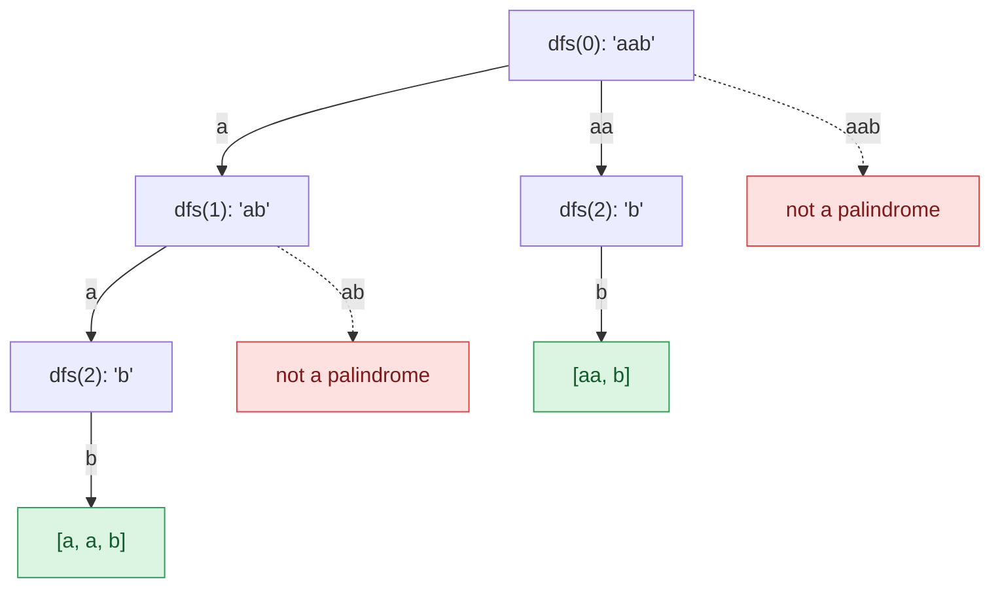

## Problem

Given a string `s`, partition `s` such that every substring of the partition is a **palindrome**. Return *all possible palindrome partitioning of* `s`.

**Example 1:**

```text
Input:  s = "aab"
Output: [["a","a","b"],["aa","b"]]
```

**Example 2:**

```text
Input:  s = "a"
Output: [["a"]]
```

**Constraints:**

- $1 \le$ `s.length` $\le 16$
- `s` contains only lowercase English letters.

## Solution approach

### Intuition

A partition is decided left to right: choose the first piece `s[0..j]`, then partition the rest `s[j+1..]` the same way. Only palindromic first pieces are allowed, so at each position we try every end `j` for which `s[start..j]` is a palindrome, recurse, and undo the choice afterwards (**backtracking**). Every path that reaches the end of the string is one valid partition, and every valid partition is reached by exactly one path, so nothing is missed or duplicated.

Checking "is `s[start..j]` a palindrome?" by reversing the substring costs $O(n)$ each time. Precompute it instead: `pal[i][j]` is true when `s[i] == s[j]` and the inside `s[i+1..j-1]` is a palindrome (or has length at most 1). Filling `i` from right to left guarantees `pal[i+1][j-1]` is ready. Each check is then $O(1)$.

### Algorithm

1. Let `n = s.size()`. Fill `pal[i][j]` for `i` from `n - 1` down to `0` and `j` from `i` to `n - 1`: `pal[i][j] = s[i] == s[j] && (j - i < 2 || pal[i + 1][j - 1])`.
2. `dfs(start)`: if `start == n`, append the current pieces `cur` to `result` and return.
3. Otherwise, for each `j` from `start` to `n - 1` with `pal[start][j]`, push `s.substr(start, j - start + 1)` onto `cur`, call `dfs(j + 1)`, then pop it.
4. Call `dfs(0)` and return `result`.

### Walkthrough

The recursion tree for `s = "aab"`. Each edge is a palindromic piece cut from the front; red leaves are prefixes that are not palindromes (never explored), green leaves are complete partitions:



### Complexity

- **Time:** $O(n \cdot 2^n)$ — there are $n - 1$ gaps, each cut or not, so at most $2^{n-1}$ partitions; building each one copies at most $n$ characters. The table costs $O(n^2)$. A string like `"aaaa…a"` really has $2^{n-1}$ partitions, so no algorithm can do better in the worst case.
- **Space:** $O(n^2)$ for `pal`, plus $O(n)$ for the recursion and `cur` (not counting the output).

### Edge cases

- **Single character** (Example 2): `pal[0][0]` is true, so the only partition is `["a"]`.
- **All characters equal:** every substring is a palindrome, giving the maximum $2^{n-1}$ partitions; the table keeps each check $O(1)$.

## Code

```cpp
class Solution {
    vector<vector<bool>> pal;
    vector<string> cur;
    vector<vector<string>> result;

    void dfs(const string& s, int start) {
        int n = s.size();
        if (start == n) {
            result.push_back(cur);
            return;
        }
        for (int j = start; j < n; j++) {
            if (!pal[start][j]) continue;
            cur.push_back(s.substr(start, j - start + 1));
            dfs(s, j + 1);
            cur.pop_back();
        }
    }

   public:
    vector<vector<string>> partition(string s) {
        int n = s.size();
        pal.assign(n, vector<bool>(n, false));
        for (int i = n - 1; i >= 0; i--) {
            for (int j = i; j < n; j++) {
                pal[i][j] = s[i] == s[j] && (j - i < 2 || pal[i + 1][j - 1]);
            }
        }
        dfs(s, 0);
        return result;
    }
};
```

```java
class Solution {
    private boolean[][] pal;
    private final List<String> cur = new ArrayList<>();
    private final List<List<String>> result = new ArrayList<>();

    private void dfs(String s, int start) {
        int n = s.length();
        if (start == n) {
            result.add(new ArrayList<>(cur));
            return;
        }
        for (int j = start; j < n; j++) {
            if (!pal[start][j]) continue;
            cur.add(s.substring(start, j + 1));
            dfs(s, j + 1);
            cur.remove(cur.size() - 1);
        }
    }

    public List<List<String>> partition(String s) {
        int n = s.length();
        pal = new boolean[n][n];
        for (int i = n - 1; i >= 0; i--) {
            for (int j = i; j < n; j++) {
                pal[i][j] = s.charAt(i) == s.charAt(j) && (j - i < 2 || pal[i + 1][j - 1]);
            }
        }
        dfs(s, 0);
        return result;
    }
}
```

```python
class Solution:
    def partition(self, s: str) -> list[list[str]]:
        n = len(s)
        pal = [[False] * n for _ in range(n)]
        for i in range(n - 1, -1, -1):
            for j in range(i, n):
                pal[i][j] = s[i] == s[j] and (j - i < 2 or pal[i + 1][j - 1])

        result, cur = [], []

        def dfs(start: int) -> None:
            if start == n:
                result.append(cur[:])
                return
            for j in range(start, n):
                if not pal[start][j]:
                    continue
                cur.append(s[start:j + 1])
                dfs(j + 1)
                cur.pop()

        dfs(0)
        return result
```
