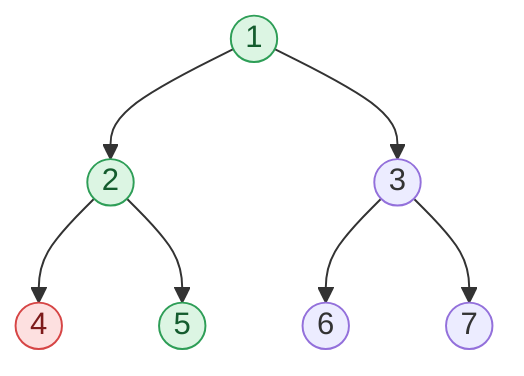

## Problem

Given a Binary Tree `A` containing `N` nodes.

You need to find the path from **Root** to a given node `B`.

**NOTE:**

- No two nodes in the tree have same data values.
- You can assume that `B` is present in the tree `A` and a path always exists.

The first argument is a pointer to the root of the binary tree `A`; the second is an integer `B` denoting the node number. Return a one-dimensional array denoting the path from the root to the node `B`, in order.

**Example 1:**

```text
Input:  A =       1
                /   \
               2     3
              / \   / \
             4   5 6   7
        B = 5
Output: [1, 2, 5]
Explanation: We need to find the path from root node to node with data value 5.
So the path is 1 -> 2 -> 5 so we will return [1, 2, 5].
```

**Example 2:**

```text
Input:  A =       1
                /   \
               2     3
              / \     \
             4   5     6
        B = 1
Output: [1]
Explanation: We need to find the path from root node to node with data value 1.
As node with data value 1 is the root so there is only one node in the path. So we will return [1].
```

**Constraints:**

- $1 \le N \le 10^5$
- $1 \le$ data value of each node $\le N$
- $1 \le B \le N$

## Solution approach

### Intuition

During a depth-first search, the nodes on the recursion stack are exactly the path from the root to the node currently being visited. So if we keep that stack as an explicit array `path` — push a node when we enter it, pop it when we leave it — then at the moment we reach the node with value `B`, `path` **is** the answer, already in root-to-node order.

When a subtree does not contain `B`, the search returns `false` and the node is popped again, so dead ends leave no trace. As soon as `B` is found, every caller returns `true` immediately without popping, which freezes `path`.

### Algorithm

1. `findPath(node, B, path)` returns whether `B` lies in the subtree of `node`:
   - If `node` is null, return `false`.
   - Push `node->val` onto `path`.
   - If `node->val == B`, or `findPath` succeeds in the left subtree, or in the right subtree, return `true` (leave `node` on the path).
   - Otherwise pop `node->val` and return `false`.
2. `solve(A, B)` calls `findPath(A, B, path)` on an empty `path` and returns it.

### Walkthrough

Example 1: the search enters `1`, `2`, `4` (dead end, popped), then `5` = `B`. Green nodes are the returned path, red the dead end that was backtracked; `3` and its subtree are never visited:



### Complexity

- **Time:** $O(n)$ — each node is entered at most once, and the search stops as soon as `B` is found.
- **Space:** $O(h)$ — the recursion stack and `path` both hold at most `h` nodes, where `h` is the height ($O(n)$ for a skewed tree).

### Edge cases

- **`B` is the root** (Example 2): the first call matches and returns `[A->val]`.
- **`B` is a deep leaf in a skewed tree:** `path` grows to `N` entries; it is still exactly the root-to-node path.

## Code

```cpp
bool findPath(TreeNode* node, int B, vector<int>& path) {
    if (!node) return false;
    path.push_back(node->val);
    if (node->val == B || findPath(node->left, B, path) || findPath(node->right, B, path)) return true;
    path.pop_back();
    return false;
}

vector<int> Solution::solve(TreeNode* A, int B) {
    vector<int> path;
    findPath(A, B, path);
    return path;
}
```

```java
public class Solution {
    public ArrayList<Integer> solve(TreeNode A, int B) {
        // Iterative DFS (a skewed tree can be 10^5 deep): `path` is the stack of
        // nodes from the root to the current node, `last` the subtree just finished.
        ArrayList<TreeNode> path = new ArrayList<>();
        TreeNode node = A, last = null;
        while (node != null || !path.isEmpty()) {
            if (node != null) {
                path.add(node);
                if (node.val == B) break;
                node = node.left;
            } else {
                TreeNode top = path.get(path.size() - 1);
                if (top.right != null && top.right != last) {
                    node = top.right;
                } else {
                    last = path.remove(path.size() - 1);  // dead end: backtrack
                }
            }
        }
        ArrayList<Integer> result = new ArrayList<>(path.size());
        for (TreeNode t : path) result.add(t.val);
        return result;
    }
}
```

```python
class Solution:
    # @param A : root node of tree
    # @param B : integer
    # @return a list of integers
    def solve(self, A, B):
        # Iterative DFS (a skewed tree can be 10^5 deep): `path` is the stack of
        # nodes from the root to the current node, `last` the subtree just finished.
        path = []
        node, last = A, None
        while node or path:
            if node:
                path.append(node)
                if node.val == B:
                    break
                node = node.left
            else:
                top = path[-1]
                if top.right and top.right is not last:
                    node = top.right
                else:
                    last = path.pop()  # dead end: backtrack
        return [t.val for t in path]
```
