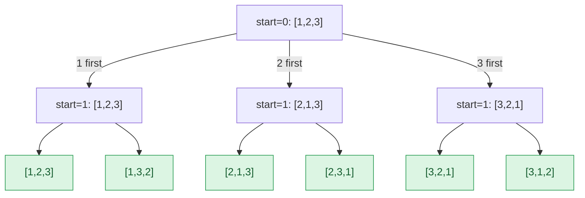

## Problem

Given an array `nums` of distinct integers, return all the possible permutations. You can return the answer in **any order**.

**Example 1:**

```text
Input:  nums = [1,2,3]
Output: [[1,2,3],[1,3,2],[2,1,3],[2,3,1],[3,1,2],[3,2,1]]
```

**Example 2:**

```text
Input:  nums = [0,1]
Output: [[0,1],[1,0]]
```

**Example 3:**

```text
Input:  nums = [1]
Output: [[1]]
```

**Constraints:**

- $1 \le$ `nums.length` $\le 6$
- $-10 \le$ `nums[i]` $\le 10$
- All the integers of `nums` are **unique**.

## Solution approach

### Intuition

A permutation is built position by position: choose which element goes first, then which of the remaining ones goes second, and so on. That is a decision tree with `n` choices at the top, `n - 1` below each, … — exactly `n!` leaves, one per permutation.

We can walk this tree **in place**. Keep the array split at index `start`: `nums[0..start-1]` is the fixed prefix, `nums[start..n-1]` holds the elements still unused. To try element `nums[i]` at position `start`, swap it into `nums[start]`, recurse on `start + 1`, then swap it back. Swapping back restores the array exactly, so the next choice at this level starts from the same state (this is the backtracking step). Because the elements are distinct, every leaf is a different permutation.

### Algorithm

1. `backtrack(nums, start, result)`: if `start == nums.size()`, the whole array is fixed, so append a copy of `nums` to `result` and return.
2. For each `i` from `start` to `nums.size() - 1`:
   - `swap(nums[start], nums[i])` — put `nums[i]` at position `start`;
   - `backtrack(nums, start + 1, result)`;
   - `swap(nums[start], nums[i])` — undo.
3. `permute` calls `backtrack(nums, 0, result)` and returns `result`.

### Walkthrough

The recursion tree for `[1,2,3]`. Each edge swaps a value into position `start`; the leaves are the permutations in the order they are produced:



### Complexity

- **Time:** $O(n \cdot n!)$ — there are `n!` leaves and copying each permutation costs $O(n)$; the whole tree has $\sum_{j=0}^{n} n!/j! \lt e \cdot n!$ nodes, so there are $O(n!)$ calls, each looping over at most `n` choices. The output itself has $n \cdot n!$ numbers, so this is optimal.
- **Space:** $O(n)$ — the recursion depth, not counting the output.

### Edge cases

- **One element** (Example 3): `start = 0` swaps the element with itself, recurses once and records `[nums[0]]`.
- **Negative values or zero:** values are only moved, never compared, so they need no special handling.

## Code

```cpp title="C++"
class Solution {
    void backtrack(vector<int>& nums, int start, vector<vector<int>>& result) {
        if (start == (int)nums.size()) {
            result.push_back(nums);
            return;
        }
        for (int i = start; i < (int)nums.size(); i++) {
            swap(nums[start], nums[i]);
            backtrack(nums, start + 1, result);
            swap(nums[start], nums[i]);
        }
    }

   public:
    vector<vector<int>> permute(vector<int>& nums) {
        vector<vector<int>> result;
        backtrack(nums, 0, result);
        return result;
    }
};
```
