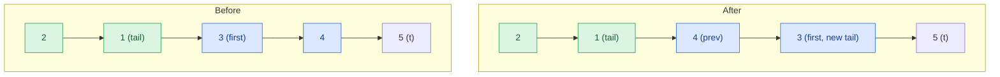

## Problem

Given the `head` of a linked list, reverse the nodes of the list `k` at a time, and return *the modified list*.

`k` is a positive integer and is less than or equal to the length of the linked list. If the number of nodes is not a multiple of `k` then left-out nodes, in the end, should remain as it is.

You may not alter the values in the list's nodes, only nodes themselves may be changed.

**Example 1:**


```text
Input:  head = [1,2,3,4,5], k = 2
Output: [2,1,4,3,5]
```

**Example 2:**


```text
Input:  head = [1,2,3,4,5], k = 3
Output: [3,2,1,4,5]
```

**Constraints:**

- The number of nodes in the list is `n`.
- $1 \le k \le n \le 5000$
- $0 \le$ `Node.val` $\le 1000$

**Follow-up:** Can you solve the problem in $O(1)$ extra memory space?

## Solution approach

### Intuition

The list is handled `k` nodes at a time. Before touching a group, count ahead to make sure `k` nodes are actually there; if fewer than `k` remain, they are left exactly as they are.

A full group is reversed **in place** by relinking its nodes, just like reversing a whole list, except that the group's first node must end up pointing at the node right after the group instead of `NULL`. Starting the reversal with `prev` set to that following node does this automatically. After the reversal, the group's old first node is its new last node, so it becomes the `tail` that the next group is attached to.

A dummy node `root` sits before the head so that the first group is attached in the same way as every later group. It lives on the stack, so no node is ever allocated and no value is ever copied.

### Algorithm

1. Create a stack dummy `root` with `root.next = head`, and set `tail = &root` (the last node of the part already processed).
2. Repeat:
   - Starting at `tail->next`, step forward up to `k` nodes with `t`, counting them in `cnt`.
   - If `cnt < k`, stop: the leftover nodes are still linked after `tail` in their original order.
   - Otherwise `t` is the first node after the group. Remember the group's first node as `first`, set `prev = t` and `cur = first`, and `k` times do: save `cur->next`, point `cur->next` at `prev`, then move `prev` and `cur` one step forward.
   - Now `prev` is the group's new first node: set `tail->next = prev`, and move `tail` to `first`, which is the group's new last node and already points at `t`.
3. Return `root.next`.

### Walkthrough

Example 1 (`k = 2`) just before and just after the second group `3 → 4` is reversed. `tail` is the last node of the finished part, `first` the group's first node and `t` the node after the group:



Because `prev` started at `t`, the group's old first node `3` ends up pointing at `5` with no extra fix-up; `tail->next = prev` then attaches `4` behind `1`.

### Complexity

- **Time:** $O(n)$ — each node is visited at most twice: once while counting ahead and once while being reversed.
- **Space:** $O(1)$ — only a few pointers and a stack dummy node; the original nodes are relinked and nothing is allocated.

### Edge cases

- **Length not a multiple of `k`:** e.g. `[1,2,3,4,5]` with `k = 3` gives `[3,2,1,4,5]`; the counting step finds only 2 nodes left and stops before changing them.
- **`k = 1`:** every group is a single node, so reversing changes nothing and the list is returned unchanged.
- **`k` equal to the length:** the whole list is reversed once, and the next count finds no nodes.

## Code

```cpp title="C++"
class Solution {
   public:
    ListNode* reverseKGroup(ListNode* head, int k) {
        ListNode root(0);
        root.next = head;
        ListNode* tail = &root;
        while (1) {
            ListNode* t = tail->next;
            int cnt = 0;
            while (t && cnt < k) {
                cnt++;
                t = t->next;
            }
            if (cnt < k) break;

            ListNode* first = tail->next;
            ListNode* prev = t;
            ListNode* cur = first;
            for (int i = 0; i < k; i++) {
                ListNode* nxt = cur->next;
                cur->next = prev;
                prev = cur;
                cur = nxt;
            }
            tail->next = prev;
            tail = first;
        }
        return root.next;
    }
};

```
