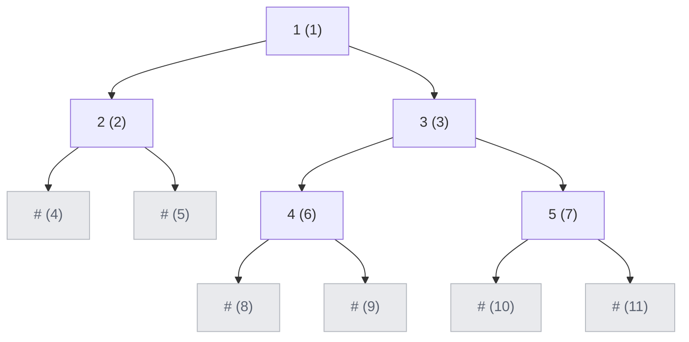

## Problem

Serialization is the process of converting a data structure or object into a sequence of bits so that it can be stored in a file or memory buffer, or transmitted across a network connection link to be reconstructed later in the same or another computer environment.

Design an algorithm to serialize and deserialize a binary tree. There is no restriction on how your serialization/deserialization algorithm should work. You just need to ensure that a binary tree can be serialized to a string and this string can be deserialized to the original tree structure.

**Clarification:** The input/output format is the same as [how LeetCode serializes a binary tree](https://support.leetcode.com/hc/en-us/articles/32442719377939-How-to-create-test-cases-on-LeetCode#h_01J5EGREAW3NAEJ14XC07GRW1A). You do not necessarily need to follow this format, so please be creative and come up with different approaches yourself.

**Example 1:**


```text
Input:  root = [1,2,3,null,null,4,5]
Output: [1,2,3,null,null,4,5]
```

**Example 2:**

```text
Input:  root = []
Output: []
```

**Constraints:**

- The number of nodes in the tree is in the range $[0, 10^4]$.
- $-1000 \le$ `Node.val` $\le 1000$

The judge calls `deser.deserialize(ser.serialize(root))` on two `Codec` objects and checks that the result equals `root`.

## Solution approach

### Intuition

Listing the values alone is not enough — `[1,2]` could be `2` as a left or as a right child of `1`. What makes a tree unique is its values **plus the positions of its missing children**. If we write a marker (`#`) for every null child, the string pins down the shape exactly.

A level-order (BFS) walk is a natural fit: visit nodes with a queue, and for each node visited write its value, or `#` if it is null; real nodes push both children, including null ones, so every gap is recorded. Deserialisation replays the same BFS: the first token is the root, and every real node taken from the queue claims the **next two tokens** as its left and right child. Because both sides consume nodes in the same order, each token is matched to the parent that wrote it.

BFS is also iterative, so a degenerate tree with $10^4$ levels needs no deep recursion.

### Algorithm

**`serialize(root)`**

1. Push `root` into a queue.
2. Pop `node`. If it is null, append `#,`. Otherwise append `node->val` followed by `,`, and push `node->left` and `node->right`.
3. Repeat until the queue is empty and return the string. An empty tree gives `"#,"`.

**`deserialize(data)`**

1. Split `data` on `,` with `getline`. Read the first token; if it is `#`, return `nullptr`. Otherwise create `root` and push it into a queue.
2. While the queue is not empty, pop `node`, then read two tokens. For each, if it is not `#`, create a child with `stoi(token)`, attach it as `node->left` (first token) or `node->right` (second), and push it.
3. Return `root`.

### Walkthrough

Example 1. The numbers in brackets are the BFS order in which each slot is written and read; `#` slots are the null children:



`serialize` produces `"1,2,3,#,#,4,5,#,#,#,#,"`. During `deserialize`, node `1` takes tokens `2` and `3`, node `2` takes `#,#`, node `3` takes `4,5`, and nodes `4` and `5` each take `#,#`.

### Complexity

- **Time:** $O(n)$ for both — every node and every null child (there are $n + 1$ of them) is pushed, written and read once.
- **Space:** $O(n)$ — the queue and the output string. The string has $2n + 1$ tokens.

### Edge cases

- **Empty tree** (Example 2): serialised as `"#,"`; the first token is `#`, so `deserialize` returns `nullptr`.
- **Negative values:** written with `to_string` and read with `stoi`, so the sign survives; `#` never collides with a number.
- **Very deep (list-shaped) tree:** both directions are iterative, so there is no recursion-depth risk.

## Code

```cpp title="C++"
class Codec {
   public:
    string serialize(TreeNode* root) {
        string out;
        queue<TreeNode*> q;
        q.push(root);
        while (!q.empty()) {
            TreeNode* node = q.front();
            q.pop();
            if (!node) {
                out += "#,";
                continue;
            }
            out += to_string(node->val) + ',';
            q.push(node->left);
            q.push(node->right);
        }
        return out;
    }

    TreeNode* deserialize(string data) {
        istringstream in(data);
        string tok;
        getline(in, tok, ',');
        if (tok == "#") return nullptr;
        TreeNode* root = new TreeNode(stoi(tok));
        queue<TreeNode*> q;
        q.push(root);
        while (!q.empty()) {
            TreeNode* node = q.front();
            q.pop();
            for (TreeNode** child : {&node->left, &node->right}) {
                getline(in, tok, ',');
                if (tok == "#") continue;
                *child = new TreeNode(stoi(tok));
                q.push(*child);
            }
        }
        return root;
    }
};
```
