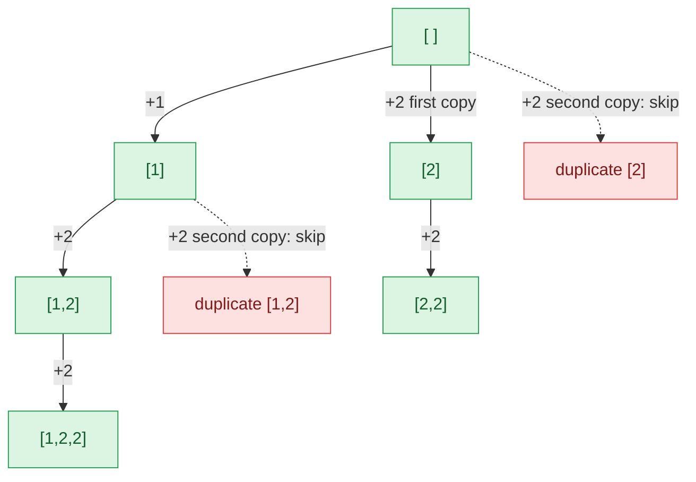

## Problem

Given an integer array `nums` that may contain duplicates, return *all possible subsets (the power set)*.

The solution set **must not** contain duplicate subsets. Return the solution in **any order**.

**Example 1:**

```text
Input:  nums = [1,2,2]
Output: [[],[1],[1,2],[1,2,2],[2],[2,2]]
```

**Example 2:**

```text
Input:  nums = [0]
Output: [[],[0]]
```

**Constraints:**

- $1 \le nums.length \le 10$
- $-10 \le nums[i] \le 10$

## Solution approach

### Intuition

Use the same backtracking as [Subsets](/docs/codes/subsets/): from position `start`, choose which element to append **next** (any `nums[i]` with `i >= start`), recurse from `i + 1`, and record `cur` at every node.

With duplicates, two different indices holding the same value produce the same subtree. For `[1,2,2]`, choosing "the first `2`" or "the second `2`" as the next element both give `[2]`, `[2,2]`, ... twice. The fix is to **sort** `nums` so equal values are adjacent, and then, at one level of the recursion, use each **value** only once as the next element:

> skip `nums[i]` when `i > start` and `nums[i] == nums[i - 1]`.

Using the second `2` *after* the first one (deeper in the tree, `i == start`) is still allowed, so `[2,2]` is generated — but only once, through the first copy. This removes duplicates at the source instead of filtering them with a `set` afterwards.

### Algorithm

1. Sort `nums`.
2. `backtrack(start)`: append a copy of `cur` to `ans`.
3. For each `i` from `start` to `n - 1`:
   - if `i > start` and `nums[i] == nums[i - 1]`, continue (this value was already tried at this level);
   - push `nums[i]`, call `backtrack(i + 1)`, pop it.
4. Call `backtrack(0)` and return `ans`.

### Walkthrough

Recursion tree for `nums = [1,2,2]` (after sorting). The red branch is skipped because the same value `2` was already chosen at that level:



The six green nodes are exactly the six answers.

### Complexity

- **Time:** $O(n \cdot 2^n)$ — at most $2^n$ subsets are recorded, each copy costs $O(n)$, and every skipped index is charged to the loop of a recorded node. Sorting adds only $O(n \log n)$.
- **Space:** $O(n)$ auxiliary — recursion depth and `cur`; the output is $O(n \cdot 2^n)$.

### Edge cases

- **All elements equal** (`[2,2,2]`): each level has one usable choice, giving `[]`, `[2]`, `[2,2]`, `[2,2,2]`.
- **No duplicates:** the skip condition never fires and the result is the ordinary power set.

## Code

```cpp title="C++"
class Solution {
    vector<vector<int>> ans;
    vector<int> cur;

    void backtrack(const vector<int>& nums, int start) {
        ans.push_back(cur);
        for (int i = start; i < (int)nums.size(); i++) {
            if (i > start && nums[i] == nums[i - 1]) continue;  // value already used at this level
            cur.push_back(nums[i]);
            backtrack(nums, i + 1);
            cur.pop_back();
        }
    }

   public:
    vector<vector<int>> subsetsWithDup(vector<int>& nums) {
        sort(nums.begin(), nums.end());
        backtrack(nums, 0);
        return ans;
    }
};
```
