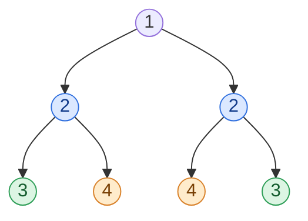

## Problem

Given the `root` of a binary tree, *check whether it is a mirror of itself* (i.e., symmetric around its center).

**Example 1:**


```text
Input:  root = [1,2,2,3,4,4,3]
Output: true
```

**Example 2:**


```text
Input:  root = [1,2,2,null,3,null,3]
Output: false
```

**Constraints:**

- The number of nodes in the tree is in the range $[1, 1000]$.
- $-100 \le Node.val \le 100$

**Follow-up:** Could you solve it both recursively and iteratively?

## Solution approach

A tree is symmetric when its left subtree is the **mirror image** of its right subtree. Two trees `a` and `b` are mirrors of each other exactly when:

1. both are empty, or
2. both are non-empty, `a->val == b->val`, **and** `a->left` mirrors `b->right` (the outer pair) **and** `a->right` mirrors `b->left` (the inner pair).

Both approaches below check this definition pair by pair; they differ only in whether the pending pairs are kept on the call stack or in an explicit queue.



In Example 1, nodes of the same colour are compared with each other: first the two `2`s, then the outer pair (`3`, `3`), then the inner pair (`4`, `4`).

### Approach 1: Recursion

**Intuition.** The definition above is already recursive: `isMirror(a, b)` handles the empty cases and the value check, then recurses on the outer and inner pairs.

**Algorithm.**

1. `isMirror(a, b)`: if both are null return `true`; if exactly one is null return `false`.
2. Return `a->val == b->val && isMirror(a->left, b->right) && isMirror(a->right, b->left)`. The `&&` short-circuits, so the search stops at the first mismatch.
3. The answer is `isMirror(root->left, root->right)`.

**Complexity.**

- **Time:** $O(n)$ — every node is visited once, as part of exactly one pair.
- **Space:** $O(h)$ for the recursion, where `h` is the tree height — $O(\log n)$ when balanced, $O(n)$ for a degenerate tree.

### Approach 2: Iterative with a queue

**Intuition.** Replace the call stack with a queue of node pairs that must mirror each other. Pop a pair, check it, and push its outer and inner child pairs.

**Algorithm.**

1. Push the pair `(root->left, root->right)` into `pending`.
2. While `pending` is not empty, pop `(a, b)`:
   - if both are null, continue;
   - if exactly one is null or `a->val != b->val`, return `false`;
   - push `(a->left, b->right)` and `(a->right, b->left)`.
3. Return `true`.

**Complexity.**

- **Time:** $O(n)$ — each node enters the queue once.
- **Space:** $O(w)$, where `w` is the maximum width of the tree — $O(n)$ in the worst case.

### Edge cases

- **Single node:** both children are null, so the first pair is `(null, null)` and the answer is `true`.
- **Same values, different shape** (Example 2): the inner pair is `(null, 3)`, which fails the "exactly one is null" check.

## Code

```cpp title="Approach 1: Recursion"
class Solution {
    bool isMirror(TreeNode* a, TreeNode* b) {
        if (!a || !b) return a == b;  // both null -> true, exactly one null -> false
        return a->val == b->val && isMirror(a->left, b->right) && isMirror(a->right, b->left);
    }

   public:
    bool isSymmetric(TreeNode* root) {
        return isMirror(root->left, root->right);
    }
};
```

```cpp title="Approach 2: Iterative with a queue"
class Solution {
   public:
    bool isSymmetric(TreeNode* root) {
        queue<pair<TreeNode*, TreeNode*>> pending;
        pending.push({root->left, root->right});
        while (!pending.empty()) {
            auto [a, b] = pending.front();
            pending.pop();
            if (!a && !b) continue;
            if (!a || !b || a->val != b->val) return false;
            pending.push({a->left, b->right});
            pending.push({a->right, b->left});
        }
        return true;
    }
};
```
