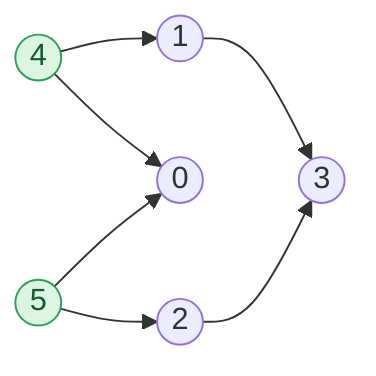

## Problem

Given a Directed Acyclic Graph (DAG) with **V** vertices numbered from `0` to `V - 1`, represented by an adjacency list **`adj[][]`**, return a topological ordering of its vertices.

A topological ordering is a linear ordering of vertices such that for every directed edge `u -> v`, vertex `u` appears before vertex `v` in the ordering.

**Note:** Multiple valid topological orderings may exist. Any valid ordering is accepted. The output is `true` if the returned ordering is valid; otherwise, it is `false`.

Complete the function `topoSort()` which takes the adjacency list `adj` and returns a list of all `V` vertices in topological order.

**Example 1:**


```text
Input:  adj[][] = [[], [0], [0], [0]]
Output: true
Explanation: The output true denotes that the order is valid. Few valid topological orders
for the given graph are:
[3, 2, 1, 0]
[1, 2, 3, 0]
[2, 3, 1, 0]
```

**Example 2:**


```text
Input:  adj[][] = [[], [3], [3], [], [1, 0], [0, 2]]
Output: true
Explanation: The output true denotes that the order is valid. Few valid topological orders
for the graph are:
[4, 5, 0, 1, 2, 3]
[5, 2, 4, 0, 1, 3]
```

**Constraints:**

- $2 \le$ `adj.size()` $\le 5 \times 10^3$
- $0 \le$ `adj[i][j]` $<$ `adj.size()`

## Solution approach

### Intuition

A vertex with **no incoming edges** (in-degree `0`) has no vertex that must come before it, so it can safely be placed first. Once it is placed, its outgoing edges no longer constrain anything, so we can delete them; this lowers the in-degree of its neighbours, and any neighbour that reaches in-degree `0` becomes safe to place next.

Repeating this is **Kahn's algorithm**. The invariant is: a vertex is appended to the answer only after **every** vertex with an edge into it has already been appended (that is exactly what in-degree `0` means after the deletions). So every edge `u -> v` has `u` before `v`. Because the graph is acyclic, there is always at least one vertex of in-degree `0` left until all vertices are placed.

Unlike the DFS-with-a-stack approach, this is iterative, so a long chain of $5 \times 10^3$ vertices cannot overflow the call stack.

### Algorithm

1. Count `indegree[v]` for every vertex by scanning every edge `u -> v` in `adj`.
2. Append every vertex with `indegree[u] == 0` to `order`. `order` doubles as the BFS queue: `order[head..]` are vertices that are placed but whose edges are not yet removed.
3. For `head = 0, 1, ...` while `head < order.size()`: take `u = order[head]` and, for each neighbour `v` in `adj[u]`, decrement `indegree[v]`; if it becomes `0`, append `v` to `order`.
4. Return `order`; it contains all `V` vertices because the input is a DAG.

### Walkthrough

Example 2. The initial in-degrees are `0:2, 1:1, 2:1, 3:2, 4:0, 5:0`. Green vertices start with in-degree `0`:



| Step | Remove edges of | In-degrees that drop to 0 | `order` |
| --- | --- | --- | --- |
| start | — | `4`, `5` | `[4, 5]` |
| 1 | `4` | `1` (`0` drops to 1) | `[4, 5, 1]` |
| 2 | `5` | `0`, `2` | `[4, 5, 1, 0, 2]` |
| 3 | `1` | — (`3` drops to 1) | `[4, 5, 1, 0, 2]` |
| 4 | `0` | — | `[4, 5, 1, 0, 2]` |
| 5 | `2` | `3` | `[4, 5, 1, 0, 2, 3]` |
| 6 | `3` | — | `[4, 5, 1, 0, 2, 3]` |

### Complexity

- **Time:** $O(V + E)$ — each vertex is appended and processed once, and each edge is looked at twice (once when counting in-degrees, once when it is removed).
- **Space:** $O(V)$ — the `indegree` array and `order`; no recursion.

### Edge cases

- **Disconnected graph / isolated vertices** (vertex `3` in Example 2 has no outgoing edges, and a vertex may have no edges at all): every vertex with in-degree `0` is seeded in step 2, so each component is reached.
- **Parallel edges** (`u -> v` listed twice): `indegree[v]` counts both and both are removed, so `v` is still released exactly once.

## Code

```cpp title="C++"
class Solution {
   public:
    vector<int> topoSort(vector<vector<int>>& adj) {
        int V = adj.size();
        vector<int> indegree(V, 0);
        for (int u = 0; u < V; u++)
            for (int v : adj[u]) indegree[v]++;

        vector<int> order;
        order.reserve(V);
        for (int u = 0; u < V; u++)
            if (indegree[u] == 0) order.push_back(u);

        // order doubles as the BFS queue: order[head..] still have edges to remove.
        for (size_t head = 0; head < order.size(); head++) {
            int u = order[head];
            for (int v : adj[u])
                if (--indegree[v] == 0) order.push_back(v);
        }
        return order;
    }
};
```
