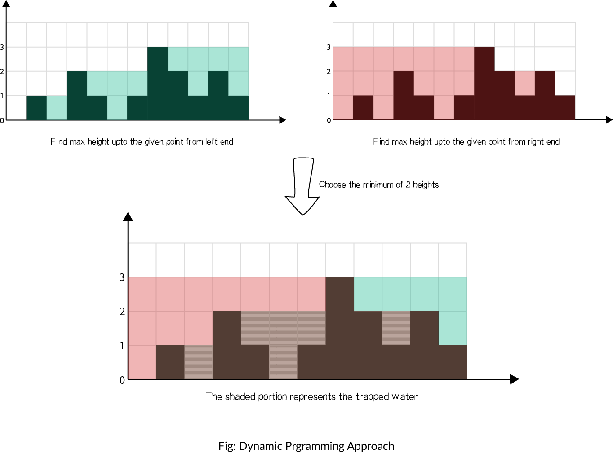

## Problem

<p>Given <code>n</code> non-negative integers representing an elevation map where the width of each bar is <code>1</code>, compute how much water it can trap after raining.</p>

## Solution approach

### Intuition

Imagine pouring water until it fills everything it can, then measure the total area covered by bars **plus** water. The water alone is that total minus the sum of the bar heights.

The filled shape rises in steps towards the tallest bar $h_m$ and falls in steps after it. Walk from the left edge towards the tallest bar: each time a bar higher than everything before it appears, it adds a new horizontal layer that extends from that bar all the way to the tallest bar. Taking the bars in increasing order of height this way means each layer is counted once and no area overlaps. The same is done from the right edge.



### Algorithm

1. In one pass, compute the sum of heights `sm` and the index `indx` of the tallest bar.
2. Start `ans` at `height[indx]`, the area of the tallest column.
3. Sweep `i` from `0` to `indx - 1` with a running maximum `mx`. When `height[i] > mx`, add the layer `(indx - i) * (height[i] - mx)` and update `mx`.
4. Sweep `i` from `n - 1` down to `indx + 1` the same way, adding `(i - indx) * (height[i] - mx)`.
5. Return `ans - sm`, the filled area minus the bars.

### Complexity

- **Time:** $O(n)$ — three linear passes.
- **Space:** $O(1)$ — only a few variables.

### Edge cases

- **Several bars of maximum height**: `indx` is the first of them; the right sweep still raises the level up to that height, so the water between them is counted.

## Code

```cpp title="C++"
class Solution {
public:
    int trap(vector<int>& height) {
        int n = height.size();
        int ans = 0, sm = height[0];
        int mx = height[0], indx = 0;
        for (int i = 1; i < n; i++) {
            sm += height[i];
            if (mx < height[i]) {
                mx = height[i];
                indx = i;
            }
        }
        mx = 0;
        ans = height[indx];
        for (int i = 0; i < indx; i++) {
            if (mx < height[i]) {
                ans += (indx - i) * (height[i] - mx);
                mx = height[i];
            }
        }
        mx = 0;
        for (int i = n - 1; i > indx; i--) {
            if (mx < height[i]) {
                ans += (i - indx) * (height[i] - mx);
                mx = height[i];
            }
        }
        return ans - sm;

    }
};   

```
