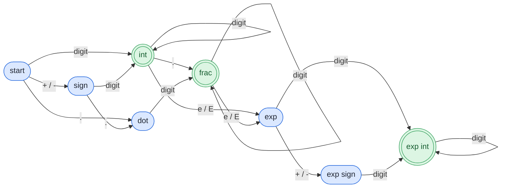

## Problem

Given a string `s`, return whether `s` is a **valid number**.

For example, all the following are valid numbers: `"2", "0089", "-0.1", "+3.14", "4.", "-.9", "2e10", "-90E3", "3e+7", "+6e-1", "53.5e93", "-123.456e789"`, while the following are not valid numbers: `"abc", "1a", "1e", "e3", "99e2.5", "--6", "-+3", "95a54e53"`.

Formally, a **valid number** is defined using one of the following definitions:

1. An **integer number** followed by an **optional exponent**.
2. A **decimal number** followed by an **optional exponent**.

An **integer number** is defined with an **optional sign** `'-'` or `'+'` followed by **digits**.

A **decimal number** is defined with an **optional sign** `'-'` or `'+'` followed by one of the following definitions:

1. **Digits** followed by a **dot** `'.'`.
2. **Digits** followed by a **dot** `'.'` followed by **digits**.
3. A **dot** `'.'` followed by **digits**.

An **exponent** is defined with an **exponent notation** `'e'` or `'E'` followed by an **integer number**.

The **digits** are defined as one or more digits.

**Example 1:**

```text
Input:  s = "0"
Output: true
```

**Example 2:**

```text
Input:  s = "e"
Output: false
```

**Example 3:**

```text
Input:  s = "."
Output: false
```

**Constraints:**

- $1 \le$ `s.length` $\le 20$
- `s` consists of only English letters (both uppercase and lowercase), digits (`0-9`), plus `'+'`, minus `'-'`, or dot `'.'`.

## Solution approach

### Intuition

The grammar is a **regular language**: it can be recognised by a small finite automaton that reads the string once. Drawn out, the automaton looks like this (double circles are accepting states):



Any character with no outgoing arrow from the current state makes the string invalid. Rather than storing the table, we can track the same information with three flags, because the automaton only ever needs to know:

- `seenDigit` — has the **current part** (mantissa, or exponent after an `e`) got at least one digit?
- `seenDot` — has a `.` appeared? Only one is allowed, and only in the mantissa.
- `seenExp` — has an `e`/`E` appeared? Only one is allowed, and only after a mantissa with digits.

A sign is legal only at the very start or immediately after `e`/`E`. Every rule of the grammar maps onto one of these checks, and the string is valid when the scan finishes with `seenDigit` true (so neither the mantissa nor the exponent is empty).

### Algorithm

1. Set `seenDigit = seenDot = seenExp = false`.
2. For each index `i` with character `c = s[i]`:
   - **Digit:** set `seenDigit = true`.
   - **`+` or `-`:** valid only if `i == 0` or `s[i - 1]` is `e`/`E`; otherwise return `false`.
   - **`e` or `E`:** if `seenExp` is already set or the mantissa has no digit (`!seenDigit`), return `false`. Set `seenExp = true` and reset `seenDigit = false`, because the exponent needs digits of its own.
   - **`.`:** if `seenDot` or `seenExp` is set, return `false`; otherwise set `seenDot = true`.
   - **Anything else** (letters other than `e`/`E`): return `false`.
3. Return `seenDigit`.

### Walkthrough

| `s` | Decisive step | Result |
| --- | --- | --- |
| `"-123.456e789"` | sign at `i = 0`, one dot before `e`, digits on both sides of `e` | `true` |
| `"4."` | one dot, mantissa has digits, no exponent | `true` |
| `"1e"` | `seenDigit` reset at `e` and never set again | `false` |
| `"99e2.5"` | `.` after `seenExp` | `false` |
| `"-+3"` | `+` at `i = 1`, previous char is not `e` | `false` |
| `"."` | ends with `seenDigit = false` | `false` |

### Complexity

- **Time:** $O(n)$ — one constant-time check per character.
- **Space:** $O(1)$ — three booleans.

### Edge cases

- **A lone `"."` or `".e1"`:** the mantissa has no digit, so `.` is accepted but `e` (or the end of the string) fails on `seenDigit`.
- **`"e3"`:** `e` arrives with `seenDigit = false` and is rejected.
- **Trailing dot before exponent (`"1.e5"`):** allowed by rule 1 of decimal numbers; the dot comes before `seenExp`, so it passes.

## Code

```cpp
class Solution {
   public:
    bool isNumber(string s) {
        bool seenDigit = false, seenDot = false, seenExp = false;
        for (size_t i = 0; i < s.size(); i++) {
            char c = s[i];
            if (c >= '0' && c <= '9') {
                seenDigit = true;
            } else if (c == '+' || c == '-') {
                if (i > 0 && s[i - 1] != 'e' && s[i - 1] != 'E') return false;
            } else if (c == 'e' || c == 'E') {
                if (seenExp || !seenDigit) return false;
                seenExp = true;
                seenDigit = false;  // the exponent needs its own digits
            } else if (c == '.') {
                if (seenDot || seenExp) return false;
                seenDot = true;
            } else {
                return false;
            }
        }
        return seenDigit;
    }
};
```

```java
class Solution {
    public boolean isNumber(String s) {
        boolean seenDigit = false, seenDot = false, seenExp = false;
        for (int i = 0; i < s.length(); i++) {
            char c = s.charAt(i);
            if (c >= '0' && c <= '9') {
                seenDigit = true;
            } else if (c == '+' || c == '-') {
                if (i > 0 && s.charAt(i - 1) != 'e' && s.charAt(i - 1) != 'E') return false;
            } else if (c == 'e' || c == 'E') {
                if (seenExp || !seenDigit) return false;
                seenExp = true;
                seenDigit = false;  // the exponent needs its own digits
            } else if (c == '.') {
                if (seenDot || seenExp) return false;
                seenDot = true;
            } else {
                return false;
            }
        }
        return seenDigit;
    }
}
```

```python
class Solution:
    def isNumber(self, s: str) -> bool:
        seen_digit = seen_dot = seen_exp = False
        for i, c in enumerate(s):
            if '0' <= c <= '9':
                seen_digit = True
            elif c in '+-':
                if i > 0 and s[i - 1] not in 'eE':
                    return False
            elif c in 'eE':
                if seen_exp or not seen_digit:
                    return False
                seen_exp = True
                seen_digit = False  # the exponent needs its own digits
            elif c == '.':
                if seen_dot or seen_exp:
                    return False
                seen_dot = True
            else:
                return False
        return seen_digit
```
