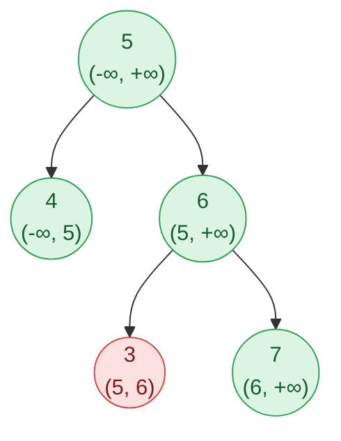

## Problem

Given the `root` of a binary tree, _determine if it is a valid binary search tree (BST)_.

A **valid BST** is defined as follows:

- The left subtree of a node contains only nodes with keys **strictly less than** the node's key.
- The right subtree of a node contains only nodes with keys **strictly greater than** the node's key.
- Both the left and right subtrees must also be binary search trees.

**Example 1:**

![Tree [2,1,3]](https://assets.leetcode.com/uploads/2020/12/01/tree1.jpg)

```text
Input:  root = [2,1,3]
Output: true
```

**Example 2:**

![Tree [5,1,4,null,null,3,6]](https://assets.leetcode.com/uploads/2020/12/01/tree2.jpg)

```text
Input:  root = [5,1,4,null,null,3,6]
Output: false
Explanation: The root node's value is 5 but its right child's value is 4.
```

**Constraints:**

- The number of nodes in the tree is in the range $[1, 10^4]$.
- $-2^{31} \le$ `Node.val` $\le 2^{31} - 1$

## Solution approach

### Intuition

Comparing each node only with its own children is **not** enough. In the tree below every parent–child pair looks fine, yet `3` sits in the right subtree of `5` and is smaller than `5`:



The fix is to pass **down** the constraints of all ancestors. Each node gets an open interval `(lo, hi)` its value must lie in. The root may be anything. Going **left** from a node with value `v` keeps `lo` and sets `hi = v` (everything there must be smaller than `v`, and still satisfy the older bounds); going **right** sets `lo = v`. Each interval is the intersection of all the ancestor constraints on that path, so a tree is a BST exactly when every node lies inside its interval. In the picture, `3` must lie in `(5, 6)` and fails.

Node values span the full `int` range, so the "no bound yet" values must lie outside it; the bounds are `long long` starting at `LLONG_MIN` / `LLONG_MAX`.

### Algorithm

1. Call `valid(root, LLONG_MIN, LLONG_MAX)`.
2. In `valid(node, lo, hi)`: a null node is valid, so return `true`.
3. If `node->val <= lo` or `node->val >= hi`, return `false` (the bounds are strict, so duplicates are rejected).
4. Return `valid(node->left, lo, node->val) && valid(node->right, node->val, hi)`; `&&` stops as soon as one side fails.

### Complexity

- **Time:** $O(n)$ — each node is checked once.
- **Space:** $O(h)$ — the recursion stack, where $h$ is the tree height ($O(n)$ for a skewed tree, at most $10^4$ frames here).

### Edge cases

- **Duplicate values** (`[2,2]`): the child's interval is `(-∞, 2)` and `2 <= 2` fails, as the strict definition requires.
- **Values at `INT_MIN` / `INT_MAX`** (`[2147483647]`): they lie strictly inside `(LLONG_MIN, LLONG_MAX)`, so a single extreme node is valid, and no `val ± 1` arithmetic can overflow.

## Code

```cpp title="C++"
class Solution {
    // Every value in this subtree must lie strictly between lo and hi.
    bool valid(TreeNode* node, long long lo, long long hi) {
        if (!node) return true;
        if (node->val <= lo || node->val >= hi) return false;
        return valid(node->left, lo, node->val) && valid(node->right, node->val, hi);
    }

   public:
    bool isValidBST(TreeNode* root) { return valid(root, LLONG_MIN, LLONG_MAX); }
};
```
