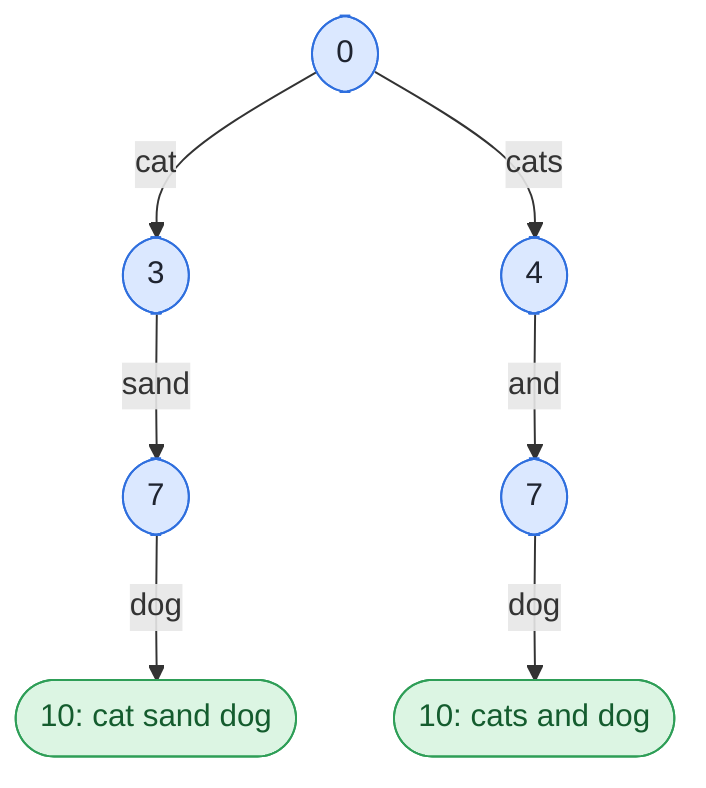

## Problem

Given a string `s` and a dictionary of strings `wordDict`, add spaces in `s` to construct a sentence where each word is a valid dictionary word. Return all such possible sentences in **any order**.

**Note** that the same word in the dictionary may be reused multiple times in the segmentation.

**Example 1:**

```text
Input:  s = "catsanddog", wordDict = ["cat","cats","and","sand","dog"]
Output: ["cats and dog","cat sand dog"]
```

**Example 2:**

```text
Input:  s = "pineapplepenapple", wordDict = ["apple","pen","applepen","pine","pineapple"]
Output: ["pine apple pen apple","pineapple pen apple","pine applepen apple"]
Explanation: Note that you are allowed to reuse a dictionary word.
```

**Example 3:**

```text
Input:  s = "catsandog", wordDict = ["cats","dog","sand","and","cat"]
Output: []
```

**Constraints:**

- $1 \le$ `s.length` $\le 20$
- $1 \le$ `wordDict.length` $\le 1000$
- $1 \le$ `wordDict[i].length` $\le 10$
- `s` and `wordDict[i]` consist of only lowercase English letters.
- All the strings of `wordDict` are **unique**.
- Input is generated in a way that the length of the answer doesn't exceed $10^5$.

## Solution approach

### Intuition

Every sentence is a choice of the **first word** `s[start, end)` followed by a sentence for the rest `s[end..]`. So a backtracking search does the job: at position `start`, try each `end` such that `s[start, end)` is a dictionary word, put the word on the current `path`, and recurse from `end`. Reaching `start == n` means `path` is a complete sentence.

Plain backtracking can waste a lot of time on prefixes that never lead to a sentence (for example `s = "aaaaaaaaaab"` with `["a","aa","aaa"]` explores thousands of paths and outputs nothing). We remove those dead ends with the DP from [Word Break](/docs/codes/word-break/), run **right to left**:

`canEnd[i]` = "the suffix `s[i..]` can be split into dictionary words", with `canEnd[n] = true`.

The search then only steps to an `end` with `canEnd[end] == true`. With that guarantee every recursive call produces **at least one** sentence, so the work done by the backtracking is proportional to the size of the output.

For `"catsanddog"` the search tree is (numbers are the `start` index of each call):



For Example 3, `"catsandog"`, `canEnd[0]` is `false`, so the function returns `[]` without searching at all.

### Algorithm

1. Build `dict` from `wordDict` and compute `maxLen`, the longest word length.
2. Fill `canEnd` from `i = n - 1` down to `0`: `canEnd[i]` is `true` if some `end` in `(i, min(n, i + maxLen)]` has `canEnd[end]` and `s[i, end)` in `dict`.
3. If `canEnd[0]` is `false`, return an empty list.
4. `dfs(start)`: if `start == n`, join `path` with single spaces and append it to `ans`. Otherwise, for each `end` from `start + 1` to `min(n, start + maxLen)` with `canEnd[end]` true and `s[start, end)` in `dict`: push the word onto `path`, call `dfs(end)`, pop it.
5. Call `dfs(0)` and return `ans`.

### Complexity

Let $n$ = `s.length` $\le 20$, $L$ = `maxLen` $\le 10$, $W$ = total dictionary length and $S$ = number of sentences returned.

- **Time:** $O(n \cdot L^2 + S \cdot n)$ — the `canEnd` table tries $L$ substrings of length up to $L$ at each index. Thanks to the pruning, each call of `dfs` lies on the path to some sentence, so there are at most $S \cdot n$ calls doing $O(L^2)$ work each, plus $O(n)$ to build each sentence; with $L$ a small constant this is $O(S \cdot n)$. Without pruning, the search could take $O(2^n)$ time even when $S = 0$.
- **Space:** $O(n + W + S \cdot n)$ — `canEnd`, the hash set, the recursion stack and `path` of depth at most $n$, and the output itself.

### Edge cases

- **No segmentation exists:** `canEnd[0]` is `false` and the empty list is returned immediately.
- **A word that matches but leaves an unsplittable rest** (`"cats"` in `"catsandog"`): skipped by the `canEnd[end]` check, so no time is spent below it.
- **Repeated calls on one `Solution` object:** all members are rebuilt at the start of `wordBreak`, so earlier inputs cannot leak into later answers.

## Code

```cpp title="C++"
class Solution {
    string s;
    unordered_set<string> dict;
    int maxLen = 0;
    vector<bool> canEnd;  // canEnd[i]: s[i..] can be segmented
    vector<string> path, ans;

    void dfs(int start) {
        int n = s.size();
        if (start == n) {
            string sentence = path[0];
            for (size_t k = 1; k < path.size(); k++) sentence += " " + path[k];
            ans.push_back(sentence);
            return;
        }
        for (int end = start + 1; end <= min(n, start + maxLen); end++) {
            if (!canEnd[end]) continue;
            string word = s.substr(start, end - start);
            if (!dict.count(word)) continue;
            path.push_back(word);
            dfs(end);
            path.pop_back();
        }
    }

   public:
    vector<string> wordBreak(string s, vector<string>& wordDict) {
        this->s = s;
        dict = unordered_set<string>(wordDict.begin(), wordDict.end());
        maxLen = 0;
        for (const string& w : wordDict) maxLen = max(maxLen, (int)w.size());

        int n = s.size();
        canEnd.assign(n + 1, false);
        canEnd[n] = true;
        for (int i = n - 1; i >= 0; i--)
            for (int end = i + 1; end <= min(n, i + maxLen) && !canEnd[i]; end++)
                canEnd[i] = canEnd[end] && dict.count(s.substr(i, end - i));

        ans.clear();
        if (canEnd[0]) dfs(0);
        return ans;
    }
};
```
