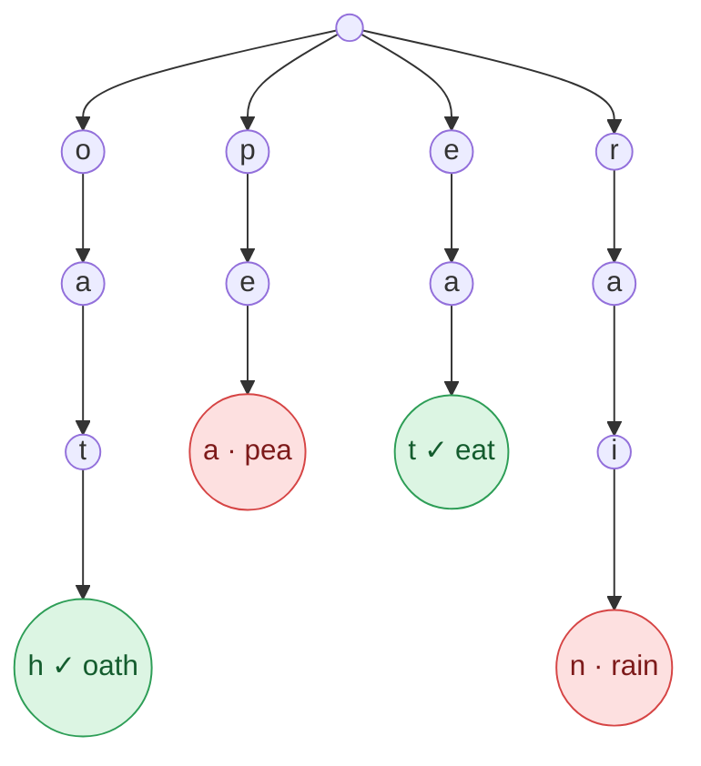

## Problem

Given an `m x n` `board` of characters and a list of strings `words`, return _all words on the board_.

Each word must be constructed from letters of sequentially adjacent cells, where **adjacent cells** are horizontally or vertically neighboring. The same letter cell may not be used more than once in a word.

**Example 1:**


```text
Input:  board = [["o","a","a","n"],["e","t","a","e"],["i","h","k","r"],["i","f","l","v"]],
        words = ["oath","pea","eat","rain"]
Output: ["eat","oath"]
```

**Example 2:**


```text
Input:  board = [["a","b"],["c","d"]], words = ["abcb"]
Output: []
```

**Constraints:**

- `m == board.length`
- `n == board[i].length`
- $1 \le m, n \le 12$
- `board[i][j]` is a lowercase English letter.
- $1 \le$ `words.length` $\le 3 \times 10^4$
- $1 \le$ `words[i].length` $\le 10$
- `words[i]` consists of lowercase English letters.
- All the strings of `words` are unique.

## Solution approach

### Intuition

Running the single-word search from [Word Search](/docs/codes/word-search/) once per word costs up to $3 \times 10^4$ full board searches — far too slow. But those searches repeat each other: words that share a prefix (`"oath"`, `"oat"`, `"oak"`) walk the same cells for that prefix again and again.

So search for **all words at once**. Put them in a **trie**; then a DFS from a cell walks the board and the trie together. Moving to a neighbouring cell with letter `ch` is allowed only if the current trie node has a child `ch` — i.e. only while the letters so far are a prefix of **some** word. Whenever the walk reaches a trie node where a word ends, that word is on the board.

For Example 1 the trie is:



The board has no `p`, so the whole `p` branch is never entered; and a DFS starting at the `o` in the corner follows `o → a → t → h` because each step is a child in the trie.

Two prunings keep it fast:

- **Report each word once.** When a word is found, clear its mark in the trie so later paths do not add it again.
- **Skip exhausted branches.** Each node keeps `remaining`, the number of not-yet-found words in its subtree. Once it drops to `0`, there is nothing left to find below that node, so the DFS does not enter it. Each `dfs` call returns how many new words it found, and the caller subtracts that from its node, so the counts stay correct all the way up to the root.

### Algorithm

1. Build the trie: node `0` is the root; `next[node][c]` is the child for letter `c` (`0` = none), `word[node]` is the word ending there (empty if none), and `remaining[node]` counts the words inserted through the node.
2. For every cell `(r, c)`, call `dfs(board, r, c, 0)` and subtract its result from `remaining[0]`; stop early once `remaining[0] == 0`.
3. `dfs(board, r, c, node)`:
   - Let `ch = board[r][c]`. If it is `'#'` (already on the path), return `0`.
   - Let `cur = next[node][ch - 'a']`. If `cur == 0` or `remaining[cur] == 0`, return `0`.
   - If `word[cur]` is not empty, append it to `found`, clear it, and count `1`.
   - Mark the cell `'#'`, recurse into the in-bounds neighbours with node `cur` and add up their results, then restore `ch`.
   - Subtract the total from `remaining[cur]` and return it.
4. Return `found`.

### Complexity

Let $K$ = total number of letters in `words` (at most $3 \times 10^5$) and $L$ = the longest word ($\le 10$).

- **Time:** $O(K + m \cdot n \cdot 4 \cdot 3^{L-1})$ — building the trie is $O(K)$. From each of the $m \cdot n$ starting cells the DFS has 4 first moves, then at most 3 (it cannot step back onto the path), and never goes deeper than $L$ because the trie has no longer paths. In practice the trie and the `remaining` counts cut this down drastically.
- **Space:** $O(26 \cdot K)$ — at most $K + 1$ trie nodes with 26 child slots each, plus the recursion depth of at most $L$. The board is marked in place.

### Edge cases

- **A word needing the same cell twice** (`"abcb"` in Example 2): the `b` cell is `'#'` when the path tries to return to it, so the word is not found.
- **A word that is a prefix of another** (`"oa"` and `"oath"`): `word[cur]` is checked before recursing, so the shorter word is reported and the search still continues to the longer one.
- **Many occurrences of one word:** the word is cleared from the trie after the first hit, so it appears once in the answer.

## Code

```cpp
class Solution {
    vector<array<int, 26>> next;  // trie edges; 0 means "no child" (node 0 is the root)
    vector<string> word;          // word ending at this node, or empty
    vector<int> remaining;        // words in this node's subtree not found yet
    vector<string> found;

    // Returns the number of new words found by paths starting at (r, c).
    int dfs(vector<vector<char>>& board, int r, int c, int node) {
        char ch = board[r][c];
        if (ch == '#') return 0;
        int cur = next[node][ch - 'a'];
        if (cur == 0 || remaining[cur] == 0) return 0;

        int got = 0;
        if (!word[cur].empty()) {
            found.push_back(word[cur]);
            word[cur].clear();
            got++;
        }
        board[r][c] = '#';
        static const int dr[] = {1, -1, 0, 0}, dc[] = {0, 0, 1, -1};
        for (int k = 0; k < 4; k++) {
            int nr = r + dr[k], nc = c + dc[k];
            if (nr >= 0 && nr < (int)board.size() && nc >= 0 && nc < (int)board[0].size())
                got += dfs(board, nr, nc, cur);
        }
        board[r][c] = ch;
        remaining[cur] -= got;
        return got;
    }

   public:
    vector<string> findWords(vector<vector<char>>& board, vector<string>& words) {
        next.assign(1, {});
        word.assign(1, "");
        remaining.assign(1, 0);
        found.clear();
        for (const string& w : words) {
            int node = 0;
            remaining[0]++;
            for (char ch : w) {
                if (next[node][ch - 'a'] == 0) {
                    next[node][ch - 'a'] = next.size();
                    next.push_back({});
                    word.push_back("");
                    remaining.push_back(0);
                }
                node = next[node][ch - 'a'];
                remaining[node]++;
            }
            word[node] = w;
        }

        for (int r = 0; r < (int)board.size() && remaining[0] > 0; r++)
            for (int c = 0; c < (int)board[0].size() && remaining[0] > 0; c++)
                remaining[0] -= dfs(board, r, c, 0);
        return found;
    }
};
```

```java
class Solution {
    private int[][] next;        // trie edges; 0 means "no child" (node 0 is the root)
    private String[] word;       // word ending at this node, or null
    private int[] remaining;     // words in this node's subtree not found yet
    private List<String> found;
    private static final int[] DR = {1, -1, 0, 0}, DC = {0, 0, 1, -1};

    // Returns the number of new words found by paths starting at (r, c).
    private int dfs(char[][] board, int r, int c, int node) {
        char ch = board[r][c];
        if (ch == '#') return 0;
        int cur = next[node][ch - 'a'];
        if (cur == 0 || remaining[cur] == 0) return 0;

        int got = 0;
        if (word[cur] != null) {
            found.add(word[cur]);
            word[cur] = null;
            got++;
        }
        board[r][c] = '#';
        for (int k = 0; k < 4; k++) {
            int nr = r + DR[k], nc = c + DC[k];
            if (nr >= 0 && nr < board.length && nc >= 0 && nc < board[0].length)
                got += dfs(board, nr, nc, cur);
        }
        board[r][c] = ch;
        remaining[cur] -= got;
        return got;
    }

    public List<String> findWords(char[][] board, String[] words) {
        int capacity = 1;  // the trie has at most 1 + (total letters) nodes
        for (String w : words) capacity += w.length();
        next = new int[capacity][26];
        word = new String[capacity];
        remaining = new int[capacity];
        found = new ArrayList<>();

        int size = 1;
        for (String w : words) {
            int node = 0;
            remaining[0]++;
            for (char ch : w.toCharArray()) {
                if (next[node][ch - 'a'] == 0) next[node][ch - 'a'] = size++;
                node = next[node][ch - 'a'];
                remaining[node]++;
            }
            word[node] = w;
        }

        for (int r = 0; r < board.length && remaining[0] > 0; r++)
            for (int c = 0; c < board[0].length && remaining[0] > 0; c++)
                remaining[0] -= dfs(board, r, c, 0);
        return found;
    }
}
```

```python
class Solution:
    def findWords(self, board: list[list[str]], words: list[str]) -> list[str]:
        nxt = [[0] * 26]  # trie edges; 0 means "no child" (node 0 is the root)
        word = ['']       # word ending at this node, or empty
        remaining = [0]   # words in this node's subtree not found yet
        for w in words:
            node = 0
            remaining[0] += 1
            for ch in w:
                i = ord(ch) - ord('a')
                if nxt[node][i] == 0:
                    nxt[node][i] = len(nxt)
                    nxt.append([0] * 26)
                    word.append('')
                    remaining.append(0)
                node = nxt[node][i]
                remaining[node] += 1
            word[node] = w

        m, n = len(board), len(board[0])
        found = []

        # Returns the number of new words found by paths starting at (r, c).
        def dfs(r: int, c: int, node: int) -> int:
            ch = board[r][c]
            if ch == '#':
                return 0
            cur = nxt[node][ord(ch) - ord('a')]
            if cur == 0 or remaining[cur] == 0:
                return 0

            got = 0
            if word[cur]:
                found.append(word[cur])
                word[cur] = ''
                got += 1
            board[r][c] = '#'
            for nr, nc in ((r + 1, c), (r - 1, c), (r, c + 1), (r, c - 1)):
                if 0 <= nr < m and 0 <= nc < n:
                    got += dfs(nr, nc, cur)
            board[r][c] = ch
            remaining[cur] -= got
            return got

        for r in range(m):
            for c in range(n):
                if remaining[0] == 0:
                    return found
                remaining[0] -= dfs(r, c, 0)
        return found
```
