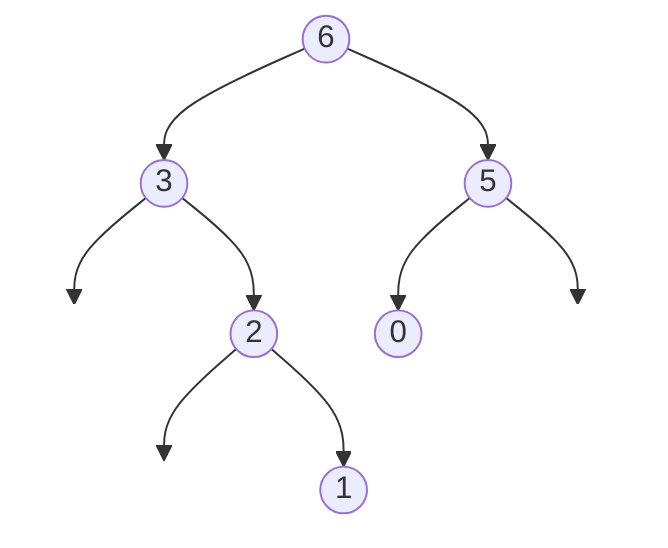

## Problem

You are given an integer array `nums` with no duplicates. A **maximum binary tree** can be built recursively from `nums` using the following algorithm:

- Create a root node whose value is the maximum value in `nums`.
- Recursively build the left subtree on the **subarray prefix** to the **left** of the maximum value.
- Recursively build the right subtree on the **subarray suffix** to the **right** of the maximum value.

Return the maximum binary tree built from `nums`. ([LeetCode 654](https://leetcode.com/problems/maximum-binary-tree/))

```txt
Input:  nums = [3,2,1,6,0,5]
Output: [6,3,5,null,2,0,null,null,1]
Explanation:
- The largest value in [3,2,1,6,0,5] is 6. Left prefix is [3,2,1] and right suffix is [0,5].
  - The largest value in [3,2,1] is 3. Left prefix is [] and right suffix is [2,1].
    - The largest value in [2,1] is 2. Left prefix is [] and right suffix is [1].
  - The largest value in [0,5] is 5. Left prefix is [0] and right suffix is [].

Input:  nums = [3,2,1]
Output: [3,null,2,null,1]
```



**Constraints:**

- $1 \le$ `nums.length` $\le 1000$
- $0 \le$ `nums[i]` $\le 1000$
- All integers in `nums` are unique.

## Approach 1: Recursion

**Idea.** Follow the definition directly. `build(lo, hi)` returns the tree for `nums[lo..hi]`: find the index of the maximum in that range, make it the root, and recurse on the two sides.

**Algorithm.**

1. If `lo > hi`, the range is empty: return `nullptr`.
2. Scan `nums[lo..hi]` for the index `best` of the largest value.
3. Create a node for `nums[best]`, set its left child to `build(lo, best - 1)` and its right child to `build(best + 1, hi)`.
4. The answer is `build(0, n - 1)`.

**Complexity.**

- **Time:** $O(n^2)$ in the worst case. Each call scans its range, and for a sorted array every call removes only one element, giving $n + (n-1) + \dots + 1$ steps. On random input it averages $O(n \log n)$.
- **Space:** $O(n)$ for the recursion stack in the worst case (a sorted array produces a chain).

Pass `nums` by reference. Passing the vector by value, as is easy to do by accident, copies the whole array in every call and adds another $O(n)$ per call in time and memory.

## Approach 2: Monotonic stack

**Idea.** Look at where each value ends up. For element `x`, its parent is the **smaller** of two candidates: the nearest larger element to its left and the nearest larger element to its right. Rather than computing those separately, scan left to right and keep a stack of nodes whose values **decrease** from bottom to top; that stack is exactly the right spine of the tree built so far.

When a new value `x` arrives:

- every node on the stack that is smaller than `x` lies between `x` and the next larger value to its left, so those nodes belong in `x`'s **left subtree**. Pop them; the last one popped is the largest of them and becomes `x`'s left child;
- if a larger node remains on the stack, `x` is the right child of that node (for now; a later, even larger value may take `x` and everything below it as its left subtree).

**Algorithm.**

1. For each value `x` in `nums`, create `node`.
2. While the stack's top is smaller than `x`: pop it and set `node->left` to the popped node.
3. If the stack is not empty, set `top->right = node`.
4. Push `node`.
5. The bottom of the stack (the overall maximum) is the root.

Trace for `[3,2,1,6,0,5]`: push 3, 2, 1 (each becomes the right child of the previous). 6 pops 1, 2, 3, so 3 (popped last) becomes 6's left child, with 2 and 1 still hanging under it. 0 becomes 6's right child. 5 pops 0, making it 5's left child, and becomes 6's right child.

**Complexity.**

- **Time:** $O(n)$: every node is pushed once and popped at most once.
- **Space:** $O(n)$ for the stack.

## Code

```cpp title="Approach 1: Recursion"
class Solution {
   public:
    TreeNode* constructMaximumBinaryTree(vector<int>& nums) {
        return build(nums, 0, (int)nums.size() - 1);
    }

   private:
    TreeNode* build(const vector<int>& nums, int lo, int hi) {
        if (lo > hi) return nullptr;
        int best = lo;
        for (int i = lo + 1; i <= hi; i++)
            if (nums[i] > nums[best]) best = i;
        TreeNode* root = new TreeNode(nums[best]);
        root->left = build(nums, lo, best - 1);
        root->right = build(nums, best + 1, hi);
        return root;
    }
};
```

```cpp title="Approach 2: Monotonic stack"
class Solution {
   public:
    TreeNode* constructMaximumBinaryTree(vector<int>& nums) {
        vector<TreeNode*> stack;  // values decrease from bottom to top
        for (int x : nums) {
            TreeNode* node = new TreeNode(x);
            while (!stack.empty() && stack.back()->val < x) {
                node->left = stack.back();  // the last popped is the largest smaller node
                stack.pop_back();
            }
            if (!stack.empty()) stack.back()->right = node;
            stack.push_back(node);
        }
        return stack.front();
    }
};
```

## Author

[Deepak Sharma](https://www.linkedin.com/in/deepak-sharma-66968120a/)
